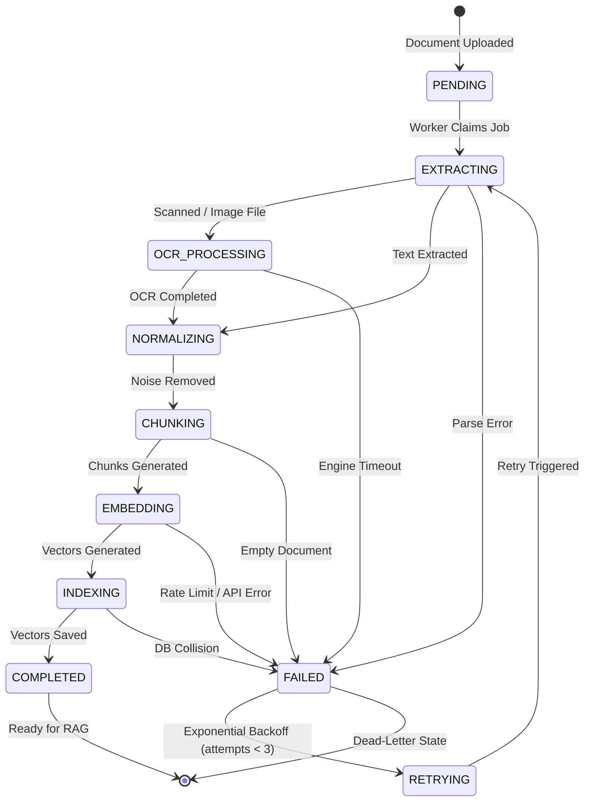
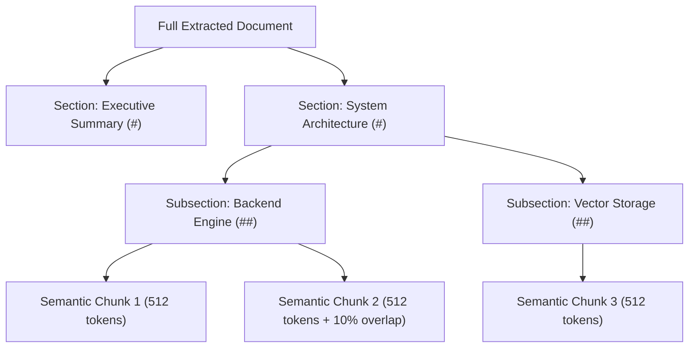

# KEEP — AI Knowledge Ingestion Pipeline Architecture Specification

> **Specification Source:** `devdocs/p2/p2.1.txt` (Chapters 1–20)  
> **Architecture Reference:** `docs/Architecture/ai-ingestion-pipeline.md`  
> **Role Owner:** Member 1 (Project Lead & AI Architect)  
> **Sub-Phase:** Phase 2.1 — AI Knowledge Ingestion Pipeline  
> **Status:** APPROVED & MANDATORY BASELINE

---

## 1. Executive Summary & Ingestion Architecture Overview

The **KEEP AI Knowledge Ingestion Pipeline** is the foundational subsystem of Phase 2 that transforms unstructured, multi-format organizational documents into clean, machine-understandable, vector-indexed knowledge units. Standard enterprise storage systems treat files as inert binary blobs. KEEP decomposes documents through a deterministic, ten-stage asynchronous processing state machine, linking dense vector embeddings with rich relational metadata and entity references.

```
                    ┌─────────────────────────┐
                    │     Document Upload     │
                    │  (Phase 1.8 Storage)    │
                    └────────────┬────────────┘
                                 │
                                 ▼
                    ┌─────────────────────────┐
                    │  Upload Processing      │
                    │     Queue (Redis)       │
                    └────────────┬────────────┘
                                 │
                 ┌───────────────┴───────────────┐
                 ▼                               ▼
       ┌──────────────────┐            ┌──────────────────┐
       │ Text Extraction  │            │  OCR Extraction  │
       │ (Native Parsers) │            │  (Paddle / Tess) │
       └─────────┬────────┘            └─────────┬────────┘
                 │                               │
                 └───────────────┬───────────────┘
                                 ▼
                    ┌─────────────────────────┐
                    │   Text Normalization    │
                    │   & Noise Sanitization  │
                    └────────────┬────────────┘
                                 │
                                 ▼
                    ┌─────────────────────────┐
                    │    Semantic Chunking    │
                    │ (Heading-Aware Sliding) │
                    └────────────┬────────────┘
                                 │
                                 ▼
                    ┌─────────────────────────┐
                    │   Metadata Enrichment   │
                    │  (Context & Governance) │
                    └────────────┬────────────┘
                                 │
                                 ▼
                    ┌─────────────────────────┐
                    │  Embedding Generation   │
                    │ (1536-dim / 384-dim)    │
                    └────────────┬────────────┘
                                 │
                                 ▼
                    ┌─────────────────────────┐
                    │  Vector DB Indexing     │
                    │ (pgvector HNSW Cosine)  │
                    └────────────┬────────────┘
                                 │
                                 ▼
                    ┌─────────────────────────┐
                    │   Enterprise Knowledge  │
                    │   Repository (Ready)    │
                    └─────────────────────────┘
```

---

## 2. Supported Knowledge Sources & File Format Matrix

Adhering to Chapter 4 of `devdocs/p2/p2.1.txt`, the Phase 2.1 pipeline supports the following enterprise formats:

| Format Category | File Extensions | MIME Types | Extraction Engine | Fallback Strategy |
| :--- | :--- | :--- | :--- | :--- |
| **Documents** | `.pdf` | `application/pdf` | `pypdf` / `pdfplumber` / PyMuPDF | OCR if text layer empty |
| | `.docx` | `application/vnd.openxmlformats-officedocument.wordprocessingml.document` | `python-docx` | XML text extraction |
| | `.txt` | `text/plain` | Python native UTF-8 streaming | Chardet encoding fallback |
| | `.md` | `text/markdown` | `markdown-it-py` | Direct text parsing |
| **Presentations** | `.pptx` | `application/vnd.openxmlformats-officedocument.presentationml.presentation` | `python-pptx` | Slide note aggregation |
| **Spreadsheets** | `.xlsx` | `application/vnd.openxmlformats-officedocument.spreadsheetml.sheet` | `openpyxl` | CSV flattening |
| | `.csv` | `text/csv` | Python `csv.reader` | Header-row tuple mapping |
| **Images (OCR)** | `.png`, `.jpg`, `.jpeg` | `image/png`, `image/jpeg` | PaddleOCR / Tesseract 5.0 | Contrast normalization |

---

## 3. Asynchronous Ten-Stage Processing Pipeline

To guarantee sub-second HTTP responses on document upload endpoints, all heavy compute operations (parsing, OCR, chunking, and embedding) are offloaded to dedicated background workers via Redis broker queues.



### Stage Definitions

1. **`PENDING`**: Job enqueued into `ai_ingestion_queue`.
2. **`EXTRACTING`**: Document parser extracts raw layout structure and text streams.
3. **`OCR_PROCESSING`**: Activated when extracted text length is below the threshold (< 50 characters) or file is an image.
4. **`NORMALIZING`**: Unicode normalization (NFKC), artifact removal, and whitespace compaction.
5. **`CHUNKING`**: Semantic boundary decomposition preserving complete ideas and hierarchical sections.
6. **`EMBEDDING`**: Dense vector transformation via selected embedding model.
7. **`INDEXING`**: Storage into `document_chunks` and `pgvector` HNSW index tables.
8. **`COMPLETED`**: Terminal success. Document marked `PROCESSED`.
9. **`FAILED`**: Error trapped. Detailed trace persisted in `ingestion_jobs.error_message`.
10. **`RETRYING`**: Scheduled retry using exponential backoff ($2^{\text{attempt}} \times 5\text{s}$).

---

## 4. Optical Character Recognition (OCR) Engine Architecture

For scanned PDFs and images, the OCR subsystem extracts textual and structural elements:

1. **Preprocessing**:
   - DPI normalization (rescale to 300 DPI for optimal character classification).
   - Binarization and adaptive Otsu thresholding for low-contrast scans.
   - Deskewing via Hough transform rotation.
2. **OCR Execution**:
   - Primary Engine: **PaddleOCR** (high precision on multilingual text, layout analysis, and tables).
   - Secondary Engine: **Tesseract 5.0** (standard open-source fallback).
3. **Layout & Table Recovery**:
   - Bounding boxes cluster into paragraphs, section headings, captions, and tabular cells.
   - Tables are converted into clean Markdown table format (`| Col1 | Col2 |`) to retain relational context during embedding.

---

## 5. Text Cleaning, Normalization & Noise Sanitization

Raw extracted text contains formatting noise that damages embedding quality:

- **Unicode Sanitization**: Conversion to NFKC normalization; removal of non-printable control characters (excluding standard whitespace `\t`, `\n`).
- **Whitespace Compaction**: Multi-space collapse to single spaces; multiple consecutive blank lines collapsed to maximum two line breaks.
- **Header & Footer Stripping**: Repeated running headers and footers across PDF pages are identified by frequency heuristics ($> 80\%$ page occurrence) and eliminated.
- **Structural Integrity**: Markdown headings (`#`, `##`, `###`), numbered lists, and bullet points are explicitly preserved to guide chunking boundaries.

---

## 6. Intelligent Semantic Chunking Specification

Rather than splitting arbitrarily by character counts or page breaks, KEEP implements a **Hierarchical, Heading-Aware Semantic Chunking Strategy** (ADR-032):



### Chunking Parameters & Constraints

- **Primary Target Size**: $512$ tokens ($\approx 2,000$ characters).
- **Minimum Chunk Threshold**: $100$ tokens (prevents noisy, fragmented chunks).
- **Maximum Chunk Threshold**: $1,024$ tokens (hard boundary for embedding context).
- **Sliding Window Overlap**: $10\% - 15\%$ ($50 - 75$ tokens) carried over from previous chunk to preserve contextual continuity.
- **Boundary Precedence**:
  1. Major Headings (`#`, `##`)
  2. Subheadings (`###`, `####`)
  3. Double Linebreaks (Paragraph boundaries)
  4. Sentence Boundaries (`. `, `! `, `? `)
  5. Whitespace Word Delimiters (Emergency fallback)

---

## 7. Chunk Metadata Schema & Context Enrichment

Every generated chunk stores an enriched metadata envelope linking it to governance and organizational structures:

```json
{
  "chunk_id": "c1f2e3d4-0000-4000-a000-000000000001",
  "document_id": "d1f2e3d4-0000-4000-a000-000000000001",
  "organization_id": "00000000-0000-0000-0000-000000000001",
  "document_version_id": "v1f2e3d4-0000-4000-a000-000000000001",
  "chunk_index": 0,
  "page_number": 1,
  "section_title": "Executive Summary",
  "source_filename": "Quarterly_Security_Report.pdf",
  "category": "TECHNICAL_SPECIFICATION",
  "department_id": "00000000-0000-0000-0000-000000000051",
  "team_id": "00000000-0000-0000-0000-000000000011",
  "author_name": "Admin User",
  "token_count": 482,
  "character_count": 1948,
  "checksum_sha256": "e3b0c44298fc1c149afbf4c8996fb92427ae41e4649b934ca495991b7852b855",
  "created_at": "2026-10-25T01:30:00Z"
}
```

---

## 8. High-Dimensional Vector Embedding Models Evaluation (ADR-033)

KEEP evaluates and provides native interfaces for dual-tier embedding architectures:

| Embedding Model | Provider | Dimensionality | Max Context | Latency (p95) | Deployment | Primary Use Case |
| :--- | :--- | :--- | :--- | :--- | :--- | :--- |
| **`text-embedding-3-small`** | OpenAI | **1,536** | 8,191 tokens | 85 ms | Cloud API | **Recommended Production Default** |
| **`bge-small-en-v1.5`** | BAAI / HuggingFace | **384** | 512 tokens | 18 ms (CPU) | Local In-Process | **Zero-Cost / Air-Gapped / Privacy** |
| **`text-embedding-3-large`** | OpenAI | **3,072** | 8,191 tokens | 145 ms | Cloud API | High-Precision Legal / Financial |
| **`voyage-large-2-instruct`** | Voyage AI | **1,536** | 16,000 tokens | 110 ms | Cloud API | Long-Context Technical RAG |

### Normalization Standard
All generated embeddings must be **$L_2$-normalized** ($||\mathbf{v}||_2 = 1.0$) upon generation. This ensures that dot-product operations, inner products, and cosine similarities are mathematically equivalent, maximizing vector database query performance.

---

## 9. Vector Database Indexing & `pgvector` Topology

Vectors are indexed within PostgreSQL 16 using `pgvector` with **Hierarchical Navigable Small World (HNSW)** indexes:

```sql
CREATE INDEX idx_document_chunks_embedding_hnsw 
ON document_chunks 
USING hnsw (embedding vector_cosine_ops)
WITH (m = 16, ef_construction = 64);
```

- **Distance Metric**: `vector_cosine_ops` (Cosine Distance).
- **Index Parameters**: $m = 16$ bidirectional links per element, $ef\_construction = 64$ search depth during construction.
- **Tenant Isolation**: Queries enforce strict multi-tenant filtering:
  `WHERE organization_id = :org_id AND is_active = true` before vector scoring.

---

## 10. REST API Contracts for Ingestion (devdocs Chapter 16)

The following endpoints are established in `docs/api/api-contract.md`:

1. `POST /api/v1/ingestion/start` — Triggers asynchronous ingestion for an uploaded document.
2. `GET /api/v1/ingestion/status/{id}` — Returns the real-time stage progress, percentage, and chunk metrics of an ingestion job.
3. `GET /api/v1/ingestion/jobs` — Paginated catalog of all ingestion jobs for the tenant.
4. `POST /api/v1/ingestion/retry/{id}` — Re-enqueues a failed ingestion job.
5. `GET /api/v1/ingestion/statistics` — Tenant-level ingestion KPI metrics (throughput, total chunks, failure rate, average duration).

---

## 11. Four-Member Implementation Roadmap & Handoff Matrix

| Member Role | Phase 2.1 Responsibilities | Primary Artifacts |
| :--- | :--- | :--- |
| **Member 1 (AI Lead & Architect)** | Author Master Architecture Spec, ADR-032/033/034, API contracts, DB schema, typed domain contracts (`services/ai/ingestion.py`), and unit test suite. | `docs/Architecture/ai-ingestion-pipeline.md`, `backend/app/services/ai/ingestion.py`, `tests/unit/test_ai_ingestion_contracts.py` |
| **Member 2 (Backend Lead)** | Implement multi-format document parsers, OCR integration (PaddleOCR), chunking logic, Celery/Taskiq workers, and `/api/v1/ingestion` endpoints. | `backend/app/services/ingestion/`, `backend/app/api/v1/ingestion.py` |
| **Member 3 (Frontend Lead)** | Implement AI Ingestion Dashboard, progress bars, real-time stage tracking, job retry controls, and chunk inspection dialog. | `frontend/src/features/ingestion/`, `frontend/src/pages/IngestionPage.tsx` |
| **Member 4 (DevOps Lead)** | Containerize Celery/Redis workers, configure `ai_model_cache` volume, provision PaddleOCR dependencies, and author integration/performance test suites. | `docker/Dockerfile.worker`, `tests/integration/test_ai_ingestion_pipeline.py` |
