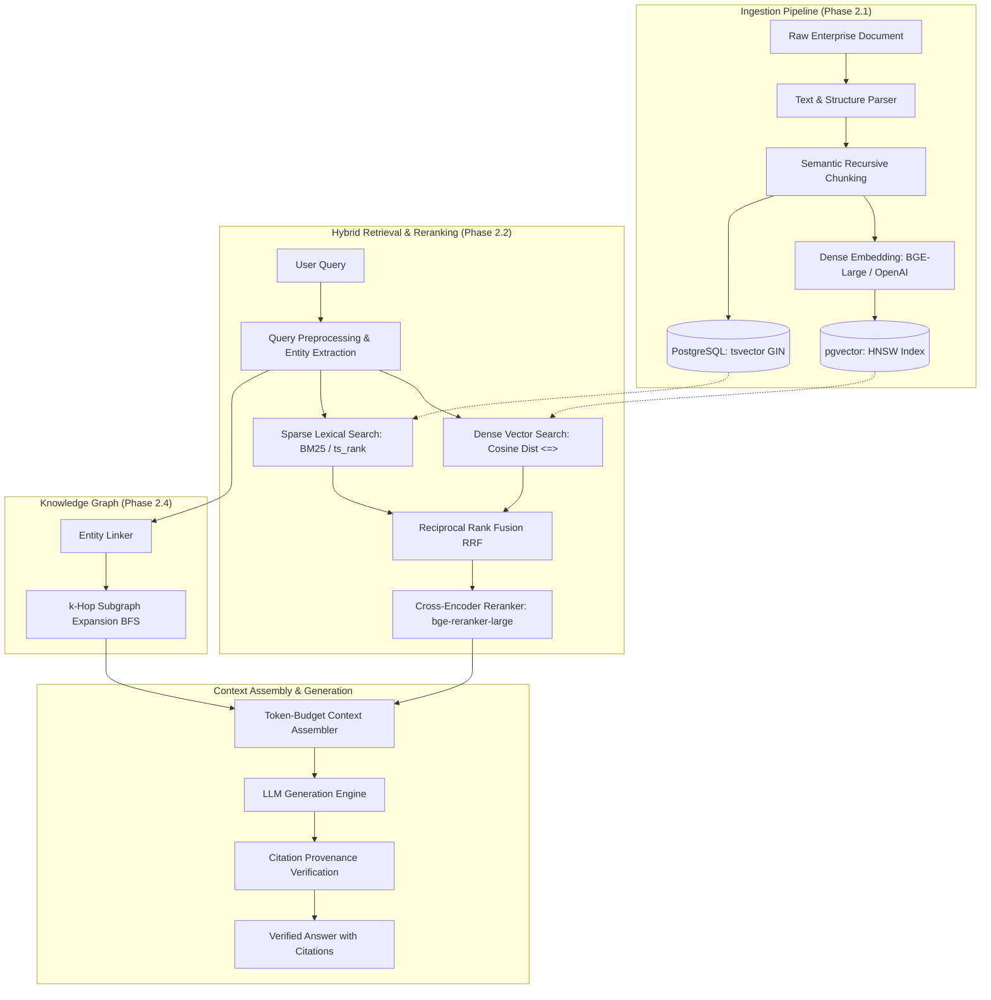

# KEEP — Core Algorithms, Mathematical Foundations & Model Specification

> **Document Location in Repository:** [`docs/Architecture/algorithms-and-models-specification.md`](file:///Users/kushalkolhe/kyoku/docs/Architecture/algorithms-and-models-specification.md)  
> **Cross-Reference:** `devdocs/p1/`, `devdocs/p2/` (p2.1–p2.5), `devdocs/p3/`, [`ai-rag-architecture.md`](file:///Users/kushalkolhe/kyoku/docs/Architecture/ai-rag-architecture.md), [`ai-persistence-architecture.md`](file:///Users/kushalkolhe/kyoku/docs/Architecture/ai-persistence-architecture.md), [`interfaces.py (RAG)`](file:///Users/kushalkolhe/kyoku/backend/app/services/rag/interfaces.py), [`interfaces.py (AI)`](file:///Users/kushalkolhe/kyoku/backend/app/services/ai/interfaces.py)

---

## 1. Executive Summary: Documentation vs. Active Codebase

A complete audit of all documentation folders (`devdocs/p1`, `devdocs/p2`, `devdocs/p3`, `docs/Architecture/`) and the active implementation (`backend/app/`, `tests/`) establishes the following facts:

### Audit of User-Specified Hypotheses

| Hypothesis / Mentioned Component | Present in Documentation? | Present in Active Codebase? | Implementation Reality & Exact Details |
| :--- | :--- | :--- | :--- |
| **Cosine Similarity** | ✅ Yes (`p2.1`, `p2.2`, `ai-rag-architecture.md`, `ai-persistence-architecture.md`) | ✅ Yes (`backend/alembic/versions/`, `document_chunks` table schema) | pgvector HNSW index configured with `vector_cosine_ops`. Distance metric: Cosine Distance $D_C = 1 - S_C$. |
| **BGE-Large** (`BAAI/bge-large-en-v1.5`, `bge-reranker-large`) | ✅ Yes (`ai-rag-architecture.md`, `p2.1.txt`, `p2.2.txt`) | ⏳ Contract Ready (`BaseEmbeddingService`, `BaseReranker`) | Specified as target open-source bi-encoder (1024-dim) and cross-encoder reranker. Phase 1 provides abstract contracts; concrete inference models load in Phase 2. |
| **Dense Matrix** | ✅ Yes (`p2.1`, `p2.2`, `ai-persistence-architecture.md`) | ✅ Yes (`document_chunks.embedding vector(1536)`) | Document chunks stored as continuous dense float arrays (dense vector matrix) in PostgreSQL via `pgvector`. Ingestion batches compute dense 2D tensors $\mathbf{E} \in \mathbb{R}^{B \times D}$. |

---

## 2. Inventory of Models and Algorithmic Components



### 2.1 Embedding Models (Bi-Encoders)
1. **Target Open-Source Model:** `BAAI/bge-large-en-v1.5`
   - **Architecture:** Transformer backbone with mean pooling and normalized embeddings.
   - **Dimensionality ($D$):** $1024$ dimensions.
   - **Context Window:** 512 tokens.
2. **Target Cloud Model:** OpenAI `text-embedding-3-small` / `text-embedding-3-large`
   - **Dimensionality ($D$):** $1536$ dimensions (small) / $3072$ dimensions (large).
   - **Database Column:** `document_chunks.embedding vector(1536)`.
3. **Target Lightweight Fallback:** `BAAI/bge-small-en-v1.5`
   - **Dimensionality ($D$):** $384$ dimensions.

### 2.2 Reranking Model (Cross-Encoder)
- **Model:** `BAAI/bge-reranker-large`
- **Architecture:** Full cross-attention over concatenated pairs: `[CLS] Query [SEP] Chunk Text [SEP]`.
- **Output:** Relevance logit passed through sigmoid $\sigma(z) \in [0, 1]$.

### 2.3 Sparse & Full-Text Search Model
- **Algorithm:** **Okapi BM25** and PostgreSQL **`tsvector` + GIN Indexing**.
- **Lexical Representation:** Inverted index with TF-IDF term weights.

### 2.4 Approximate Nearest Neighbor (ANN) Indexing
- **Algorithm:** **HNSW (Hierarchical Navigable Small World)** via `pgvector`.
- **Parameters:**
  - $M = 16$ (Maximum bidirectional connections per node per layer).
  - $ef_{construction} = 64$ (Exploration size during index construction).
  - $ef_{search} = 40$ (Dynamic priority queue size during query search).
  - Operator: `vector_cosine_ops`.

### 2.5 Rank Aggregation Algorithm
- **Algorithm:** **Reciprocal Rank Fusion (RRF)**.
- **Smoothing Constant:** $k = 60$.
- **Weights:** Dense weight $w_{\text{dense}} = 0.7$, Sparse weight $w_{\text{sparse}} = 0.3$.

---

## 3. Mathematical Foundations & Formulations

### 3.1 Cosine Similarity & Cosine Distance

Given query embedding $\mathbf{q} \in \mathbb{R}^D$ and chunk embedding $\mathbf{d} \in \mathbb{R}^D$:

$$\text{Cosine Similarity: } S_C(\mathbf{q}, \mathbf{d}) = \frac{\mathbf{q} \cdot \mathbf{d}}{\|\mathbf{q}\|_2 \|\mathbf{d}\|_2} = \frac{\sum_{i=1}^D q_i d_i}{\sqrt{\sum_{i=1}^D q_i^2} \sqrt{\sum_{i=1}^D d_i^2}}$$

For $L_2$-normalized unit vectors ($\|\mathbf{q}\|_2 = 1, \|\mathbf{d}\|_2 = 1$):
$$S_C(\mathbf{q}, \mathbf{d}) = \mathbf{q} \cdot \mathbf{d} = \sum_{i=1}^D q_i d_i$$

In PostgreSQL `pgvector`, the cosine distance `<=>` operator computes:
$$D_C(\mathbf{q}, \mathbf{d}) = 1 - S_C(\mathbf{q}, \mathbf{d})$$
- Metric Range: $D_C \in [0, 2]$.
- Identical: $D_C = 0 \iff S_C = 1$.
- Orthogonal: $D_C = 1 \iff S_C = 0$.

---

### 3.2 Okapi BM25 Lexical Scoring

For query $Q = \{t_1, t_2, \dots, t_n\}$ and chunk text $D$:

$$\text{Score}_{\text{BM25}}(D, Q) = \sum_{i=1}^n \text{IDF}(t_i) \cdot \frac{f(t_i, D) \cdot (k_1 + 1)}{f(t_i, D) + k_1 \cdot \left(1 - b + b \cdot \frac{|D|}{\text{avgdl}}\right)}$$

Where:
- $f(t_i, D)$: Raw term frequency of term $t_i$ in chunk $D$.
- $|D|$: Length of chunk $D$ in tokens.
- $\text{avgdl}$: Average chunk length across the tenant's corpus.
- $k_1 = 1.2$: Term frequency saturation parameter.
- $b = 0.75$: Document length penalization ratio.
- $\text{IDF}(t_i) = \ln \left( \frac{N - n(t_i) + 0.5}{n(t_i) + 0.5} + 1 \right)$.

---

### 3.3 Reciprocal Rank Fusion (RRF)

To aggregate dense and sparse rankings without score calibration issues:

$$\text{RRF\_Score}(d) = \sum_{m \in \{\text{dense}, \text{sparse}\}} \frac{w_m}{k + r_m(d)}$$

Where:
- $r_m(d)$: 1-indexed rank position of chunk $d$ in retriever channel $m$.
- $k = 60$: Rank smoothing constant.
- $w_{\text{dense}} = 0.7$, $w_{\text{sparse}} = 0.3$.

---

### 3.4 Cross-Encoder Relevance Scoring

$$\mathbf{H} = \text{Transformer}(\text{"[CLS] "} \circ Q \circ \text{" [SEP] "} \circ D \circ \text{" [SEP]"})$$
$$\text{Score}_{\text{rerank}}(Q, D) = \sigma(\mathbf{W} \cdot \mathbf{h}_{\text{[CLS]}} + b) = \frac{1}{1 + e^{-(\mathbf{W} \cdot \mathbf{h}_{\text{[CLS]}} + b)}}$$

Where $\mathbf{h}_{\text{[CLS]}}$ is the contextual pooled embedding and $\sigma(\cdot)$ outputs a calibrated score in $[0, 1]$.

---

### 3.5 Knowledge Graph Neighborhood Decay

For entity $v_0$ and a directed relational path $P = (v_0, e_1, v_1, \dots, e_h, v_h)$:

$$\text{Relevance}(P) = \prod_{i=1}^h \left( \mathcal{W}(e_i) \cdot \gamma \right)$$

Where $\mathcal{W}(e_i) \in [0, 1]$ is relationship confidence and $\gamma = 0.85$ is hop attenuation.

---

## 4. End-to-End Algorithmic Pseudocode

### 4.1 Ingestion & Chunking Algorithm

```python
def ingest_document(doc_id: UUID, raw_bytes: bytes, file_type: str, org_id: UUID, chunk_size=512, overlap=64):
    # 1. Parse text and structure
    text = extract_text_and_structure(raw_bytes, file_type)
    cleaned_text = clean_and_normalize(text)
    
    # 2. Semantic recursive splitting
    raw_blocks = recursive_section_split(cleaned_text, delimiters=["\n\n# ", "\n\n## ", "\n\n", ". "])
    
    chunks = []
    current_tokens = []
    chunk_idx = 0
    
    for block in raw_blocks:
        block_tokens = tokenize(block)
        if len(current_tokens) + len(block_tokens) > chunk_size:
            chunk_content = detokenize(current_tokens)
            chunks.append(DocumentChunk(
                id=uuid4(),
                org_id=org_id,
                doc_id=doc_id,
                chunk_index=chunk_idx,
                content=chunk_content,
                token_count=len(current_tokens)
            ))
            chunk_idx += 1
            current_tokens = current_tokens[-overlap:]  # Sliding window
        current_tokens.extend(block_tokens)
        
    if current_tokens:
        chunks.append(DocumentChunk(id=uuid4(), org_id=org_id, doc_id=doc_id, chunk_index=chunk_idx, content=detokenize(current_tokens)))
        
    # 3. Dense Embedding Ingestion (Batch B x D)
    embeddings = embedding_service.embed_documents([c.content for c in chunks])
    for chunk, emb in zip(chunks, embeddings):
        chunk.embedding = emb
        
    db.bulk_insert_chunks(chunks)
    return chunks
```

---

### 4.2 Multi-Stage Hybrid Retrieval, RRF Fusion & Cross-Encoder Reranking

```python
async def hybrid_retrieve_and_rerank(
    query: str,
    org_id: UUID,
    security_ctx: RAGSecurityContext,
    top_k_final: int = 5,
    candidates_pool_n: int = 25,
    k_rrf: int = 60,
    w_dense: float = 0.7,
    w_sparse: float = 0.3
) -> list[ContextBlock]:
    # Step 1: Query embedding
    normalized_query = preprocess_query(query)
    q_vec = await embedding_service.embed_query(normalized_query)
    
    # Step 2: Parallel Dual-Channel Retrieval
    dense_task = db.execute_ann_search(
        query_vector=q_vec,
        org_id=org_id,
        allowed_docs=security_ctx.allowed_document_ids,
        limit=candidates_pool_n
    )
    sparse_task = db.execute_bm25_search(
        query=normalized_query,
        org_id=org_id,
        allowed_docs=security_ctx.allowed_document_ids,
        limit=candidates_pool_n
    )
    dense_results, sparse_results = await asyncio.gather(dense_task, sparse_task)
    
    # Step 3: Reciprocal Rank Fusion (RRF)
    rrf_scores = defaultdict(float)
    chunks_by_id = {}
    
    for rank, chunk in enumerate(dense_results, start=1):
        rrf_scores[chunk.id] += w_dense / (k_rrf + rank)
        chunks_by_id[chunk.id] = chunk
        
    for rank, chunk in enumerate(sparse_results, start=1):
        rrf_scores[chunk.id] += w_sparse / (k_rrf + rank)
        chunks_by_id[chunk.id] = chunk
        
    # Top N candidates from RRF fusion
    sorted_fused_ids = sorted(rrf_scores.keys(), key=lambda cid: rrf_scores[cid], reverse=True)[:candidates_pool_n]
    fused_pool = [chunks_by_id[cid] for cid in sorted_fused_ids]
    
    # Step 4: Cross-Encoder Neural Reranking
    pairs = [(normalized_query, chunk.content) for chunk in fused_pool]
    rerank_scores = await reranker_service.score_pairs(pairs)
    
    for chunk, score in zip(fused_pool, rerank_scores):
        chunk.score = score
        
    reranked_chunks = sorted(fused_pool, key=lambda c: c.score, reverse=True)[:top_k_final]
    
    # Step 5: Token-Budget Context Assembly
    context_blocks = []
    accumulated_tokens = 0
    MAX_TOKENS = 3500
    
    for idx, chunk in enumerate(reranked_chunks, start=1):
        tokens = count_tokens(chunk.content)
        if accumulated_tokens + tokens > MAX_TOKENS:
            break
        context_blocks.append(ContextBlock(
            index=idx,
            chunk_id=chunk.id,
            document_id=chunk.document_id,
            content=chunk.content,
            page_number=chunk.page_number,
            score=chunk.score
        ))
        accumulated_tokens += tokens
        
    return context_blocks
```

---

## 5. Variable Dictionary

| Symbol | Data / Code Type | Scope | Operational Meaning |
| :--- | :--- | :--- | :--- |
| $\mathbf{q}$ | `list[float]` ($\mathbb{R}^D$) | Query Vector | Dense vector representation of user search query. |
| $\mathbf{d}$ | `list[float]` ($\mathbb{R}^D$) | Chunk Vector | Dense vector embedding of chunk text. |
| $D$ | `int` | Embedding Dimension | 1024 for BGE-Large, 1536 for OpenAI `text-embedding-3-small`, 384 for BGE-Small. |
| $S_C(\mathbf{q}, \mathbf{d})$ | `float` $\in [0, 1]$ | Vector Math | Cosine similarity between query and document chunk. |
| $D_C(\mathbf{q}, \mathbf{d})$ | `float` $\in [0, 2]$ | pgvector Operator | Cosine distance metric computed via `<=>`. |
| $M$ | `int` (16) | HNSW Index | Maximum bidirectional edges per node per layer in HNSW index. |
| $ef_{construction}$ | `int` (64) | HNSW Construction | Size of dynamic candidate list evaluated when building HNSW graph. |
| $ef_{search}$ | `int` (40) | HNSW Search | Dynamic candidate queue size evaluated during query traversal. |
| $k_1, b$ | `float` ($1.2, 0.75$) | BM25 Parameters | Term saturation ($k_1$) and document length normalization ($b$). |
| $k$ (or $k_{rrf}$) | `int` (60) | Rank Aggregation | Smoothing constant for Reciprocal Rank Fusion. |
| $w_{\text{dense}}, w_{\text{sparse}}$ | `float` ($0.7, 0.3$) | Rank Fusion | Weight coefficients balancing semantic recall and exact keyword precision. |
| $\gamma$ | `float` (0.85) | Knowledge Graph | Hop decay attenuation coefficient during graph neighbor traversal. |
