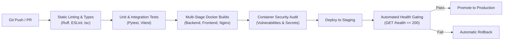

# KEEP — Master Deployment, Production Infrastructure & AI Readiness Architecture Specification

> **Specification Source:** `devdocs/p1/p1.10.txt`  
> **Phase:** Phase 1.10 — Deployment, Infrastructure & Production Readiness  
> **Author:** Member 1 (Project Lead & AI Architect)  
> **Status:** APPROVED & MANDATORY BASELINE FOR PHASE 1.10 IMPLEMENTATION

---

## 1. Executive Summary & Sub-Phase Objective

The objective of Phase 1.10 is to design, configure, and establish the complete KEEP platform in a secure, scalable, and production-ready environment. While Phases 1.1 through 1.9 established core capabilities (database models, authentication, multi-tenancy, RBAC, dashboard workspaces, document storage, and system observability), Phase 1.10 hardens and unifies the platform for enterprise deployment and creates the operational bridge for the AI and RAG implementations beginning in Phase 2.

This architecture specification defines:
1. The enterprise containerized production topology across client, gateway, backend API, persistence, and observability layers.
2. Production security hardening, TLS/HTTPS termination, reverse proxy routing, and secrets isolation.
3. Dedicated infrastructure blueprints for future AI services (CPU/GPU sizing, asynchronous worker isolation, model cache volumes, vector database scaling, and multi-tenant rate limiting).
4. Automated backup, disaster recovery, and high-availability procedures.
5. Continuous integration and deployment (CI/CD) pipelines with health-gated rollouts.
6. Concrete downstream implementation contracts for Member 2 (Backend Lead), Member 3 (Frontend Lead), and Member 4 (DevOps Lead).

---

## 2. Master Production Architecture Blueprint

```mermaid
flowchart TD
    Client(["Enterprise Users / Browsers"]) -->|HTTPS 443 / TLS 1.3| Ingress["Reverse Proxy (Nginx Gateway)"]
    
    subgraph DMZ ["Demilitarized Zone & Ingress"]
        Ingress
    end

    subgraph AppCluster ["KEEP Application Monorepo Network (keep-network)"]
        Ingress -->|/api/* & /health*| Backend["FastAPI Backend API\n(Uvicorn Workers)"]
        Ingress -->|/* (SPA / SSR)| Frontend["Next.js / React Frontend\n(Production Runtime)"]
        Ingress -->|/metrics (Restricted)| Prometheus["Prometheus Monitoring\n(:9090)"]
        
        Backend -->|Query / ORM| Postgres[("PostgreSQL 16 + pgvector\n(:5432)")]
        Backend -->|Cache / Rate Limits| Redis[("Redis 7 In-Memory Cache\n(:6379)")]
        Backend -->|Read / Write| Storage[("Persistent Volume Mount\n(/app/storage)")]
        
        subgraph FutureAI ["Phase 2 AI & Background Worker Subsystem"]
            Redis -->|Task Broker| AIWorker["Celery / Taskiq AI Workers\n(Ingestion / Embeddings / Graph)"]
            AIWorker -->|Model Weights| ModelCache[("Model Cache Volume\n(/app/models/cache)")]
            AIWorker -->|Chunk Embeddings| Postgres
            AIWorker -->|Document Extraction| Storage
        end
    end

    subgraph ObservabilityStack ["Observability & Telemetry Infrastructure"]
        Promtail["Promtail Log Shipper"] -->|ndjson Logs| Loki["Grafana Loki (:3100)"]
        Prometheus -->|Scrape /metrics| Backend
        Grafana["Grafana Dashboards (:3001)"] -->|Query Metrics| Prometheus
        Grafana -->|Query Logs| Loki
    end
```

### 2.1 Component Sizing & Specification Matrix

| Component | Image / Base | Internal Port | Exposed Port | Memory Limit | CPU Allocation | Persistent Volume |
| :--- | :--- | :--- | :--- | :--- | :--- | :--- |
| **Reverse Proxy (Nginx)** | `nginx:1.27-alpine` | `80`, `443` | `80`, `443` | 256 MB | 0.5 cores | `nginx_certs:/etc/nginx/certs:ro` |
| **Frontend (Next.js/React)** | Node 22 / Nginx Alpine | `3000` | None (Internal) | 1024 MB | 1.0 cores | None (Stateless) |
| **Backend API (FastAPI)** | Python 3.12-slim | `8000` | None (Internal) | 2048 MB | 2.0 cores | `storage_data:/app/storage` |
| **Database (PostgreSQL)** | `pgvector/pgvector:pg16` | `5432` | None (Internal) | 4096 MB | 2.0 cores | `postgres_data:/var/lib/postgresql/data` |
| **Cache & Queue (Redis)** | `redis:7-alpine` | `6379` | None (Internal) | 1024 MB | 1.0 cores | `redis_data:/data` |
| **Prometheus** | `prom/prometheus:v2.54.1` | `9090` | `9090` (Admin only)| 1024 MB | 0.5 cores | `prometheus_data:/prometheus` |
| **Grafana** | `grafana/grafana:11.1.0` | `3000` | `3001` | 512 MB | 0.5 cores | `grafana_data:/var/lib/grafana` |
| **Loki** | `grafana/loki:3.1.0` | `3100` | None (Internal) | 1024 MB | 0.5 cores | `loki_data:/loki` |
| **Promtail** | `grafana/promtail:3.1.0`| `9080` | None (Internal) | 256 MB | 0.2 cores | Docker socket & log mounts |
| **AI Workers (Phase 2)** | Python 3.12-slim | None | None (Worker) | 4096 MB | 4.0 cores | `ai_model_cache:/app/models/cache` |

---

## 3. Reverse Proxy, Ingress & Security Hardening Specification

### 3.1 Reverse Proxy Routing Rules

Nginx serves as the single public gateway terminating TLS/HTTPS and routing traffic based on path prefixes:
1. `GET /health` and `GET /health/*`: Routed to Backend API (`http://backend:8000/health`) for external container health check polling and load-balancer probes.
2. `/api/v1/*`: Routed to Backend API (`http://backend:8000/api/v1/*`) with preserve headers (`X-Request-ID`, `X-Forwarded-For`, `X-Forwarded-Proto`).
3. `/metrics`: Gated by IP allowlisting (accessible only from internal Docker network or monitoring bastion host).
4. `/*`: Routed to Frontend SPA / SSR container (`http://frontend:3000/`) with HTML5 History API fallback.
5. Static Assets (`/_next/static/*`, `/assets/*`, `/favicon.ico`): Aggressively cached with `Cache-Control: public, max-age=31536000, immutable` and Gzip/Brotli compression.

### 3.2 Security Hardening Headers

All HTTP responses emitted through the gateway must contain the mandatory enterprise security headers:
- `Strict-Transport-Security: max-age=63072000; includeSubDomains; preload`
- `X-Content-Type-Options: nosniff`
- `X-Frame-Options: DENY`
- `X-XSS-Protection: 1; mode=block`
- `Referrer-Policy: strict-origin-when-cross-origin`
- `Permissions-Policy: geolocation=(), camera=(), microphone=()`
- `Content-Security-Policy: default-src 'self'; script-src 'self' 'unsafe-inline'; style-src 'self' 'unsafe-inline'; img-src 'self' data: https:; font-src 'self' data:; connect-src 'self' https: wss:; frame-ancestors 'none';`

### 3.3 Zero-Trust Container Network Segmentation

1. All application services (`backend`, `postgres`, `redis`, `loki`, `promtail`) are bound strictly to the isolated `keep-network` bridge.
2. No database (`5432`) or cache (`6379`) ports are published to the host interfaces in production.
3. The backend and worker containers execute as unprivileged system users (`appuser:appgroup` with UID/GID 10001:10001).
4. File storage permissions are restricted to `0750` for directories and `0640` for stored documents.

---

## 4. Future AI Infrastructure Readiness Blueprint (Phase 2 Bridge)

To ensure the infrastructure seamlessly accommodates Phase 2 AI workloads (multimodal ingestion, OCR, embedding generation, dense/sparse RAG vector queries, and Knowledge Graph extraction) without operational refactoring, the following standards are codified in `backend/app/services/ai/deployment.py`.

### 4.1 Compute Architecture & Execution Modes

Four operational runtime modes are established:
1. `LOCAL_GPU`: Accelerated inference on local hardware (NVIDIA CUDA / TensorRT) for embedding models and high-throughput vector reranking.
2. `LOCAL_CPU`: Quantized inference using ONNX Runtime / `llama.cpp` for zero-cost on-premises development and sovereign deployments.
3. `REMOTE_API`: Cloud-hosted foundation models (OpenAI, Anthropic Claude, Azure OpenAI) for heavy reasoning with zero GPU infrastructure overhead.
4. `HYBRID` (Recommended Production Baseline): Local CPU/GPU embedding and reranking combined with remote cloud LLMs for generation and citation synthesis.

### 4.2 Asynchronous Worker & Task Queue Topology

Phase 2 AI operations must never execute synchronously within the FastAPI request-response threadpool. A dedicated Celery worker cluster is specified:
- `ai_ingestion_queue`: PDF extraction, OCR normalization, and structural chunking.
- `ai_embedding_queue`: Batch vector embedding generation via SentenceTransformers.
- `ai_graph_queue`: Entity recognition, coreference resolution, and relationship extraction for the Knowledge Graph.
- `ai_batch_queue`: Asynchronous batch summarization and periodic tenant analytics.

```
Incoming Request -> FastAPI Gateway -> Enqueue Task (Redis) -> Return 202 Accepted
                                          │
                                          ▼
                                   Celery AI Worker
                             (Dedicated CPU/RAM & Cache)
                                          │
                                          ▼
                        PostgreSQL (Chunks & Vector Embeddings)
```

### 4.3 Model Weights & Local Volume Caching

1. A dedicated persistent volume `ai_model_cache` is mounted at `/app/models/cache`.
2. Embedding models (`all-MiniLM-L6-v2`, `text-embedding-3-small` local proxies) and rerankers (`bge-reranker-base`) are cached locally to eliminate repeated Internet downloads during container scaling.
3. Checksum verification (SHA-256) is enforced prior to model loading to ensure supply-chain integrity.

### 4.4 PostgreSQL `pgvector` Sizing & Index Optimization

1. Index Architecture: HNSW (Hierarchical Navigable Small World) with parameters `m = 16`, `ef_construction = 64`, and runtime query `ef_search = 40`.
2. Memory Allocation: PostgreSQL `maintenance_work_mem` configured to `512MB` for rapid vector index builds; `work_mem` set to `64MB`.
3. Dimension Standard: Standardized at 1536-dimensional vectors for cloud embeddings and 384-dimensional vectors for local lightweight embeddings.

---

## 5. Environment & Secret Management Protocol

### 5.1 Environment Tiering

KEEP enforces four strict, isolated operational tiers:
1. **Development (`development`)**: Hot-reloading, mock authentication options, verbose logging, SQLite/local PostgreSQL.
2. **Testing (`testing`)**: Ephemeral containers, in-memory databases, automated test fixtures.
3. **Staging (`staging`)**: Mirror of production topology with sanitized data, automated CI deployment targets.
4. **Production (`production`)**: Fully hardened, HTTPS enforced, structured JSON logging, strict RBAC, automated backups.

### 5.2 Secret Injection & Rotation Standards

- Real `.env` files are strictly excluded from version control via `.gitignore`.
- All environment configurations must provide complete templates in `.env.example`.
- Secrets (`JWT_SECRET_KEY`, `POSTGRES_PASSWORD`, `REDIS_PASSWORD`, `OPENAI_API_KEY`) are injected via Docker secrets or secure environment variables.
- Minimum secret strength: 256-bit cryptographically random tokens (`openssl rand -hex 32`).

---

## 6. Backup, Disaster Recovery & High Availability Strategies

### 6.1 Backup Cadence & Retention Schedule

| Data Asset | Backup Method | Cadence | Retention Window | Destination |
| :--- | :--- | :--- | :--- | :--- |
| **Database (Relational & Vectors)**| `pg_dump` compressed snapshot | Every 24 hours | 30 days rolling | Encrypted volume / Offsite S3 |
| **Document Storage Volume** | Tar/Gzip with SHA-256 manifest | Every 24 hours | 30 days rolling | Encrypted volume / Offsite S3 |
| **Configuration & Secrets** | Encrypted config export | Weekly / On change | 90 days | Secure vault / Offsite |
| **Observability Logs (Loki)** | TSDB compaction & retention | Continuous | 30 days auto-prune| Local Loki storage volume |

### 6.2 Service Level Objectives (SLOs)

- **Recovery Point Objective (RPO):** < 1 hour (maximum data loss acceptable in disaster scenario).
- **Recovery Time Objective (RTO):** < 15 minutes (time to restore service online from cold backup).

---

## 7. CI/CD Deployment Automation & Verification Pipeline



The pipeline enforces zero-downtime rolling updates. If the `/health` endpoint does not report `healthy` within 60 seconds of container launch, traffic remains pinned to the prior healthy container version and an automated rollback is triggered.

---

## 8. Definition of Done & Team Deliverable Contracts

### 8.1 Member 1 (Project Lead & AI Architect) — Current Sub-Phase
- [x] Author Master Deployment, Infrastructure & AI Readiness Architecture Specification (`docs/Architecture/deployment-ai-infrastructure.md`).
- [x] Record Architecture Decision Records ADR-029, ADR-030, and ADR-031 in `docs/decisions/decisions.md`.
- [x] Author typed AI deployment contracts, hardware profiles, vector topology configs, worker specs, and readiness validator in `backend/app/services/ai/deployment.py`.
- [x] Define `AIRuntimeDeploymentProfile` and `BaseRAGDeploymentCoordinator` in `backend/app/services/rag/interfaces.py`.
- [x] Create comprehensive unit test suite in `tests/unit/test_deployment_ai_readiness.py` passing 100%.
- [x] Update API Contract (`docs/api/api-contract.md`) Section 7 with deployment routing and security headers.
- [x] Update Project State (`PROJECT_STATE.md`) and log handoff in `docs/handoffs/agent-handoffs.md`.

### 8.2 Member 2 (Backend Lead) — Downstream Deliverable Contract
- Configure production backend settings in `backend/app/core/config.py` supporting production environment profiles.
- Secure environment variables parsing, connection pool tuning, and graceful shutdown handlers.
- Verify production database readiness and Alembic migration sequence on container boot.
- Validate API endpoint latency SLAs under production configuration.

### 8.3 Member 3 (Frontend Lead) — Downstream Deliverable Contract
- Configure production Next.js / Vite build output optimizations (bundle splitting, tree-shaking, static asset caching).
- Implement responsive viewport optimizations across Desktop, Tablet, and Mobile.
- Wire frontend environment configuration (`VITE_API_BASE_URL`) for production Nginx reverse proxy.
- Verify clean production build (`npm run build`) with zero lint errors.

### 8.4 Member 4 (DevOps Lead) — Downstream Deliverable Contract
- Configure production `docker-compose.prod.yml` or production services in `docker-compose.yml`.
- Configure Nginx reverse proxy with SSL/TLS termination, HTTP-to-HTTPS redirect, and security headers.
- Enhance GitHub Actions CI/CD workflows with automated deployment validation and health check gating.
- Implement automated backup and disaster recovery validation scripts.
- Execute full-stack production container smoke and verification tests.
