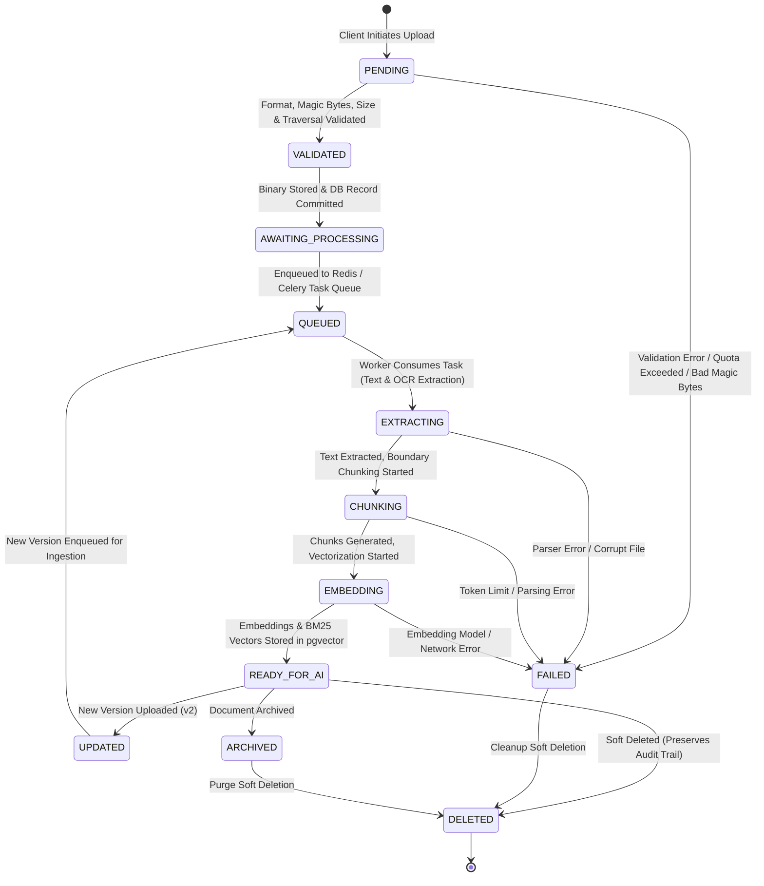
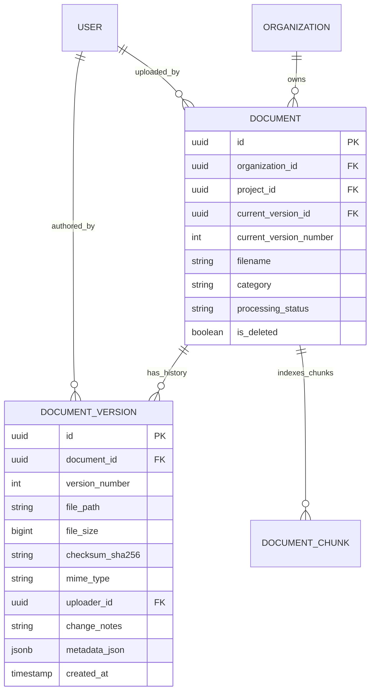

# Master Document Management, File Storage & AI Ingestion Architecture Specification (Phase 1.8)

> **Document Management, Storage Hierarchy, Version Lineage & AI Ingestion Seam Architecture**  
> **Author**: Member 1 — Project Lead & AI Architect  
> **Target Roles**: Member 2 (Backend Lead), Member 3 (Frontend Lead), Member 4 (Integration & DevOps Lead)  
> **Specification Reference**: `devdocs/p1/p1.8.txt` (Chapters 1–21)  
> **Architecture Decision Records**: ADR-023, ADR-024, ADR-025 (`docs/decisions/decisions.md`)  
> **Status**: APPROVED & ESTABLISHED

---

## 1. Executive Summary & Phase 1.8 Objectives

The core objective of **Phase 1.8 (Document Upload, File Management & Storage System)** is to design and implement an enterprise-grade, secure, multi-tenant document management subsystem for the KEEP platform. This subsystem acts as the foundational knowledge bridge: it accepts organizational digital assets across heterogeneous file formats, enforces tenant quarantine and storage quotas, extracts rich technical and domain metadata, preserves immutable version history, and prepares structured content for downstream AI ingestion, chunking, embedding generation, vector indexing, and Retrieval-Augmented Generation (RAG) in Phase 2.

### 1.1 Core Architecture Tenets
1. **Separation of Binary Storage & Structured Metadata**: Binary document assets are stored in tenant-partitioned physical/object storage, while searchable metadata, lineage, and lifecycle states reside in PostgreSQL 16.
2. **Deterministic Multi-Tenant Storage Partitioning**: Storage directories are strictly partitioned by `organization_id`, ensuring tenant isolation at both the filesystem/object-store level and the relational database layer.
3. **Immutable Version Lineage**: Documents are modeled as container entities referencing an ordered history of immutable `DocumentVersion` snapshots with cryptographic SHA-256 integrity verification.
4. **Action-Based Access Governance**: Every document operation (`document.create`, `document.read`, `document.update`, `document.delete`, `document.download`, `document.preview`, `document.version`) is gated through the Phase 1.6 7-step authorization engine with author ownership bypass.
5. **AI Preparation State Machine**: Every uploaded asset advances through an explicit 9-state processing pipeline (`PENDING` -> `VALIDATED` -> `AWAITING_PROCESSING` -> `QUEUED` -> `EXTRACTING` -> `CHUNKING` -> `EMBEDDING` -> `READY_FOR_AI`), providing a seamless contract for Celery workers in Phase 2.

---

## 2. End-to-End Document Lifecycle & Processing State Machine



### 2.1 State Definitions

| State | Scope | Description | Allowed Next States |
| :--- | :--- | :--- | :--- |
| `PENDING` | Phase 1.8 | Upload initiated; client multipart payload received in temporary buffer. | `VALIDATED`, `FAILED` |
| `VALIDATED` | Phase 1.8 | MIME magic bytes confirmed, size limits checked, path safe, duplicate SHA-256 evaluated. | `AWAITING_PROCESSING`, `FAILED` |
| `AWAITING_PROCESSING` | Phase 1.8 | File written to tenant storage path; database record created; ready for background queue. | `QUEUED`, `FAILED`, `ARCHIVED`, `DELETED` |
| `QUEUED` | Phase 1.8 / Phase 2 | Celery task ID registered; task awaiting worker availability in Redis queue. | `EXTRACTING`, `FAILED` |
| `EXTRACTING` | Phase 2.1 | Text parsing, structural layout analysis, and OCR running (PyMuPDF / Tesseract). | `CHUNKING`, `FAILED` |
| `CHUNKING` | Phase 2.1 | Normalized text split into semantic/token chunks with page provenance. | `EMBEDDING`, `FAILED` |
| `EMBEDDING` | Phase 2.1 | Dense vector embeddings and sparse BM25 vectors generated for chunks. | `READY_FOR_AI`, `FAILED` |
| `READY_FOR_AI` | Phase 1.8 / Phase 2 | Vector indexing complete; document fully retrievable by RAG search and KG traversal. | `UPDATED`, `ARCHIVED`, `DELETED` |
| `UPDATED` | Phase 1.8 | New revision uploaded; parent document version pointer bumped; previous version preserved. | `QUEUED` |
| `FAILED` | Phase 1.8 / Phase 2 | Terminal error during validation, storage, parsing, or embedding. Error logged. | `AWAITING_PROCESSING` (retry), `DELETED` |
| `ARCHIVED` | Phase 1.8 | Document hidden from default search and active projects; retained for compliance. | `AWAITING_PROCESSING` (restore), `DELETED` |
| `DELETED` | Phase 1.8 | Soft-deleted (`is_deleted = TRUE`); retained in database for immutable audit logs. | Terminal |

---

## 3. Supported File Formats, MIME Types & Validation Engine

### 3.1 Supported File Format Matrix

| Format Category | Extension | Canonical MIME Type | Magic Bytes Header | Size Limit | Ingestion Engine (Phase 2) |
| :--- | :--- | :--- | :--- | :--- | :--- |
| **PDF Documents** | `.pdf` | `application/pdf` | `%PDF-` (`25 50 44 46`) | 100 MB | PyMuPDF + Tesseract OCR |
| **Word Documents**| `.docx` | `application/vnd.openxmlformats-officedocument.wordprocessingml.document` | `PK\x03\x04` (`50 4B 03 04`) | 50 MB | python-docx / Mammoth |
| **Plain Text** | `.txt` | `text/plain` | UTF-8 / ASCII text | 20 MB | Native UTF-8 stream reader |
| **Markdown** | `.md` | `text/markdown` | UTF-8 text | 20 MB | Native Markdown parser |
| **Rich Text** | `.rtf` | `application/rtf` | `{\rtf` (`7B 5C 72 74 66`) | 20 MB | Striprtf / python-rtf |
| **PowerPoint** | `.pptx` | `application/vnd.openxmlformats-officedocument.presentationml.presentation` | `PK\x03\x04` (`50 4B 03 04`) | 100 MB | python-pptx slide extractor |
| **Spreadsheets** | `.xlsx` | `application/vnd.openxmlformats-officedocument.spreadsheetml.sheet` | `PK\x03\x04` (`50 4B 03 04`) | 50 MB | openpyxl tabular extractor |
| **Tabular Data** | `.csv` | `text/csv` | Delimited text | 20 MB | Python `csv` module |
| **Images** | `.png` | `image/png` | `\x89PNG\r\n\x1a\n` (`89 50 4E 47`) | 20 MB | Tesseract OCR + Resizing |
| **Images** | `.jpg`, `.jpeg` | `image/jpeg` | `\xFF\xD8\xFF` (`FF D8 FF`) | 20 MB | Tesseract OCR + Resizing |
| **Images** | `.webp`| `image/webp` | `RIFF....WEBP` (`52 49 46 46`) | 20 MB | PIL / Tesseract OCR |

### 3.2 Server-Side Validation Pipeline

1. **Filename Sanitization**:
   - Strips directory traversal sequences (`../`, `..\\`), null bytes (`\0`), and reserved OS characters (`:`, `*`, `?`, `"`, `<`, `>`, `|`).
   - Normalizes unicode characters via NFKC.
   - Enforces a maximum length of 255 characters.
2. **Magic Byte Sniffing**:
   - Compares the first 32 bytes of the binary stream against registered magic byte signatures to prevent MIME spoofing (e.g. an executable renamed to `.pdf`).
3. **Storage Quota Enforcement**:
   - Checks caller organization's aggregated storage usage against `organizations.max_storage_bytes`.
   - Rejects upload with `STORAGE_QUOTA_EXCEEDED` (400) if new file breaches allowance.
4. **Cryptographic SHA-256 Deduplication**:
   - Computes SHA-256 checksum during streaming write.
   - If a document with identical `(organization_id, checksum_sha256)` exists and is active, returns duplicate detection metadata with existing document reference.

---

## 4. Multi-Tenant Storage Architecture & Directory Layout

### 4.1 Storage Abstraction (`BaseFileStorageService`)

To decouple application logic from physical disk paths and enable seamless cloud deployment (Amazon S3 / Azure Blob / MinIO), storage operations conform to the `BaseFileStorageService` interface.

```
storage/
├── {organization_id}/                         # Organization Tenant Root
│   ├── documents/                             # Binary Document Store
│   │   └── {document_id}/
│   │       ├── v1/
│   │       │   └── {sanitized_filename}       # Primary Document File (v1)
│   │       └── v2/
│   │           └── {sanitized_filename}       # Revised Document File (v2)
│   ├── previews/                              # Generated Previews
│   │   └── {document_id}/
│   │       ├── v1/
│   │       │   └── preview.pdf / preview.html # Rendered Preview Cache
│   │       └── v2/...
│   ├── thumbnails/                            # High-Speed Cached Thumbnails
│   │   └── {document_id}/
│   │       └── thumb_300x300.webp             # Card & Explorer Thumbnail
│   └── temp/                                  # In-Flight Chunks & Streaming Buffers
```

### 4.2 Storage Security Constraints
- Files are NEVER stored with raw user-supplied paths.
- Paths are synthesized server-side using strict pattern:
  `{storage_root}/{org_id}/documents/{doc_id}/v{version_number}/{safe_filename}`.
- Direct web access to the `storage/` directory is strictly forbidden; all downloads and previews stream through authenticated FastAPI route handlers enforcing tenant matching.

---

## 5. Document Versioning Strategy & Lineage Architecture

### 5.1 Version Lineage Model

Documents operate under an **Aggregate Container + Immutable Snapshots** design:
- `Document`: Represents the persistent enterprise identity of the file (UUID, organization, project, title, category, tags, current version pointer).
- `DocumentVersion`: Represents an immutable physical snapshot of the file at revision $N$ (version number, storage path, file size, SHA-256 checksum, change notes, uploader attribution, creation timestamp).



### 5.2 Versioning Workflow
1. **Initial Upload (v1)**:
   - Creates parent `Document` record with `current_version_number = 1`.
   - Creates child `DocumentVersion` record with `version_number = 1` and `change_notes = "Initial upload"`.
   - Links `Document.current_version_id -> DocumentVersion.id`.
2. **Revision Upload (v$N+1$)**:
   - `POST /api/v1/documents/{id}/version` receives revised binary stream and change notes.
   - Computes new SHA-256 checksum and saves to `.../documents/{id}/v{N+1}/{filename}`.
   - Creates new `DocumentVersion` record with `version_number = N + 1`.
   - Bumps parent `Document.current_version_number` and points `current_version_id` to new version.
   - Previous versions remain strictly read-only and downloadable.
3. **RAG Vector Invalidation & Version Tagging**:
   - Every `DocumentChunk` records `document_version_id` alongside `document_id`.
   - When a new version is processed, old version chunks are marked inactive or pruned from active RAG candidate pools, ensuring semantic queries only retrieve from the latest approved version while retaining audit history.

---

## 6. Document Categories & Enterprise Taxonomy

To facilitate structured metadata filtering and scoped AI memory routing (devdocs Chapter 10), KEEP enforces 10 standard enterprise categories:

| Category Code | Display Name | Typical Asset Types | Default Memory Scope |
| :--- | :--- | :--- | :--- |
| `POLICIES` | Policies & Compliance | Employee handbooks, compliance charters, security guidelines | Org-Wide |
| `REPORTS` | Business Reports | Quarterly earnings, operational audits, progress reports | Department-Wide |
| `MEETING_MINUTES` | Meeting Transcripts & Notes | Standup notes, architecture reviews, board minutes | Team-Wide / Project |
| `RESEARCH` | Research Papers & Whitepapers | Academic publications, market research, AI benchmarks | Org-Wide |
| `LEGAL` | Legal & Contracts | NDAs, master services agreements, licensing terms | Org-Wide (Restricted) |
| `FINANCE` | Financial Records | Invoices, budget forecasts, tax documentation | Org-Wide (Restricted) |
| `HR` | Human Resources | Job descriptions, onboarding guides, compensation tiers | Department-Wide |
| `TECHNICAL_DOCUMENTATION` | Technical Documentation | API specifications, architecture diagrams, runbooks | Team-Wide / Project |
| `PRESENTATIONS` | Slide Decks | Investor pitches, client proposals, all-hands decks | Project-Local |
| `TRAINING_MATERIALS` | Training & Onboarding | Tutorials, walkthrough guides, standard operating procedures | Org-Wide |

---

## 7. Document Preview & Rendering Architecture

To prevent unnecessary bandwidth consumption and allow immediate client-side inspection:
1. **PDF Preview**:
   - Served via `GET /api/v1/documents/{id}/preview` using HTTP byte-range streaming (`Content-Type: application/pdf`).
   - Rendered in frontend via browser PDF viewer with canvas fallback.
2. **DOCX Preview**:
   - Transformed server-side to sanitized, lightweight HTML via Python document parser.
   - Cached in `storage/{org_id}/previews/{doc_id}/v{version}/preview.html`.
3. **Text / Markdown Preview**:
   - Streamed directly as sanitized UTF-8 text with syntax highlighting in frontend viewer.
4. **Image Preview / Thumbnails**:
   - Generated dynamically or during ingestion as optimized 300x300 WebP images.
   - Cached in `storage/{org_id}/thumbnails/{doc_id}/thumb_300x300.webp`.

---

## 8. REST API Specification (Phase 1.8 Endpoints)

| Method | Endpoint | Description | Required Permission |
| :--- | :--- | :--- | :--- |
| `POST` | `/api/v1/documents/upload` | Upload document file with metadata | `document.create` |
| `GET` | `/api/v1/documents` | List tenant documents (paginated, filtered) | `document.read` |
| `GET` | `/api/v1/documents/{id}` | Retrieve document metadata & version history | `document.read` |
| `GET` | `/api/v1/documents/{id}/download` | Download binary file stream | `document.download` |
| `GET` | `/api/v1/documents/{id}/preview` | Stream rendered preview content | `document.preview` |
| `PATCH` | `/api/v1/documents/{id}` | Update document metadata (title, category, tags) | `document.update` (owner bypass) |
| `POST` | `/api/v1/documents/{id}/version` | Upload new revision of existing document | `document.version` (owner bypass) |
| `DELETE` | `/api/v1/documents/{id}` | Soft-delete / archive document | `document.delete` (owner bypass) |

---

## 9. Security, Governance & Audit Logging

### 9.1 Multi-Tenant Authorization Enforcement
All document endpoints enforce the 7-step authorization engine established in Phase 1.6:
1. **Hard Tenant Check**: `caller.organization_id == document.organization_id`. Mismatches return immediate 403 `AUTH_ORGANIZATION_MISMATCH`.
2. **Project Workspace Scoping**: If `document.project_id` is set, non-administrative users must belong to the associated project (`document.project_id in caller.project_ids`).
3. **Resource Ownership Override**: Document uploaders bypass base role restrictions for `document.update`, `document.version`, and `document.delete`.

### 9.2 Immutable Audit Trail
Every document mutation and access event emits an audit record to `activity_logs`:
- `DOCUMENT_UPLOAD`: Actor, document ID, filename, file size, category.
- `DOCUMENT_VERSION_UPLOAD`: Actor, document ID, new version number, change notes.
- `DOCUMENT_DOWNLOAD`: Actor, document ID, version number, client IP.
- `DOCUMENT_PREVIEW`: Actor, document ID, MIME type viewed.
- `DOCUMENT_METADATA_UPDATE`: Actor, document ID, updated fields diff.
- `DOCUMENT_DELETE`: Actor, document ID, soft deletion timestamp.

---

## 10. Performance Loading Targets & SLAs

| Operation | Target SLA | Strategy |
| :--- | :--- | :--- |
| **Upload Initiation** | < 1.0 s | Streaming chunk upload, async spooling to disk buffer |
| **Metadata Extraction** | < 3.0 s | Synchronous core metadata (MIME, SHA-256, size) extracted during upload stream |
| **Preview Generation** | < 5.0 s | Lazy generation on first request + persistent disk caching |
| **Document Catalog Listing** | < 500 ms | Composite indexes on `(organization_id, status, created_at)` + Redis cache |
| **Download Initiation** | < 500 ms | Chunked file streaming with `aiofiles` / FastAPI `FileResponse` |

---

## 11. Division of Responsibilities for Phase 1.8

| Team Member | Subsystem Ownership | Phase 1.8 Specific Deliverables |
| :--- | :--- | :--- |
| **Member 1 (AI Lead)** | Architecture & Domain Contracts | Master architecture spec, ADRs (023–025), API & schema contracts, typed contracts in `services/rag/` & `services/ai/`, unit tests. |
| **Member 2 (Backend Lead)** | API, Repositories, Services, DB | Implement upload router, storage service, metadata persistence, version repository, validation logic, Alembic migration for `document_versions`. |
| **Member 3 (Frontend Lead)** | UI Components, Stores, Client | Drag-and-drop uploader, document explorer, file preview viewer, metadata editor, version history timeline. |
| **Member 4 (DevOps Lead)** | Storage Volumes, CI/CD, QA | Storage volume mounting in Docker, upload stress benchmarks, multi-tenant isolation tests, Playwright E2E tests. |
