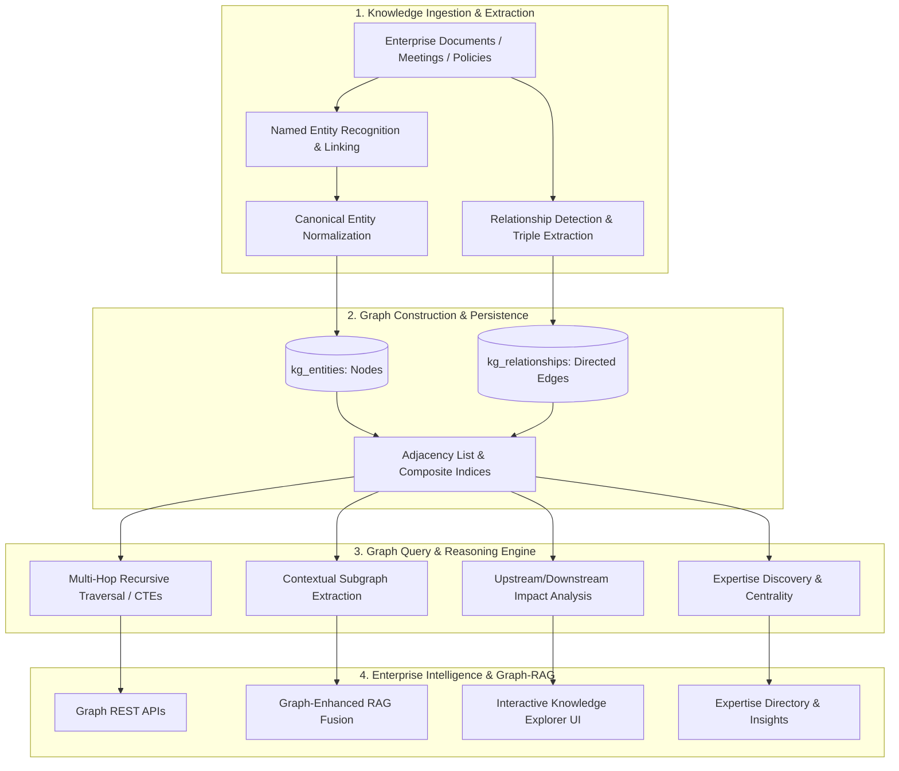

# KEEP — Enterprise Knowledge Graph & Intelligence Architecture Specification
**Phase 2.4 — Knowledge Graph Construction, Relationship Mapping & Enterprise Intelligence**  
**Specification Reference**: `devdocs/p2/p2.4.txt` (Chapters 1–20)  
**Author**: Member 1 (Project Lead & AI Architect)  
**Status**: APPROVED / IN EXECUTION

---

## 1. Executive Architecture Overview

The KEEP Enterprise Knowledge Graph transforms unstructured corporate documentation, user activities, project workspaces, organizational hierarchies, meeting transcripts, and compliance policies into a connected semantic network. While traditional Retrieval-Augmented Generation (RAG) relies solely on vector similarity over isolated document chunks, the Knowledge Graph adds relational reasoning, multi-hop contextual traversal, structural impact analysis, and subject-matter expertise discovery.



---

## 2. Enterprise Ontology & Entity Taxonomy

The Knowledge Graph categorizes entities into four distinct core namespaces:

### 2.1 Organizational Entities
- **Organization**: Top-level tenant boundary entity.
- **Department**: Functional business unit (e.g., Engineering, Legal, Operations, Human Resources).
- **Team**: Collaborative group within or across departments.
- **Employee (User)**: Enterprise staff member with role, title, and assigned workspaces.

### 2.2 Knowledge Entities
- **Document**: Authoritative corporate document (specification, guide, manual).
- **Policy**: Governance rule, regulatory standard, or legal constraint.
- **SOP (Standard Operating Procedure)**: Step-by-step procedural guideline.
- **Meeting**: Recorded/transcribed synchronization session.
- **Report**: Synthesized intelligence or operational rollup brief.
- **Research Paper**: Technical whitepaper or benchmark report.

### 2.3 Operational Entities
- **Project**: Collaborative initiative with deliverables and timelines.
- **Task**: Granular action item with assignee, status, and due date.
- **Milestone**: Major project checkpoint.
- **Risk**: Identified security, technical, or compliance hazard.
- **Decision**: Formal architecture or business determination (e.g., ADR).

### 2.4 AI & Semantic Entities
- **Knowledge Chunk**: Granular text segment with high-dimensional embedding vector.
- **Technology / Product**: Software stack component, vendor library, or enterprise asset.
- **Topic / Domain**: Abstract subject domain (e.g., Cybersecurity, GDPR Compliance, Distributed Systems).

---

## 3. Relationship Taxonomy & Semantic Edges

Each directed edge in the Knowledge Graph represents a semantic relation $E_s \xrightarrow{R} E_t$ characterized by:
- `source_entity_id`: Originating node UUID.
- `target_entity_id`: Terminating node UUID.
- `relation_type`: Standardized semantic verb.
- `weight`: Edge strength $[0.0, 1.0]$ based on extraction confidence and frequency.
- `properties_json`: Extracted context (source document ID, sentence excerpt, extraction timestamp).

| Source Entity | Relation Type | Target Entity | Inverse Relation | Description |
| :--- | :--- | :--- | :--- | :--- |
| **Employee** | `WORKS_IN` | **Department** | `EMPLOYS` | Departmental membership |
| **Employee** | `LEADS` | **Team / Project** | `LED_BY` | Leadership responsibility |
| **Employee** | `PARTICIPATES_IN` | **Project / Meeting**| `INVOLVES` | Active participation |
| **Employee** | `AUTHORED` | **Document / Policy**| `AUTHORED_BY` | Provenance attribution |
| **Project** | `CONTAINS` | **Document** | `BELONGS_TO` | Workspace document containment |
| **Document** | `REFERENCES` | **Document / Policy**| `REFERENCED_BY` | Cross-document citation |
| **Policy** | `APPLIES_TO` | **Department / Team**| `GOVERNED_BY` | Regulatory compliance scoping |
| **Task** | `DEPENDS_ON` | **Task / Milestone** | `BLOCKS` | Operational task sequencing |
| **Meeting** | `DISCUSSED` | **Project / Risk** | `DISCUSSED_IN` | Conversational agenda topic |
| **Employee** | `EXPERT_IN` | **Topic / Technology**| `HAS_EXPERT` | Subject-matter expertise link |

---

## 4. Entity Extraction & Deduplication Pipeline

```text
Document / Text Stream
        │
        ▼
1. Rule-Based & Regex Pattern Extraction (Dates, Policies, Standards)
        │
        ▼
2. Named Entity Recognition (NER) (People, Projects, Technologies, Orgs)
        │
        ▼
3. Canonical Disambiguation & Entity Resolution
   - String normalization (case, punctuation, whitespace)
   - Alias mapping ("K8s" -> "Kubernetes", "HR" -> "Human Resources")
   - Exact & Levenshtein similarity against existing tenant entities
        │
        ▼
4. Upsert Entity Node (increment mention_count, update source_document_ids)
```

---

## 5. Relationship Extraction Engine

1. **Explicit Metadata Relations**: Deterministic linkage from structured relational models (e.g., `User.department_id` -> `WORKS_IN`, `Document.uploader_id` -> `AUTHORED`, `Project.team_id` -> `OWNED_BY`).
2. **Textual Co-Occurrence & Dependency Triples**: NLP-based relationship extraction over document sentences:
   $$\text{Confidence}(S, R, T) = \alpha \cdot \text{SyntacticScore} + \beta \cdot \text{Frequency} + \gamma \cdot \text{ModelProbability}$$
3. **LLM Structured Triple Extraction**: For complex narrative texts, the AI extractor emits JSON-formatted triples with evidence quotation and confidence ratings $[0.70, 1.00]$.

---

## 6. Graph Persistence & Adjacency Architecture

To ensure operational simplicity, atomic transactions, and zero infrastructure overhead during MVP, the graph is persisted in PostgreSQL using optimized relational tables:
- `kg_entities`: Entity nodes indexed by `(organization_id, entity_type, name)`.
- `kg_relationships`: Directed edges indexed by `(organization_id, source_entity_id, relation_type)` and `(organization_id, target_entity_id, relation_type)`.

Multi-hop graph traversal queries are executed using PostgreSQL **Recursive Common Table Expressions (Recursive CTEs)** with cycle detection arrays (`ARRAY[id]`) and depth limiting (`depth <= max_depth`).

---

## 7. Multi-Hop Graph Traversal Engine

The traversal engine supports:
1. **Neighborhood Discovery**: Finds all entities within $K$ hops of a seed entity ($1 \le K \le 3$).
2. **Path Finding**: Discovers shortest or weighted paths connecting two arbitrary entities.
3. **Filtering by Entity & Relation Types**: Restricts search space to designated subsets (e.g., only follow `DEPENDS_ON` and `APPLIES_TO`).

```sql
WITH RECURSIVE graph_walk AS (
    SELECT 
        e.id, e.name, e.entity_type, 0 AS depth,
        ARRAY[e.id] AS path, 1.0::float AS path_weight
    FROM kg_entities e
    WHERE e.id = :start_entity_id AND e.organization_id = :org_id AND e.is_deleted = false

    UNION ALL

    SELECT 
        target.id, target.name, target.entity_type, gw.depth + 1,
        gw.path || target.id, gw.path_weight * r.weight
    FROM graph_walk gw
    JOIN kg_relationships r ON r.source_entity_id = gw.id AND r.organization_id = :org_id
    JOIN kg_entities target ON target.id = r.target_entity_id AND target.is_deleted = false
    WHERE gw.depth < :max_depth 
      AND NOT (target.id = ANY(gw.path))
)
SELECT * FROM graph_walk;
```

---

## 8. Graph-Enhanced RAG (GraphRAG) Integration

Traditional RAG retrieves vector chunks based solely on embedding similarity. GraphRAG enriches vector retrieval with structured relationship context:
1. Extract named entities present in the user query.
2. Traverse 1-to-2 hops from identified seed entities in the Knowledge Graph.
3. Formulate a **Semantic Subgraph Context Block** detailing connected projects, owners, affected policies, and parent departments.
4. Prepend the Subgraph Context Block into the LLM synthesis prompt alongside vector chunks.

---

## 9. Enterprise Intelligence Capabilities

### 9.1 Upstream & Downstream Impact Analysis
When modifying or reviewing a policy, SOP, or architecture component, the impact engine computes the downstream transitive dependency tree:
- Affected Departments
- Blocked or Dependent Projects
- Associated Meeting Decisions
- Assigned Implementation Tasks

### 9.2 Subject Matter Expertise Discovery
Calculates employee expertise scores across topics using weighted in-degree centrality:
$$\text{Score}(u, t) = \sum_{d \in \text{DocsAuthored}(u)} w_{\text{author}} \cdot \text{Rel}(d, t) + \sum_{p \in \text{Projects}(u)} w_{\text{project}} \cdot \text{Rel}(p, t) + \sum_{m \in \text{Meetings}(u)} w_{\text{meeting}} \cdot \text{Rel}(m, t)$$

### 9.3 Knowledge Base Graph Health
Monitors structural health metrics:
- **Orphan Nodes**: Entities with zero relationships.
- **Graph Density**: Edge-to-node ratio.
- **Top Hubs**: High-degree central knowledge artifacts.
- **Knowledge Gaps**: High-query topics with sparse connectivity.

---

## 10. Multi-Tenant Quarantine & RBAC Boundary

- **Tenant Isolation**: Every graph node and edge possesses an `organization_id` foreign key. All traversal queries enforce `organization_id = :org_id` at every recursion step. Cross-tenant traversal is cryptographically and logically prohibited.
- **Permission Filtering**: Edge and node inspection respects user role boundaries (e.g., Viewer cannot inspect confidential HR entity properties).
