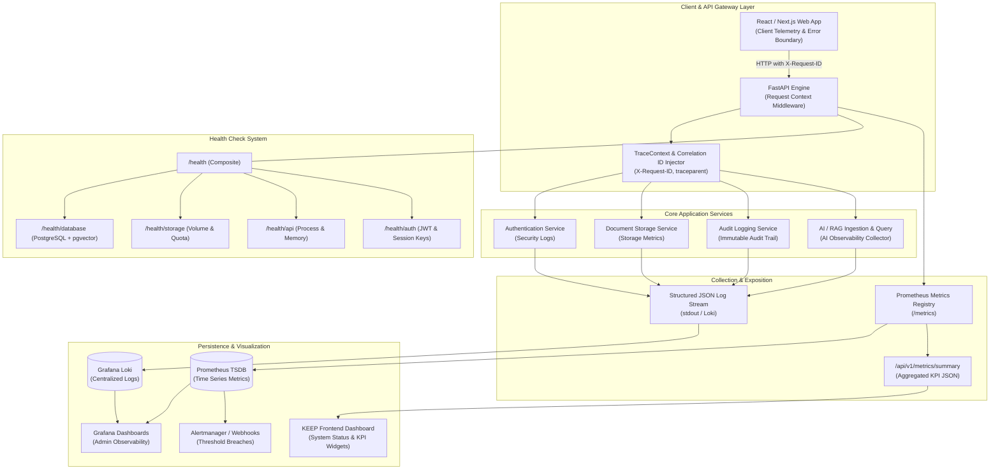
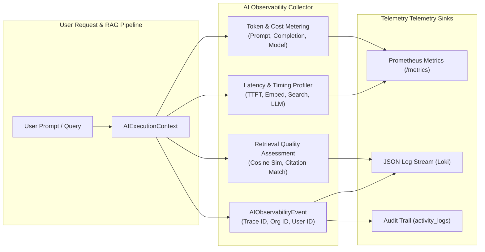

# KEEP — Observability, Monitoring & Logging Architecture Specification

> **Specification Source**: `devdocs/p1/p1.9.txt`  
> **Phase**: 1.9 — Logging, Monitoring & System Observability  
> **Role**: Member 1 (Project Lead & AI Architect)  
> **Status**: APPROVED & ACTIVE  

---

## 1. Executive Summary & Objectives

As KEEP expands into an enterprise-grade AI knowledge platform, continuous end-to-end operational visibility becomes foundational. Without unified telemetry, distributed errors remain undetected, multi-tenant resource saturation occurs silently, latency degrades without attribution, security boundaries risk quiet breach, and future AI/RAG inference failures cannot be diagnosed.

This specification establishes the official **KEEP Observability & Monitoring Framework**, defining:
1. **Centralized Structured Logging**: Standardized JSON log schema, log categories, severity taxonomy, and distributed correlation tracking across all services.
2. **Multi-Tier Health Check Topology**: Granular readiness and liveness probes (`/health`, `/health/database`, `/health/storage`, `/health/api`, `/health/auth`) providing instant diagnostic isolation.
3. **Application & Infrastructure Metrics**: Prometheus-compatible metric exposition (`/metrics`), KPI computation, and time-series aggregation for enterprise operational dashboards.
4. **Security & Audit Telemetry**: Immutable audit trails (`activity_logs`), RBAC violation monitoring, brute-force alerting, and cross-tenant quarantine logging.
5. **Log Retention & Lifecycle Policies**: Granular retention schedules balancing compliance, storage footprint, and rapid incident response.
6. **AI Pipeline & RAG Observability Framework (Phase 2 Preparation)**: Comprehensive telemetry architecture for LLM token tracking, embedding generation latency, dense/sparse vector retrieval scoring, citation grounding validation, cost attribution, and fallback resilience.

---

## 2. Distributed Observability Topology



---

## 3. Centralized Structured Logging Strategy

### 3.1 Canonical JSON Log Schema
To enable automated parsing, structured querying in Grafana Loki, and programmatic alert evaluation, every log record emitted across backend services, workers, and API routers must conform to the canonical JSON log specification:

```json
{
  "timestamp": "2026-10-21T21:30:00.123456Z",
  "level": "INFO",
  "module": "document_service",
  "action": "document_upload_completed",
  "status": "success",
  "user_id": "3fa85f64-5717-4562-b3fc-2c963f66afa6",
  "organization_id": "7ca38f12-2111-4b12-a1b2-1c2d3e4f5a6b",
  "request_id": "req-98f24a1b-312c-47ea-8d19-bca128f73110",
  "trace_id": "4bf92f3577b34da6a3ce929d0e0e4736",
  "execution_time_ms": 14.82,
  "ip_address": "192.168.1.105",
  "message": "Document version 1 created successfully",
  "metadata": {
    "document_id": "e8b23f11-9a1c-4b62-9e22-83bfa99321e1",
    "filename": "quarterly_financials_2026.pdf",
    "file_size_bytes": 1048576,
    "mime_type": "application/pdf"
  }
}
```

### 3.2 Schema Field Definitions

| Field | Type | Description | Mandatory |
| :--- | :--- | :--- | :--- |
| `timestamp` | ISO-8601 String | UTC timestamp with microsecond precision (`YYYY-MM-DDTHH:MM:SS.mmmmmmZ`). | Yes |
| `level` | String | Log severity: `DEBUG`, `INFO`, `WARNING`, `ERROR`, `CRITICAL`. | Yes |
| `module` | String | Subsystem source identifier (e.g., `api`, `auth`, `document_service`, `rag_engine`). | Yes |
| `action` | String | Machine-readable verb denoting the specific event (e.g., `user_login`, `chunk_indexed`). | Yes |
| `status` | String | Outcome status: `success`, `failure`, `degraded`, `quarantined`. | Yes |
| `user_id` | UUID / null | Authenticated caller UUID; `null` for public/anonymous or internal background tasks. | Yes |
| `organization_id`| UUID / null | Tenant boundary UUID for multi-tenant isolation analysis; `null` for system-wide tasks. | Yes |
| `request_id` | String | Unique correlation identifier propagated across the complete request lifecycle. | Yes |
| `trace_id` | String / null | Distributed trace identifier conforming to W3C TraceContext standards. | No |
| `execution_time_ms`| Float | Elapsed execution duration in milliseconds for performance tracking. | Yes |
| `ip_address` | String / null | Originating client IP address (sanitized for privacy and proxy headers). | No |
| `message` | String | Human-readable event description. | Yes |
| `metadata` | Object | Arbitrary domain-specific key-value context (e.g. document details, token counts). | Yes |

### 3.3 Log Categories & Event Taxonomy

1. **Application Logs**: General operational activities (user sign-in, document upload, project modification, search query execution).
2. **Error Logs**: Unhandled exceptions, failed third-party RPCs, database query timeouts, filesystem errors, and validation rejections. Includes truncated stack traces and `error_code`.
3. **Security Logs**: Brute-force login attempts, expired or forged JWT tokens, unauthorized path traversal attempts, and cross-tenant data access rejections.
4. **Audit Logs**: Irreversible or governance-relevant mutations (user creation, role assignment, document deletion, organization tier change, permission override). Emitted to both stdout and persisted in `activity_logs`.
5. **AI Telemetry Logs (Phase 2)**: Embedding model generation runs, dense/sparse search scoring, LLM generation latency, prompt token counts, citation grounding evaluations, and vector indexing operations.

---

## 4. Multi-Tier Health Check Topology

To prevent cascading failures and enable Kubernetes/Docker container orchestrators to accurately assess platform status, KEEP implements a multi-tier health probe architecture.

```
                  ┌────────────────┐
                  │  GET /health   │  (Overall Composite Status)
                  └───────┬────────┘
                          │
          ┌───────────────┼───────────────┬───────────────┐
          ▼               ▼               ▼               ▼
   ┌─────────────┐ ┌─────────────┐ ┌─────────────┐ ┌─────────────┐
   │  /database  │ │  /storage   │ │    /api     │ │    /auth    │
   │ PostgreSQL  │ │ Local / S3  │ │ FastAPI VM  │ │ JWT Secret  │
   │  pgvector   │ │ Free Space  │ │ Memory / CPU│ │ Key Health  │
   └─────────────┘ └─────────────┘ └─────────────┘ └─────────────┘
```

### 4.1 Endpoint Specifications

| Endpoint | Path | Scope & Verification Checks | Expected SLA |
| :--- | :--- | :--- | :--- |
| **Composite Health** | `GET /health` | Aggregates all sub-checks into unified `status`: `"healthy"`, `"degraded"`, or `"unhealthy"`. Returns HTTP 200 if operational or degraded, 503 if critical. | < 25 ms |
| **Database Probe** | `GET /health/database` | Executes `SELECT 1` on connection pool; checks active connection count and pgvector extension availability (`SELECT 1 FROM pg_extension WHERE extname = 'vector'`). | < 10 ms |
| **Storage Probe** | `GET /health/storage` | Verifies write/read access to `STORAGE_ROOT`; inspects remaining filesystem capacity against high-watermark threshold (90%). | < 5 ms |
| **API Probe** | `GET /health/api` | Validates event loop responsiveness, uptime seconds, process resident set memory (RSS), and Python runtime version. | < 2 ms |
| **Auth Probe** | `GET /health/auth` | Verifies secret key configuration, JWT signing validity, and token revocation cache accessibility. | < 5 ms |

### 4.2 Composite Health Response Model
```json
{
  "status": "healthy",
  "version": "1.0.0",
  "timestamp": "2026-10-21T21:30:00Z",
  "uptime_seconds": 86420,
  "environment": "production",
  "dependencies": {
    "database": {
      "status": "healthy",
      "latency_ms": 1.42,
      "connection_pool": {
        "size": 20,
        "checked_out": 2,
        "overflow": 0
      },
      "vector_extension_enabled": true
    },
    "storage": {
      "status": "healthy",
      "latency_ms": 0.85,
      "writable": true,
      "free_space_bytes": 107374182400,
      "used_percent": 14.2
    },
    "api": {
      "status": "healthy",
      "memory_rss_mb": 142.5,
      "active_requests": 3
    },
    "auth": {
      "status": "healthy",
      "jwt_secret_configured": true,
      "algorithm": "HS256"
    }
  }
}
```

---

## 5. Performance Metrics & KPI Framework

KEEP continuously records operational metrics across three distinct layers: Infrastructure, Application, and Data.

### 5.1 Key Performance Indicators (KPIs) & Target SLAs

| Dimension | Metric Name | Unit | Target Operational SLA | Critical Alert Threshold |
| :--- | :--- | :--- | :--- | :--- |
| **API Latency** | `http_request_duration_seconds` (p50) | ms | < 50 ms | > 200 ms |
| **API Latency** | `http_request_duration_seconds` (p95) | ms | < 250 ms | > 1,000 ms |
| **API Latency** | `http_request_duration_seconds` (p99) | ms | < 500 ms | > 2,500 ms |
| **API Error Rate** | `http_requests_failed_ratio` | % | < 0.1% | > 2.0% |
| **Throughput** | `http_requests_total` | req/sec | Baseline: 500 req/sec | N/A |
| **DB Query Duration**| `db_query_duration_seconds` (p95) | ms | < 15 ms | > 100 ms |
| **DB Active Conns** | `db_connection_pool_active` | count | < 60% pool max | > 85% pool max |
| **Storage Usage** | `storage_volume_used_percent` | % | < 70% capacity | > 90% capacity |
| **Auth Failures** | `auth_login_failures_total` | rate | < 5 failures / min | > 25 failures / min |
| **AI LLM TTFT** (P2)| `ai_time_to_first_token_ms` | ms | < 600 ms | > 2,000 ms |
| **AI Generation** (P2)| `ai_generation_duration_ms` | ms | < 2,500 ms | > 8,000 ms |
| **RAG Retrieval** (P2)| `ai_rag_retrieval_duration_ms`| ms | < 80 ms | > 350 ms |

### 5.2 Prometheus Exposition Standard (`GET /metrics`)
Metrics are exported using standard Prometheus text exposition format with consistent label taxonomy:
- `http_requests_total{method="POST", handler="/api/v1/documents/upload", status="202"}`
- `http_request_duration_seconds_bucket{le="0.05", handler="/api/v1/documents", method="GET"}`
- `db_query_duration_seconds{query_type="select", table="documents"}`
- `storage_bytes_written_total{organization_id="7ca38f12-2111-4b12-a1b2-1c2d3e4f5a6b"}`
- `ai_tokens_consumed_total{model="gpt-4o", operation="rag_generation", organization_id="..."}`

---

## 6. Alerting Matrix & Notification Policies

Alert rules detect abnormal system states before they impact user availability.

| Alert Identifier | Severity | Trigger Condition | Evaluation Window | Notification Channels | Runbook Action |
| :--- | :--- | :--- | :--- | :--- | :--- |
| `DatabaseOffline` | CRITICAL | `/health/database` returns non-200 or timeout | 15 seconds | PagerDuty, Slack, Email | Inspect DB container, verify volume mount, restart container. |
| `HighApiErrorRate` | WARNING / CRITICAL | 5xx error rate > 2% (Warning), > 5% (Critical) | 2 minutes | Slack, Email | Review recent deployments, check error logs by Request ID. |
| `HighCpuUtilization`| WARNING | Host CPU > 85% for 5 consecutive minutes | 5 minutes | Slack, Dashboard | Inspect worker queues, scale backend replicas. |
| `HighMemoryUsage` | WARNING | Host RAM > 90% for 3 consecutive minutes | 3 minutes | Slack, Dashboard | Check for memory leaks in PDF parsers or vector buffers. |
| `StorageNearCapacity`| WARNING / CRITICAL | Storage volume > 85% (Warning), > 95% (Critical) | 5 minutes | Slack, Email | Run `storage-backup.sh`, purge soft-deleted files, expand volume. |
| `BruteForceAttempt`| SECURITY | > 10 failed logins for single IP / Org in 3 min | 3 minutes | Security Alert Log, Email | Temporarily rate-limit IP, verify user account lockout. |
| `AIRateLimitExceeded`| WARNING | > 20 requests throttled with 429 in 5 min | 5 minutes | Dashboard, Log | Review organization quota settings, upgrade plan limits. |

---

## 7. Log Retention & Compliance Policies

To comply with data privacy regulations (GDPR/SOC2) and prevent uncontrolled disk growth:

| Log Type | Storage Location | Active Retention | Cold Archive Retention | Deletion Policy |
| :--- | :--- | :--- | :--- | :--- |
| **Application Logs** | Loki / File | 30 Days | 60 Days | Automatic TTL purge |
| **Error Logs** | Loki / Sentry | 90 Days | 180 Days | Compressed archive |
| **Security Logs** | PostgreSQL (`activity_logs`) + Loki | 1 Year | 3 Years | WORM (Write Once, Read Many) |
| **Audit Logs** | PostgreSQL (`activity_logs`) | 1 Year | 5 Years | Immutable; tamper-evident |
| **AI Inference Logs**| PostgreSQL / Loki | 90 Days | 1 Year | PII-anonymized retention |

---

## 8. AI Observability & Monitoring Framework (Phase 2 Preparation)

Phase 2 introduces LLM inference, embedding generation, dense/sparse RAG retrieval, and Knowledge Graph extraction. Observability for AI systems requires specialized tracking beyond standard HTTP metrics.



### 8.1 Specialized AI Telemetry Attributes
Every AI invocation records the following multidimensional metrics:
1. **Model Identification**: Model name (`gpt-4o`, `text-embedding-3-small`, `all-MiniLM-L6-v2`), provider (`openai`, `ollama`, `anthropic`), model version.
2. **Token Accounting**: `prompt_tokens`, `completion_tokens`, `total_tokens`, and real-time financial cost estimation in USD (`estimated_cost_usd`).
3. **Latency Profiling**:
   - `time_to_first_token_ms` (TTFT): Initial response latency in streaming mode.
   - `total_generation_duration_ms`: Total completion time.
   - `embedding_generation_duration_ms`: Duration of vector embedding calls.
   - `dense_search_duration_ms`: pgvector HNSW similarity query duration.
   - `rerank_duration_ms`: Cross-encoder reranking latency.
4. **Retrieval Quality & Grounding**:
   - `candidate_chunks_retrieved`: Raw chunks selected by vector query.
   - `top_similarity_score`: Highest cosine similarity score.
   - `average_similarity_score`: Mean similarity across top-k chunks.
   - `citation_grounding_confidence`: Heuristic score measuring whether generated claims align with source chunks.
   - `hallucination_risk_score`: Heuristic evaluation of claims absent from retrieved context.
5. **Multi-Tenant Cost Attribution**:
   - Aggregate token consumption grouped by `organization_id`, `project_id`, and `user_id` for accurate per-tenant billing and enterprise department cost allocation.

---

## 9. Definition of Done for Phase 1.9

Phase 1.9 is complete across all four roles when:
1. **Member 1 (AI Lead)**: Master Observability Architecture specified, ADRs documented, API/Database contracts updated, typed AI monitoring domain contracts implemented in `services/ai/observability.py`, and unit test suite verified (100% pass).
2. **Member 2 (Backend Lead)**: Structured logging middleware, `/health` and `/health/*` endpoints, `/metrics` Prometheus registry, `/api/v1/metrics/summary` API, and correlation ID tracking implemented.
3. **Member 3 (Frontend Lead)**: System Health & Status dashboards, admin log viewers, alert notification indicators, and real-time metric cards developed.
4. **Member 4 (DevOps Lead)**: Prometheus, Grafana, Loki containers configured in `docker-compose.yml`, alert rules provisioned, integration load benchmarks executed, and Playwright E2E observability tests verified.
