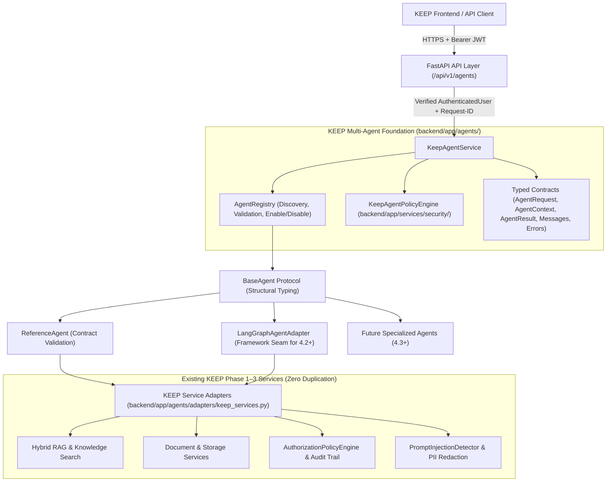

# KEEP Phase 4.1 — Multi-Agent Architecture Specification

**Version:** 1.0.0  
**Phase:** Phase 4.1 — Multi-Agent Architecture  
**Specification Source:** `devdocs/p4/p4.1.txt`  
**Owner:** Member 1 (Architecture & Agent Registry Lead)  
**Status:** ACCEPTED  

---

## 1. Executive Summary & Core Principle

Phase 4.1 establishes the foundational multi-agent architecture for KEEP's agentic intelligence layer (`Phase 4.1` – `Phase 4.18`).

> **Core Architectural Principle:** KEEP owns the agent architecture, agent identity, registry, contracts, tenant boundaries, authorization policies, and business rules. **LangGraph** is integrated strictly as an optional orchestration adapter behind KEEP's `BaseAgent` protocol — it never replaces KEEP's architecture or duplicates existing KEEP platform services.

### Scope Boundary ("Build in 4.1 vs Defer to 4.2+")

| Built in Phase 4.1 | Deferred to Later Phases |
| :--- | :--- |
| `BaseAgent` Python `Protocol` & structural typing | Persistent execution lifecycle & background runtime (`4.2`) |
| `AgentMetadata`, `AgentCapability`, & `AgentRegistry` | Multi-agent graph orchestration (`4.3`) |
| `AgentRequest`, `AgentContext`, `AgentResult`, `EvidenceReference` | Planning & reasoning engine (`4.4`) |
| Inter-agent communication envelopes (`AgentMessageEnvelope`) | Research agents & full tool-calling framework (`4.5` – `4.6`) |
| Trusted identity context, capability policies & guardrails | Long-term agent memory & collaboration (`4.7` – `4.8`) |
| KEEP service adapters, `LangGraphAgentAdapter` seam, `ReferenceAgent` | Autonomous & event-driven proactive workflows (`4.9` – `4.11`) |
| Minimal FastAPI `/api/v1/agents` discovery & contract-verification API | HITL approvals, evals, tracing, incidents & releases (`4.12` – `4.18`) |

---

## 2. Layered System Architecture



---

## 3. Module Boundaries & Repository Layout

Phase 4.1 adopts a **modular monolith** layout inside KEEP's existing Python/FastAPI backend without duplicating `services/` or `security/` packages:

```text
backend/app/
├── main.py                                  # Lifespan initializes app.state.agent_registry
├── api/v1/
│   ├── router.py                            # Mounts agents_router under /api/v1
│   └── agents.py                            # Discovery, inspection, admin status & reference invoke
├── agents/
│   ├── __init__.py                          # Public package exports
│   ├── base.py                              # @runtime_checkable BaseAgent Protocol
│   ├── metadata.py                          # AgentCapability, AgentMetadata, CapabilityAccess
│   ├── contracts.py                         # AgentRequest, AgentContext, AgentResult, EvidenceReference
│   ├── messages.py                          # AgentMessageEnvelope, AgentHandoffPayload (4.3+/4.8+ ready)
│   ├── errors.py                            # AgentErrorCode, AgentErrorDetail, typed exceptions
│   ├── registry.py                          # AgentRegistry (register, lookup, enable/disable, discover)
│   ├── reference_agent.py                   # ReferenceAgent proving end-to-end contract integration
│   ├── service.py                           # KeepAgentService (policy-gated invocation facade)
│   └── adapters/
│       ├── __init__.py
│       ├── keep_services.py                 # Tenant-scoped wrappers for existing KEEP services
│       └── langgraph_adapter.py             # LangGraphAgentAdapter seam implementing BaseAgent
└── services/
    ├── ai/interfaces.py                     # Adds AGENT_VIEW, AGENT_INVOKE, AGENT_MANAGE permissions
    └── security/
        ├── agent_permissions.py             # Trusted AgentContext builder & RBAC capability evaluator
        └── agent_policy.py                  # KeepAgentPolicyEngine (tenant, capability, prompt guardrails)
```

---

## 4. LangGraph Framework-Adapter Decision

KEEP decouples its agent layer from any specific orchestration framework through structural typing (`typing.Protocol`):

```text
KEEP BaseAgent Protocol
   ├── ReferenceAgent (pure Python async, zero framework coupling)
   ├── Future domain agents (Research, Planning, Governance)
   └── LangGraphAgentAdapter (wraps LangGraph CompiledGraph / Runnable behind BaseAgent)
```

- **Why:** Registry lookup, RBAC capability checks, tenant boundary enforcement, audit logging, and API contracts never import or depend on LangGraph internals.
- **Phase 4.2 Readiness:** Phase 4.2's `AgentRuntime` invokes any registered `BaseAgent` via `await agent.invoke(request, context)` without modifying Phase 4.1 contracts or registry APIs.

---

## 5. Security & Zero-Trust Boundaries

1. **Trusted Execution Context:** `AgentContext(user_id, tenant_id, roles, correlation_id)` is constructed exclusively from KEEP's verified JWT `AuthenticatedUser` dependency. Any client-supplied identity or tenant fields in request payloads are ignored or rejected on mismatch.
2. **Metadata Is Not Authorization:** `AgentMetadata.capabilities` declares what an agent *can* do; `KeepAgentPolicyEngine` independently verifies whether the authenticated principal is permitted to invoke `read`, `write`, or `sensitive` capabilities.
3. **Strict Tenant Isolation:** Every adapter call (`KeepKnowledgeAdapter`, `KeepDocumentAdapter`) receives `AgentContext` and scopes all lookups to `context.tenant_id`. Cross-tenant resource requests raise `AgentTenantIsolationError`.
4. **Prompt Injection & Untrusted Content Safeguards:** Incoming goals/inputs and untrusted retrieved excerpts are screened by `KeepAgentPolicyEngine` (wrapping KEEP Phase 3.3 security detectors) before invocation, and error outputs are sanitized to prevent secret/PII leakage.

---

## 6. Setup & Verification Guide

- **Unit Tests:** `pytest tests/unit/test_phase4_1_registry.py tests/unit/test_phase4_1_contracts.py tests/unit/test_phase4_1_security.py`
- **Integration & Regression Tests:** `pytest tests/integration/test_phase4_1_agent_integration.py`
- **API Endpoints (mounted under `/api/v1/agents`):**
  - `GET /api/v1/agents` — List discoverable agents (disabled agents hidden from non-admins).
  - `GET /api/v1/agents/{agent_id}` — Retrieve agent metadata & capability declarations.
  - `POST /api/v1/agents/{agent_id}/invoke` — Validate contracts & invoke a registered agent through trusted context and policy checks.
  - `PATCH /api/v1/agents/{agent_id}/status` — Admin-only enable/disable control.
