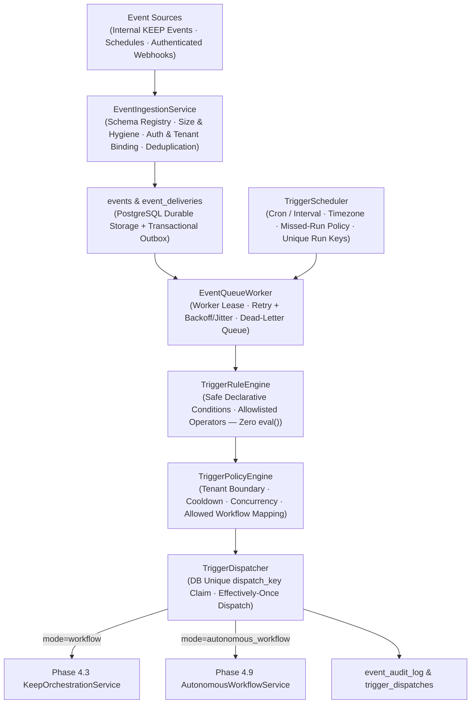

# Phase 4.10 — Event-Driven & Trigger-Based Agents Architecture

> **System:** KEEP — Knowledge Intelligence Platform  
> **Phase:** Phase 4.10 — Event-Driven & Trigger-Based Agents  
> **Owner:** Member 1 (Event Contracts & Ingestion Architecture)  
> **Status:** ACTIVE ARCHITECTURE  
> **Specification:** `devdocs/p4/p4.10.txt`

---

## 1. Overview & Purpose

Phases 4.1–4.9 enabled KEEP to plan, research, collaborate, and run bounded autonomous workflows when explicitly requested by a user. Phase 4.10 connects those capabilities to **events, declarative trigger rules, and persistent schedules**, allowing approved workflows to launch reliably when changes happen inside KEEP or via authenticated webhooks.

Core invariant: **An event never executes an arbitrary agent directly.** Every event is schema-validated under trusted tenant context, persisted durably, matched against enabled declarative rules, checked against cooldown/concurrency/authorization policies, claimed atomically via a unique `dispatch_key`, and dispatched cleanly through KEEP's Phase 4.3 `KeepOrchestrationService` or Phase 4.9 `AutonomousWorkflowService`.

---

## 2. Layered Pipeline

---

## 3. Four-Member Ownership Split

### Member 1 — Event Contracts & Ingestion (`backend/app/agents/events/`)
- Canonical event envelope `KeepEvent` (`event_id`, `event_type`, `schema_version`, `source`, `occurred_at`, `published_at`, `tenant_id`, `resource_id`, `correlation_id`, `payload`).
- `EventSchemaRegistry` validating known event types, versions, payload size bounds, and absence of leaked secrets/raw document blobs.
- `InternalEventPublisher`, `OutboxEventRelay`, `EventIngestionService`, and webhook HMAC/replay validation (`adapters/webhook.py`).

### Member 2 — Trigger Registry, Rule Engine & Persistence (`backend/app/agents/triggers/` & `backend/app/models/agent_triggers.py`)
- Declarative `TriggerRule` contracts, allowlisted condition evaluator (`conditions.py`, zero `eval()`), `TriggerRegistry`, `TriggerRuleEngine`.
- SQLAlchemy ORM models across 6 tables (`events`, `trigger_rules`, `event_deliveries`, `trigger_dispatches`, `trigger_schedules`, `event_audit_log`), Alembic migration `0e1f2a3b4c5d`, and `SqlAlchemyEventTriggerRepository`.

### Member 3 — Queue, Scheduling & Reliability (`backend/app/agents/workers/event_worker.py`, `triggers/scheduler.py`, `triggers/policies.py`)
- `TriggerPolicyEngine` enforcing RBAC, tenant isolation, cooldown windows, concurrency limits, and allowed event-to-workflow rules.
- `EventQueueWorker` implementing retryable vs permanent error classification, exponential backoff + jitter, worker leases, DLQ routing, restart recovery, and safe replay.
- `TriggerScheduler` managing cron/interval schedules, timezone evaluation, missed-run handling (`skip`/`coalesce`/`replay_latest`), and unique run keys.

### Member 4 — Dispatcher, REST APIs & QA (`triggers/dispatcher.py`, `triggers/service.py`, `api/v1/events.py`, `api/v1/triggers.py`)
- `TriggerDispatcher` claiming unique `(event_id, trigger_id, trigger_version)` dispatches and launching Phase 4.3 or Phase 4.9 workflows (including registered `document_enrichment`).
- FastAPI REST routes under `/api/v1/triggers*`, `/api/v1/events*`, and `/api/v1/webhooks/{source_id}` (plus `/api/*` aliases).
- Full 17-point Readiness QA suite and Recommended First Demo (`knowledge.document.indexed` → `document_enrichment` + duplicate replay prevention).
