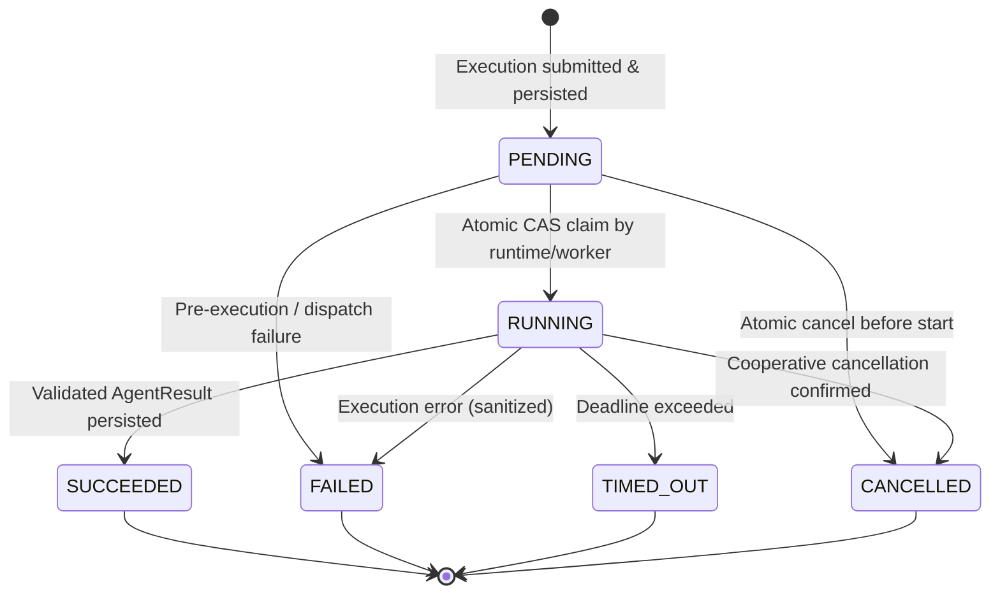

# KEEP Phase 4.2 — Agent Runtime & Execution Engine Architecture

**Version:** 1.0.0  
**Phase:** Phase 4.2 — Agent Runtime & Execution Engine  
**Specification Source:** `devdocs/p4/p4.2.txt`  
**Owner:** Member 1 (Runtime Architecture & Execution Lifecycle Lead)  
**Status:** ACCEPTED  

---

## 1. Executive Summary & Core Principle

Phase 4.2 builds directly on Phase 4.1's `BaseAgent` protocol, `AgentRegistry`, contracts, and security policies. It introduces KEEP's durable execution runtime so registered agents can be invoked reliably (synchronously or via background worker), tracked through an immutable lifecycle state machine, persisted across restarts, protected by safety limits, and inspected through REST APIs and the Agent Runtime UI.

> **Core Principle:** KEEP owns execution records, authentication, authorization, idempotency, safety policies, and API contracts. **LangGraph** manages internal graph node transitions and checkpoints behind `LangGraphAgentAdapter` — it never bypasses KEEP authorization or owns the public execution API.

### Scope Boundary ("Build in 4.2 vs Defer to 4.3+")

| Built in Phase 4.2 | Deferred to Later Phases |
| :--- | :--- |
| `AgentRuntime`, lifecycle state machine & immutable terminal states | Multi-agent graph orchestration (`4.3`) |
| Durable `agent_executions` & `agent_checkpoints` tables + Alembic migration | Planning & reasoning engine (`4.4`) |
| Scoped idempotency keys with SHA-256 request fingerprinting | Full research agent suite & tool-calling framework (`4.5` – `4.6`) |
| Timeouts, cooperative cancellation, concurrency limits & bounded retries | Long-term agent memory & multi-agent collaboration (`4.7` – `4.8`) |
| Durable background worker + stale-execution crash recovery | Autonomous & event-driven workflows (`4.9` – `4.11`) |
| LangGraph 2-step proof-of-concept adapter with tenant-scoped checkpointing | HITL approvals, evals, tracing, incidents & releases (`4.12` – `4.18`) |
| FastAPI `/api/v1/agents/{id}/executions` & `/api/v1/executions/*` + Runtime UI | Advanced multi-agent graph visualizer (`4.3` / `4.14`) |

---

## 2. Execution Lifecycle State Machine



- **Terminal State Immutability:** `SUCCEEDED`, `FAILED`, `TIMED_OUT`, and `CANCELLED` are strictly immutable for a given `execution_id`. Enforcement occurs both in Python (`assert_valid_transition`) and atomically in SQL (`WHERE status = :expected_status`).
- **Retry Semantics:** Retrying a terminal execution creates a **new** `agent_executions` row with `parent_execution_id` pointing to the prior attempt and `attempt_number = parent.attempt_number + 1`. Original outcomes are never overwritten.

---

## 3. Runtime Interface for Phase 4.3 Orchestration

Phase 4.3's `AgentOrchestrationEngine` consumes `AgentRuntimeInterface` (`backend/app/agents/runtime/interfaces.py`) without touching HTTP routes or database internals:

- `await runtime.submit(agent_id, request, context, *, mode="sync"|"async", idempotency_key=None, timeout_seconds=None) -> ExecutionRecord`
- `await runtime.get_execution(execution_id, context) -> ExecutionRecord`
- `await runtime.get_result(execution_id, context) -> AgentResult`
- `await runtime.cancel_execution(execution_id, context) -> ExecutionRecord`
- `await runtime.retry_execution(execution_id, context) -> ExecutionRecord`
- `await runtime.reconcile_stale_executions(stale_after_seconds=300) -> list[ExecutionRecord]`

---

## 4. KEEP Execution Records vs. LangGraph Checkpoints

| Concern | KEEP `agent_executions` | KEEP `agent_checkpoints` (LangGraph Seam) |
| :--- | :--- | :--- |
| **Purpose** | Business-level execution lifecycle, owner, tenant, outcome | Graph step state snapshot for resume/continuation |
| **Authorization** | Enforces KEEP JWT + RBAC + tenant concealment (404) | Never used as auth token; re-authorizes caller on resume |
| **API Exposure** | Exposed via `/api/v1/executions/*` | Internal to `LangGraphAgentAdapter` |

---

## 5. Module Layout

```text
backend/app/
├── models/agent_execution.py                # AgentExecution & AgentCheckpoint ORM models
├── migrations/versions/2c3d4e5f6a7b_*.py    # Phase 4.2 Alembic migration
├── agents/
│   ├── runtime/
│   │   ├── lifecycle.py                     # ExecutionStatus, transitions, ExecutionRecord DTO
│   │   ├── context.py                       # RuntimeExecutionContext & deadline tracking
│   │   ├── interfaces.py                    # Protocols (AgentRuntime, ExecutionRepository, Policy)
│   │   ├── cancellation.py                  # CancellationToken & CancellationRegistry
│   │   ├── limits.py                        # ExecutionLimitsConfig & ConcurrencyLimiter
│   │   ├── policies.py                      # RetryPolicy & KeepExecutionPolicy
│   │   └── executor.py                      # AgentRuntime core coordinator
│   ├── persistence/
│   │   ├── execution_repository.py          # SQLAlchemy + InMemory CAS repositories & idempotency
│   │   └── checkpoints.py                   # KeepCheckpointStore (tenant-scoped + re-auth)
│   ├── workers/
│   │   └── execution_worker.py              # DurableExecutionWorker + stale recovery
│   ├── observability/
│   │   └── telemetry.py                     # Structured lifecycle events & RuntimeMetricsCollector
│   └── adapters/
│       └── langgraph_adapter.py             # Checkpointed LangGraphAgentAdapter + 2-step demo graph
└── api/v1/agent_executions.py               # /api/v1/agents/{id}/executions & /api/v1/executions/*
```
