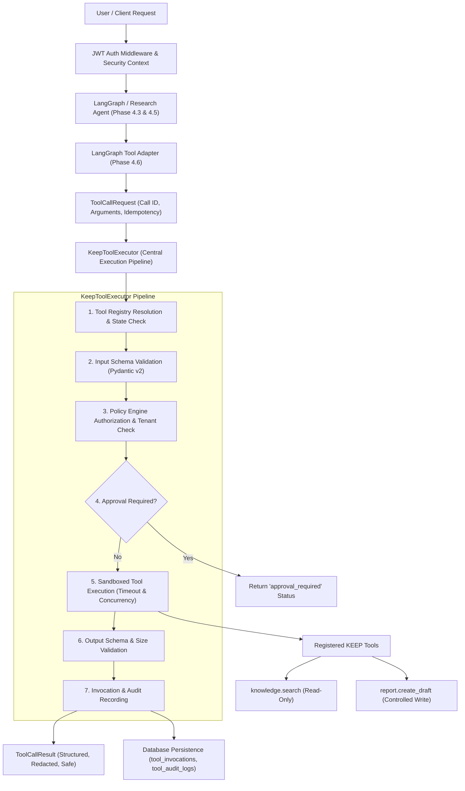

# Phase 4.6 — Tool-Calling Framework Architecture

## 1. Executive Summary

Phase 4.6 establishes a secure, enterprise-grade, reusable Tool-Calling Framework for the KEEP (Knowledge Intelligence Platform) agent ecosystem. In previous phases, individual agents or workflows either implemented specialized integrations or accessed platform capabilities directly. Phase 4.6 decouples tool invocation from agent implementations by introducing:
1. **Central Tool Registry**: Dynamic registration, schema validation, versioning, capability discovery, and lifecycle controls (enable/disable) for approved tools.
2. **Standardized Tool Contracts & Protocols**: Strictly typed `BaseTool`, `ToolMetadata`, `ToolCallRequest`, and `ToolCallResult` contracts with server-side trusted execution context (`ToolContext`).
3. **Multi-Stage Execution Pipeline**: Schema validation, policy-driven authorization (tenant isolation, RBAC, access tier checks), approval requirement gating, execution sandboxing with strict timeouts, bounded retries, concurrency limits, and output bounding.
4. **Comprehensive Audit Trail & Observability**: Complete persistence of invocation requests, outcomes, execution latencies, policy decisions, and security events with automatic secret redaction.
5. **LangGraph & Research Agent Integration**: Seamless integration with LangGraph and Phase 4.5 `KeepResearchAgent` through trusted adapters that enforce KEEP security policies.

---

## 2. System Architecture & Component Interactions

---

## 3. Core Architectural Principles

1. **Server-Side Trusted Context**: Model-generated arguments can NEVER override or dictate `tenant_id`, `user_id`, `roles`, `agent_execution_id`, or security clearance. The executing context is constructed exclusively from verified server-side JWT authentication and runtime session state.
2. **Zero Direct Execution**: LLMs and agent nodes have no direct access to Python `eval`, raw shell commands, database connections, or secret-bearing environment variables. All operations must route through registered, approved `BaseTool` implementations.
3. **Fail-Closed Security & Audit**: Any policy ambiguity, schema mismatch, prompt injection detection, or audit persistence failure triggers an immediate fail-closed rejection with sanitized error messaging.
4. **Idempotency & Retry Safety**: Only read-only or explicitly declared idempotent operations are eligible for bounded retries on transient errors. Write operations and state-altering tools are strictly non-retryable by default.
5. **Output Bounding & Secret Redaction**: Tool responses are strictly validated against output schemas, capped to prevent context window explosion or resource exhaustion (maximum payload sizes), and scrubbed of any embedded API keys, JWTs, or passwords before returning to agent state.
