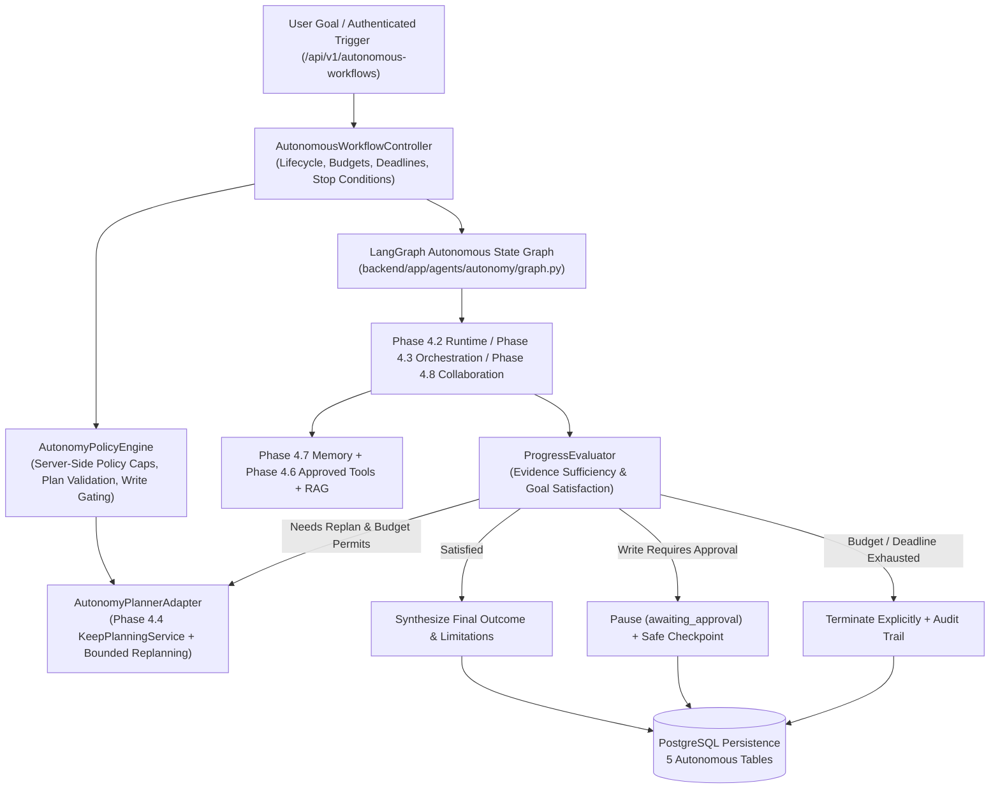

# Phase 4.9 — Autonomous Workflow Engine Architecture

> **System:** KEEP — Knowledge Intelligence Platform  
> **Phase:** Phase 4.9 — Autonomous Workflow Engine  
> **Owner:** Member 1 (Autonomous Controller & Lifecycle)  
> **Status:** ACTIVE ARCHITECTURE  
> **Specification:** `devdocs/p4/p4.9.txt`

---

## 1. Overview & Motivation

While Phase 4.3 (`KeepOrchestrationService`) executes predefined static workflow paths and Phase 4.4 (`KeepPlanningService`) creates validated plans, Phase 4.9 introduces **goal-driven adaptive execution** within strict enterprise bounds.

When an authenticated user triggers an autonomous workflow (for example, *"investigate a sudden rise in customer churn"*), KEEP's Autonomous Workflow Engine dynamically:
1. Parses and validates the objective under server-side zero-trust authorization.
2. Requests a bounded initial plan via the Phase 4.4 planning engine.
3. Validates the proposed plan against tenant RBAC permissions, server-side policy limits, allowed agents, and allowed tools (never letting a model-generated plan self-authorize).
4. Dispatches tasks through KEEP's Phase 4.2 AgentRuntime, Phase 4.3 Orchestration, Phase 4.6 Tool Executor, Phase 4.7 Memory, and Phase 4.8 Collaboration subsystems.
5. Evaluates intermediate evidence sufficiency and task outcomes after every step.
6. Performs bounded replanning when evidence is missing or recoverable failures occur, OR pauses cleanly for human approval before side-effecting writes (`awaiting_approval`), OR terminates explicitly with transparent limitations and reasons when complete or when budgets/deadlines are reached.

---

## 2. Layered Architecture

---

## 3. Core Components & 4-Member Ownership Split

### Member 1 — Autonomous Controller & Lifecycle
- **Canonical Module:** `backend/app/agents/autonomy/` (`contracts.py`, `state.py`, `controller.py`)
- **State Machine:** `pending` → `running` ↔ `awaiting_approval` → terminal states (`completed`, `failed`, `budget_exhausted`, `cancelled`).
- **Controller Guarantees:** Enforces step limits, replan caps, agent attempt limits, wall-clock deadlines, and supported workflow type verification at **every** state transition.

### Member 2 — Adaptive Planning, Evaluation & Persistence
- **Adapters & Services:** `planner_adapter.py` (`AutonomyPlannerAdapter`), `evaluator.py` (`ProgressEvaluator`), `repository.py` (`BaseAutonomyRepository`, `InMemoryAutonomyRepository`, `SqlAlchemyAutonomyRepository`).
- **Persistence:** SQLAlchemy ORM models (`backend/app/models/agent_autonomy.py`) and Alembic migration (`9d0e1f2a3b4c_phase_4_9_autonomous_workflow_engine.py`) across 5 tables: `autonomous_workflows`, `autonomous_workflow_steps`, `autonomy_decisions`, `autonomy_events`, and `autonomy_budgets`.

### Member 3 — Autonomy Policies & Safety
- **Policy Enforcement (`policy.py`):** `AutonomyPolicyEngine` clamps client-requested policies within strict server-side ceilings, validates planner-proposed steps before execution, integrates Phase 4.6 tool permissions, enforces `require_approval_for_writes`, prevents infinite cycles, and audits every policy decision and termination reason.
- **Graph & Service (`graph.py`, `service.py`):** LangGraph state machine isolating graph control flow behind KEEP-owned services.

### Member 4 — API, Integration & Full QA
- **REST API:** Mounted under `/api/v1/autonomous-workflows` (and `/api/autonomous-workflows` compatibility mount) in `backend/app/api/v1/autonomous_workflows.py`.
- **Integration & QA:** Proves all 12 Phase 4.9 Definition-of-Done criteria, Churn Investigation demonstration, multi-tenant isolation, permission revocation upon resume, durable restart survival, and full Phase 4.1–4.9 regression.

### Stage 5 — Frontend UI (`UI_MODE = YES`)
- **Route:** `/agents/autonomy` (`Autonomous Workflows`, badge `Phase 4.9`).
- **Features:** Goal submission with bounded policy configuration, real-time step & budget inspector, decision/event audit timeline, explicit approval/resume controls, and safe cancellation.

---

## 4. Security & Zero-Trust Boundaries

1. **Identity Authority:** `tenant_id`, `user_id`, and `roles` are always extracted from verified JWT tokens via `AuthenticatedUser` — never trusted from client request bodies or LLM state checkpoints.
2. **Plan Non-Authority:** Planner outputs are treated strictly as untrusted proposals until validated by `AutonomyPolicyEngine` against live `AgentRegistry`, `ToolRegistry`, and RBAC rules.
3. **Checkpoint Hygiene:** LangGraph state snapshots (`sanitize_autonomy_state`) strip credentials, bearer tokens, JWTs, and raw secrets prior to persistence.
4. **Safe Resume & Side-Effect Idempotency:** Resuming an `awaiting_approval` workflow re-verifies the caller's live permissions and skips already succeeded steps so non-idempotent side effects are never replayed.
