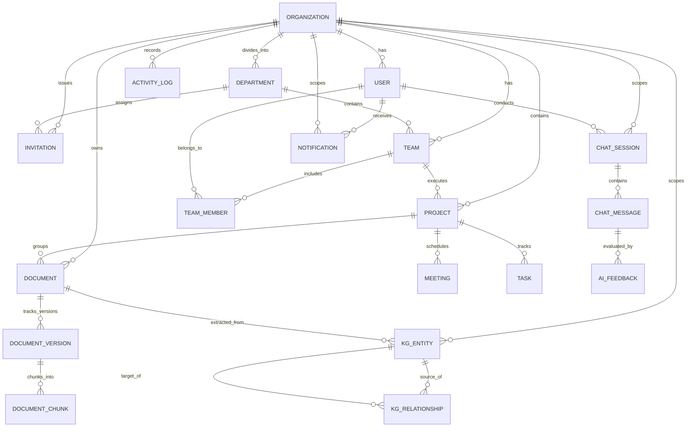

# Database Schema Specification (docs/database/database-schema.md)

> **Official Engineering Database & Persistence Layer Specification for KEEP**  
> *Approved by: Member 1 (Project Lead & AI Architect)*  
> *Target Implementer: Member 2 (Backend Lead) | Consumer: Member 3 (Frontend Lead) | Ops: Member 4 (DevOps Lead)*  
> *Derived from: devdocs/p1/p1.3.txt (Chapters 1–22)*

---

## 1. Relational Database Overview & Technology Stack

KEEP uses **PostgreSQL 16** enhanced with the **pgvector** extension as its unified multi-tenant relational persistence and vector similarity store. All application models are defined using **SQLAlchemy 2.0 ORM** (fully typed, async-first via `asyncpg`), and schema migrations are tracked and applied via **Alembic**.

### 1.1 Technology Matrix
| Layer / Component | Technology | Version | Purpose |
| :--- | :--- | :--- | :--- |
| **Relational Database** | PostgreSQL | 16 Alpine | Primary multi-tenant relational data store |
| **Vector Search Extension** | pgvector | 0.7+ | 1536-dim / 384-dim dense embedding index (HNSW / IVFFlat) |
| **ORM & Query Builder** | SQLAlchemy | 2.0+ (Async) | Typed models, session lifecycle, Unit of Work |
| **Database Driver** | asyncpg / psycopg2 | latest | High-performance asynchronous PostgreSQL driver |
| **Schema Migrations** | Alembic | latest | Version-controlled, reproducible schema revisions |
| **Data Validation** | Pydantic v2 | 2.8+ | Ingestion DTO validation & serialization |

---

## 2. Global Model Mixins & Standards

All database tables in KEEP conform to strict enterprise standards:
1. **UUID Primary Keys**: Every table uses a RFC 4122 compliant UUID primary key generated via `uuid.uuid4()` / `gen_random_uuid()`.
2. **Audit Timestamps (`TimestampMixin`)**: Every record tracks `created_at` (UTC timestamp) and `updated_at` (UTC timestamp automatically updated on change).
3. **Soft Deletion (`SoftDeleteMixin`)**: Critical entities implement `is_deleted` (boolean, default `FALSE`) and `deleted_at` (timestamp, default `NULL`).
4. **Tenant Segregation (`TenantMixin`)**: All tenant-scoped tables enforce a foreign key `organization_id` referencing `organizations(id)` with `ON DELETE CASCADE`.

---

## 3. Entity Schemas & Tables

### 3.1 `organizations` Table
Root container for enterprise multi-tenancy.

| Column | Type | Constraints | Description |
| :--- | :--- | :--- | :--- |
| `id` | `UUID` | Primary Key, Default `gen_random_uuid()` | Unique organization identifier |
| `name` | `VARCHAR(255)` | NOT NULL | Enterprise display name |
| `domain` | `VARCHAR(255)` | NOT NULL, Unique | Organization primary domain (e.g. `enterprise.com`) |
| `subscription_tier` | `VARCHAR(50)` | NOT NULL, Default `'Enterprise'` | Billing / SLA tier (`Free`, `Pro`, `Enterprise`) |
| `max_users` | `INT` | NOT NULL, Default `1000` | User seat quota |
| `max_storage_bytes` | `BIGINT` | NOT NULL, Default `107374182400` | Storage quota (default 100 GB) |
| `ai_monthly_token_quota` | `BIGINT` | NOT NULL, Default `10000000` | Monthly LLM token quota |
| `is_active` | `BOOLEAN` | NOT NULL, Default `TRUE` | Tenant operational status |
| `is_deleted` | `BOOLEAN` | NOT NULL, Default `FALSE` | Soft delete flag |
| `deleted_at` | `TIMESTAMP WITH TIME ZONE` | NULL | Soft delete timestamp |
| `created_at` | `TIMESTAMP WITH TIME ZONE` | NOT NULL, Default `NOW()` | Registration timestamp |
| `updated_at` | `TIMESTAMP WITH TIME ZONE` | NOT NULL, Default `NOW()` | Last modification timestamp |

---

### 3.2 `users` Table
Stores enterprise user credentials, profile information, and role assignments.

| Column | Type | Constraints | Description |
| :--- | :--- | :--- | :--- |
| `id` | `UUID` | Primary Key, Default `gen_random_uuid()` | Unique user identifier |
| `organization_id` | `UUID` | NOT NULL, FK -> `organizations.id` | Tenant boundary foreign key |
| `email` | `VARCHAR(255)` | NOT NULL | User login email |
| `hashed_password` | `VARCHAR(255)` | NOT NULL | Bcrypt / Argon2 hashed password |
| `full_name` | `VARCHAR(255)` | NOT NULL | User full legal/display name |
| `role` | `VARCHAR(50)` | NOT NULL, Default `'Member'` | RBAC role (`SuperAdmin`, `OrgAdmin`, `Manager`, `Member`, `Guest`) |
| `avatar_url` | `VARCHAR(512)` | NULL | Optional profile avatar image URL |
| `is_active` | `BOOLEAN` | NOT NULL, Default `TRUE` | User account active status |
| `is_verified` | `BOOLEAN` | NOT NULL, Default `FALSE` | Email verification flag |
| `is_deleted` | `BOOLEAN` | NOT NULL, Default `FALSE` | Soft delete flag |
| `deleted_at` | `TIMESTAMP WITH TIME ZONE` | NULL | Soft delete timestamp |
| `created_at` | `TIMESTAMP WITH TIME ZONE` | NOT NULL, Default `NOW()` | Registration timestamp |
| `updated_at` | `TIMESTAMP WITH TIME ZONE` | NOT NULL, Default `NOW()` | Last modification timestamp |

**Table Constraints**:
- `CONSTRAINT uq_users_org_email UNIQUE (organization_id, email)`

---

### 3.3 `departments` Table (Phase 1.5 Hierarchy)
Functional business units grouping teams, projects, and organizational domains.

| Column | Type | Constraints | Description |
| :--- | :--- | :--- | :--- |
| `id` | `UUID` | Primary Key, Default `gen_random_uuid()` | Unique department identifier |
| `organization_id` | `UUID` | NOT NULL, FK -> `organizations.id` ON DELETE CASCADE | Tenant boundary foreign key |
| `name` | `VARCHAR(255)` | NOT NULL | Department name (e.g. `Engineering`, `Human Resources`) |
| `description` | `TEXT` | NULL | Department mission charter |
| `manager_id` | `UUID` | NULL, FK -> `users.id` | Department head / manager |
| `is_deleted` | `BOOLEAN` | NOT NULL, Default `FALSE` | Soft delete flag |
| `deleted_at` | `TIMESTAMP WITH TIME ZONE` | NULL | Soft delete timestamp |
| `created_at` | `TIMESTAMP WITH TIME ZONE` | NOT NULL, Default `NOW()` | Creation timestamp |
| `updated_at` | `TIMESTAMP WITH TIME ZONE` | NOT NULL, Default `NOW()` | Last modification timestamp |

**Table Constraints**:
- `CONSTRAINT uq_departments_org_name UNIQUE (organization_id, name)`

---

### 3.4 `invitations` Table (Phase 1.5 User Onboarding)
Tracks pending, accepted, and revoked enterprise member invitations.

| Column | Type | Constraints | Description |
| :--- | :--- | :--- | :--- |
| `id` | `UUID` | Primary Key, Default `gen_random_uuid()` | Unique invitation identifier |
| `organization_id` | `UUID` | NOT NULL, FK -> `organizations.id` ON DELETE CASCADE | Tenant boundary foreign key |
| `department_id` | `UUID` | NULL, FK -> `departments.id` ON DELETE SET NULL | Pre-assigned department |
| `team_id` | `UUID` | NULL, FK -> `teams.id` ON DELETE SET NULL | Pre-assigned team |
| `email` | `VARCHAR(255)` | NOT NULL | Invitee destination email |
| `role` | `VARCHAR(50)` | NOT NULL, Default `'Member'` | Pre-assigned role (`OrgAdmin`, `ProjectManager`, `Member`, `Viewer`) |
| `token` | `VARCHAR(255)` | NOT NULL, Unique | Secure one-time onboarding token |
| `status` | `VARCHAR(50)` | NOT NULL, Default `'PENDING'` | Invitation status (`PENDING`, `ACCEPTED`, `REVOKED`, `EXPIRED`) |
| `invited_by_id` | `UUID` | NOT NULL, FK -> `users.id` | Inviting admin or manager |
| `expires_at` | `TIMESTAMP WITH TIME ZONE` | NOT NULL | Token expiration timestamp (default 7 days) |
| `created_at` | `TIMESTAMP WITH TIME ZONE` | NOT NULL, Default `NOW()` | Invitation dispatch timestamp |
| `updated_at` | `TIMESTAMP WITH TIME ZONE` | NOT NULL, Default `NOW()` | Last status update |

**Table Constraints**:
- `CONSTRAINT uq_invitations_org_email_pending UNIQUE (organization_id, email, status)`

---

### 3.5 `teams` & `team_members` Tables
Models departmental divisions and collaborative workspaces.

#### `teams` Table:
| Column | Type | Constraints | Description |
| :--- | :--- | :--- | :--- |
| `id` | `UUID` | Primary Key, Default `gen_random_uuid()` | Unique team identifier |
| `organization_id` | `UUID` | NOT NULL, FK -> `organizations.id` | Tenant boundary foreign key |
| `department_id` | `UUID` | NULL, FK -> `departments.id` ON DELETE SET NULL | Parent department (Phase 1.5 hierarchy) |
| `name` | `VARCHAR(255)` | NOT NULL | Department / Team name (e.g. `Backend Team`) |
| `description` | `TEXT` | NULL | Team charter or description |
| `lead_user_id` | `UUID` | NULL, FK -> `users.id` | Assigned team lead |
| `is_deleted` | `BOOLEAN` | NOT NULL, Default `FALSE` | Soft delete flag |
| `deleted_at` | `TIMESTAMP WITH TIME ZONE` | NULL | Soft delete timestamp |
| `created_at` | `TIMESTAMP WITH TIME ZONE` | NOT NULL, Default `NOW()` | Creation timestamp |
| `updated_at` | `TIMESTAMP WITH TIME ZONE` | NOT NULL, Default `NOW()` | Last modification timestamp |

**Table Constraints**:
- `CONSTRAINT uq_teams_org_name UNIQUE (organization_id, name)`

#### `team_members` Table:
| Column | Type | Constraints | Description |
| :--- | :--- | :--- | :--- |
| `team_id` | `UUID` | NOT NULL, FK -> `teams.id` ON DELETE CASCADE | Parent team |
| `user_id` | `UUID` | NOT NULL, FK -> `users.id` ON DELETE CASCADE | Member user |
| `role_in_team` | `VARCHAR(50)` | NOT NULL, Default `'Member'` | Team-level role (`Lead`, `Member`, `Observer`) |
| `created_at` | `TIMESTAMP WITH TIME ZONE` | NOT NULL, Default `NOW()` | Join timestamp |

**Table Constraints**:
- `PRIMARY KEY (team_id, user_id)`

---

### 3.4 `projects` Table
Enterprise initiatives, workspaces, and knowledge groupings.

| Column | Type | Constraints | Description |
| :--- | :--- | :--- | :--- |
| `id` | `UUID` | Primary Key, Default `gen_random_uuid()` | Unique project identifier |
| `organization_id` | `UUID` | NOT NULL, FK -> `organizations.id` | Tenant boundary foreign key |
| `team_id` | `UUID` | NULL, FK -> `teams.id` | Associated team |
| `owner_id` | `UUID` | NOT NULL, FK -> `users.id` | Project creator / owner |
| `name` | `VARCHAR(255)` | NOT NULL | Project name |
| `description` | `TEXT` | NULL | Project scope and details |
| `status` | `VARCHAR(50)` | NOT NULL, Default `'ACTIVE'` | Status (`ACTIVE`, `ARCHIVED`, `COMPLETED`) |
| `priority` | `VARCHAR(50)` | NOT NULL, Default `'MEDIUM'` | Priority (`LOW`, `MEDIUM`, `HIGH`, `CRITICAL`) |
| `is_deleted` | `BOOLEAN` | NOT NULL, Default `FALSE` | Soft delete flag |
| `deleted_at` | `TIMESTAMP WITH TIME ZONE` | NULL | Soft delete timestamp |
| `created_at` | `TIMESTAMP WITH TIME ZONE` | NOT NULL, Default `NOW()` | Creation timestamp |
| `updated_at` | `TIMESTAMP WITH TIME ZONE` | NOT NULL, Default `NOW()` | Last modification timestamp |

---

### 3.5 `documents` Table
Represents logical digital knowledge assets, metadata headers, and container references for document version lineage.

| Column | Type | Constraints | Description |
| :--- | :--- | :--- | :--- |
| `id` | `UUID` | Primary Key, Default `gen_random_uuid()` | Unique document identifier |
| `organization_id` | `UUID` | NOT NULL, FK -> `organizations.id` ON DELETE CASCADE | Tenant boundary foreign key |
| `uploader_id` | `UUID` | NOT NULL, FK -> `users.id` | User who uploaded the file |
| `project_id` | `UUID` | NULL, FK -> `projects.id` ON DELETE SET NULL | Associated project container |
| `current_version_id`| `UUID` | NULL, FK -> `document_versions.id` ON DELETE SET NULL | Pointer to active document version snapshot |
| `current_version_number`| `INT` | NOT NULL, Default `1` | Latest sequential version number |
| `filename` | `VARCHAR(255)` | NOT NULL | Sanitized storage filename |
| `original_filename`| `VARCHAR(255)` | NOT NULL | Original user filename at upload |
| `title` | `VARCHAR(255)` | NULL | User-specified display title |
| `description` | `TEXT` | NULL | Document description / abstract |
| `file_path` | `TEXT` | NOT NULL | Storage path (`storage/{org_id}/documents/{doc_id}/v{ver}/{filename}`) |
| `file_type` | `VARCHAR(50)` | NOT NULL | Normalized extension (`pdf`, `docx`, `txt`, `png`) |
| `mime_type` | `VARCHAR(100)` | NOT NULL | Canonical MIME type (e.g. `application/pdf`) |
| `file_size` | `BIGINT` | NOT NULL | File size in bytes |
| `checksum_sha256` | `VARCHAR(64)` | NOT NULL | SHA-256 cryptographic digest for integrity & deduplication |
| `category` | `VARCHAR(50)` | NOT NULL, Default `'REPORTS'` | Category (`POLICIES`, `REPORTS`, `MEETING_MINUTES`, `RESEARCH`, `LEGAL`, `FINANCE`, `HR`, `TECHNICAL_DOCUMENTATION`, `PRESENTATIONS`, `TRAINING_MATERIALS`) |
| `tags` | `JSONB` | NOT NULL, Default `'[]'::jsonb` | Categorization tags array |
| `status` | `VARCHAR(50)` | NOT NULL, Default `'AWAITING_PROCESSING'` | State (`PENDING`, `VALIDATED`, `AWAITING_PROCESSING`, `QUEUED`, `EXTRACTING`, `CHUNKING`, `EMBEDDING`, `READY_FOR_AI`, `FAILED`, `ARCHIVED`) |
| `chunk_count` | `INT` | NOT NULL, Default `0` | Number of generated chunks in pgvector |
| `error_message` | `TEXT` | NULL | Parsing or vectorization failure details |
| `metadata_json` | `JSONB` | NOT NULL, Default `'{}'::jsonb` | Extracted attributes (page_count, author, word_count, language, ocr_applied) |
| `is_deleted` | `BOOLEAN` | NOT NULL, Default `FALSE` | Soft delete flag |
| `deleted_at` | `TIMESTAMP WITH TIME ZONE` | NULL | Soft delete timestamp |
| `created_at` | `TIMESTAMP WITH TIME ZONE` | NOT NULL, Default `NOW()` | Upload timestamp |
| `updated_at` | `TIMESTAMP WITH TIME ZONE` | NOT NULL, Default `NOW()` | Last modification timestamp |

---

### 3.5.1 `document_versions` Table (Phase 1.8 Versioning & Lineage)
Stores immutable physical file revisions, author attributions, change notes, and version snapshots for audit and rollback.

| Column | Type | Constraints | Description |
| :--- | :--- | :--- | :--- |
| `id` | `UUID` | Primary Key, Default `gen_random_uuid()` | Unique version snapshot identifier |
| `document_id` | `UUID` | NOT NULL, FK -> `documents.id` ON DELETE CASCADE | Parent document reference |
| `version_number` | `INT` | NOT NULL | Sequential version index ($1, 2, 3, \dots$) |
| `file_path` | `TEXT` | NOT NULL | Physical storage path on disk or cloud bucket |
| `file_size` | `BIGINT` | NOT NULL | Revision file size in bytes |
| `checksum_sha256` | `VARCHAR(64)` | NOT NULL | SHA-256 digest of this version's binary stream |
| `mime_type` | `VARCHAR(100)` | NOT NULL | MIME type of this version's content |
| `uploader_id` | `UUID` | NOT NULL, FK -> `users.id` | User who authored or uploaded this revision |
| `change_notes` | `TEXT` | NULL | User-provided summary of modifications |
| `metadata_json` | `JSONB` | NOT NULL, Default `'{}'::jsonb` | Version-specific extraction metadata |
| `created_at` | `TIMESTAMP WITH TIME ZONE` | NOT NULL, Default `NOW()` | Revision creation timestamp |

**Table Constraints**:
- `CONSTRAINT uq_doc_versions_doc_num UNIQUE (document_id, version_number)`

---

### 3.6 `document_chunks` Table (Vector Persistence Layer)
Stores text chunks, vector embeddings, and chunk metadata for Hybrid RAG.

| Column | Type | Constraints | Description |
| :--- | :--- | :--- | :--- |
| `id` | `UUID` | Primary Key, Default `gen_random_uuid()` | Unique chunk identifier |
| `organization_id` | `UUID` | NOT NULL, FK -> `organizations.id` ON DELETE CASCADE | Multi-tenant boundary |
| `document_id` | `UUID` | NOT NULL, FK -> `documents.id` ON DELETE CASCADE | Parent document reference |
| `document_version_id`| `UUID`| NULL, FK -> `document_versions.id` ON DELETE CASCADE | Provenanced version snapshot reference (Phase 1.8) |
| `chunk_index` | `INT` | NOT NULL | Sequential chunk index within document |
| `content` | `TEXT` | NOT NULL | Raw chunk text content |
| `token_count` | `INT` | NOT NULL, Default `0` | Estimated token count |
| `page_number` | `INT` | NULL | Provenanced page number in source document |
| `section_title` | `VARCHAR(255)` | NULL | Heading / Section title |
| `embedding` | `vector(1536)` | NULL | Vector embedding (OpenAI / HuggingFace) |
| `metadata_json` | `JSONB` | NOT NULL, Default `'{}'::jsonb` | Additional chunk metadata (e.g. bounding boxes) |
| `tsv_content` | `tsvector` | GENERATED STORED | Full-text search vector for lexical BM25 matching |
| `created_at` | `TIMESTAMP WITH TIME ZONE` | NOT NULL, Default `NOW()` | Creation timestamp |
| `updated_at` | `TIMESTAMP WITH TIME ZONE` | NOT NULL, Default `NOW()` | Last modification timestamp |

**Table Constraints**:
- `CONSTRAINT uq_chunks_doc_idx UNIQUE (document_id, chunk_index)`

---

### 3.7 `kg_entities` & `kg_relationships` Tables (Knowledge Graph MVP)
Models interconnected enterprise semantic entities and relations in PostgreSQL.

#### `kg_entities` Table:
| Column | Type | Constraints | Description |
| :--- | :--- | :--- | :--- |
| `id` | `UUID` | Primary Key, Default `gen_random_uuid()` | Unique entity identifier |
| `organization_id` | `UUID` | NOT NULL, FK -> `organizations.id` ON DELETE CASCADE | Tenant boundary |
| `name` | `VARCHAR(255)` | NOT NULL | Normalized entity name |
| `entity_type` | `VARCHAR(100)` | NOT NULL | Entity type (`Person`, `Project`, `Technology`, `Department`, `Document`) |
| `description` | `TEXT` | NULL | Semantic description |
| `source_document_id`| `UUID` | NULL, FK -> `documents.id` ON DELETE SET NULL | Origin document if extracted by AI |
| `properties` | `JSONB` | NOT NULL, Default `'{}'::jsonb` | Arbitrary key-value properties |
| `created_at` | `TIMESTAMP WITH TIME ZONE` | NOT NULL, Default `NOW()` | Creation timestamp |
| `updated_at` | `TIMESTAMP WITH TIME ZONE` | NOT NULL, Default `NOW()` | Last modification timestamp |

**Table Constraints**:
- `CONSTRAINT uq_kg_entity_org_name_type UNIQUE (organization_id, name, entity_type)`

#### `kg_relationships` Table:
| Column | Type | Constraints | Description |
| :--- | :--- | :--- | :--- |
| `id` | `UUID` | Primary Key, Default `gen_random_uuid()` | Unique relationship edge identifier |
| `organization_id` | `UUID` | NOT NULL, FK -> `organizations.id` ON DELETE CASCADE | Tenant boundary |
| `source_entity_id` | `UUID` | NOT NULL, FK -> `kg_entities.id` ON DELETE CASCADE | Origin entity |
| `target_entity_id` | `UUID` | NOT NULL, FK -> `kg_entities.id` ON DELETE CASCADE | Target entity |
| `relation_type` | `VARCHAR(100)` | NOT NULL | Directed relation (`AUTHOR_OF`, `ASSIGNED_TO`, `DEPENDS_ON`, `BELONGS_TO`) |
| `weight` | `FLOAT` | NOT NULL, Default `1.0` | Edge strength / frequency |
| `confidence_score`| `FLOAT` | NOT NULL, Default `1.0` | AI extraction confidence (0.0 to 1.0) |
| `source_document_id`| `UUID` | NULL, FK -> `documents.id` ON DELETE SET NULL | Origin document |
| `properties` | `JSONB` | NOT NULL, Default `'{}'::jsonb` | Edge metadata |
| `created_at` | `TIMESTAMP WITH TIME ZONE` | NOT NULL, Default `NOW()` | Creation timestamp |
| `updated_at` | `TIMESTAMP WITH TIME ZONE` | NOT NULL, Default `NOW()` | Last modification timestamp |

---

### 3.8 `meetings` & `tasks` Tables

#### `meetings` Table:
| Column | Type | Constraints | Description |
| :--- | :--- | :--- | :--- |
| `id` | `UUID` | Primary Key, Default `gen_random_uuid()` | Unique meeting identifier |
| `organization_id` | `UUID` | NOT NULL, FK -> `organizations.id` | Tenant boundary |
| `project_id` | `UUID` | NULL, FK -> `projects.id` | Related project |
| `organizer_id` | `UUID` | NOT NULL, FK -> `users.id` | Meeting organizer |
| `title` | `VARCHAR(255)` | NOT NULL | Meeting title |
| `scheduled_start` | `TIMESTAMP WITH TIME ZONE` | NOT NULL | Start time |
| `scheduled_end` | `TIMESTAMP WITH TIME ZONE` | NOT NULL | End time |
| `recording_url` | `VARCHAR(512)` | NULL | Optional recording link |
| `transcript_text`| `TEXT` | NULL | Raw or processed transcript text |
| `summary_text` | `TEXT` | NULL | AI-generated summary |
| `is_deleted` | `BOOLEAN` | NOT NULL, Default `FALSE` | Soft delete flag |
| `deleted_at` | `TIMESTAMP WITH TIME ZONE` | NULL | Soft delete timestamp |
| `created_at` | `TIMESTAMP WITH TIME ZONE` | NOT NULL, Default `NOW()` | Creation timestamp |
| `updated_at` | `TIMESTAMP WITH TIME ZONE` | NOT NULL, Default `NOW()` | Last modification timestamp |

#### `tasks` Table:
| Column | Type | Constraints | Description |
| :--- | :--- | :--- | :--- |
| `id` | `UUID` | Primary Key, Default `gen_random_uuid()` | Unique task identifier |
| `organization_id` | `UUID` | NOT NULL, FK -> `organizations.id` | Tenant boundary |
| `project_id` | `UUID` | NULL, FK -> `projects.id` | Related project |
| `creator_id` | `UUID` | NOT NULL, FK -> `users.id` | Task creator |
| `assignee_id` | `UUID` | NULL, FK -> `users.id` | Assigned user |
| `title` | `VARCHAR(255)` | NOT NULL | Task title |
| `description` | `TEXT` | NULL | Task details |
| `priority` | `VARCHAR(50)` | NOT NULL, Default `'MEDIUM'` | Priority (`LOW`, `MEDIUM`, `HIGH`, `CRITICAL`) |
| `status` | `VARCHAR(50)` | NOT NULL, Default `'TODO'` | Status (`TODO`, `IN_PROGRESS`, `DONE`, `CANCELLED`) |
| `due_date` | `TIMESTAMP WITH TIME ZONE` | NULL | Due date |
| `is_deleted` | `BOOLEAN` | NOT NULL, Default `FALSE` | Soft delete flag |
| `deleted_at` | `TIMESTAMP WITH TIME ZONE` | NULL | Soft delete timestamp |
| `created_at` | `TIMESTAMP WITH TIME ZONE` | NOT NULL, Default `NOW()` | Creation timestamp |
| `updated_at` | `TIMESTAMP WITH TIME ZONE` | NOT NULL, Default `NOW()` | Last modification timestamp |

---

### 3.9 `chat_sessions`, `chat_messages` & `ai_feedback` Tables

#### `chat_sessions` Table:
| Column | Type | Constraints | Description |
| :--- | :--- | :--- | :--- |
| `id` | `UUID` | Primary Key, Default `gen_random_uuid()` | Unique conversation session ID |
| `organization_id` | `UUID` | NOT NULL, FK -> `organizations.id` | Tenant boundary |
| `user_id` | `UUID` | NOT NULL, FK -> `users.id` | User owner |
| `project_id` | `UUID` | NULL, FK -> `projects.id` | Optional project context filter |
| `title` | `VARCHAR(255)` | NOT NULL, Default `'New Conversation'` | Session topic |
| `is_archived` | `BOOLEAN` | NOT NULL, Default `FALSE` | Archived state |
| `is_deleted` | `BOOLEAN` | NOT NULL, Default `FALSE` | Soft delete flag |
| `deleted_at` | `TIMESTAMP WITH TIME ZONE` | NULL | Soft delete timestamp |
| `created_at` | `TIMESTAMP WITH TIME ZONE` | NOT NULL, Default `NOW()` | Creation timestamp |
| `updated_at` | `TIMESTAMP WITH TIME ZONE` | NOT NULL, Default `NOW()` | Last modification timestamp |

#### `chat_messages` Table:
| Column | Type | Constraints | Description |
| :--- | :--- | :--- | :--- |
| `id` | `UUID` | Primary Key, Default `gen_random_uuid()` | Unique message ID |
| `session_id` | `UUID` | NOT NULL, FK -> `chat_sessions.id` ON DELETE CASCADE | Parent conversation session |
| `role` | `VARCHAR(50)` | NOT NULL | Message role (`user`, `assistant`, `system`, `tool`) |
| `content` | `TEXT` | NOT NULL | Message text |
| `model_name` | `VARCHAR(100)` | NULL | AI model used (e.g. `gpt-4o`) |
| `tokens_prompt` | `INT` | NOT NULL, Default `0` | Prompt token count |
| `tokens_completion`| `INT` | NOT NULL, Default `0` | Completion token count |
| `latency_ms` | `FLOAT` | NOT NULL, Default `0.0` | Response generation latency |
| `citations_json` | `JSONB` | NOT NULL, Default `'[]'::jsonb` | Provenanced citations array |
| `tool_calls_json` | `JSONB` | NOT NULL, Default `'[]'::jsonb` | Tool invocations & arguments |
| `created_at` | `TIMESTAMP WITH TIME ZONE` | NOT NULL, Default `NOW()` | Timestamp |

#### `ai_feedback` Table:
| Column | Type | Constraints | Description |
| :--- | :--- | :--- | :--- |
| `id` | `UUID` | Primary Key, Default `gen_random_uuid()` | Feedback ID |
| `organization_id` | `UUID` | NOT NULL, FK -> `organizations.id` | Tenant boundary |
| `user_id` | `UUID` | NOT NULL, FK -> `users.id` | Feedback author |
| `message_id` | `UUID` | NOT NULL, FK -> `chat_messages.id` ON DELETE CASCADE | Evaluated AI message |
| `rating` | `INT` | NOT NULL | Rating (`1` for positive, `-1` for negative) |
| `comment` | `TEXT` | NULL | Optional text explanation |
| `created_at` | `TIMESTAMP WITH TIME ZONE` | NOT NULL, Default `NOW()` | Timestamp |

---

### 3.10 `activity_logs` Table (Audit Trail)
Immutable security and audit event logging. Captures authentication, workspace operations, and all Phase 1.6 authorization verdicts (`PERMISSION_GRANTED` and `PERMISSION_DENIED`).

| Column | Type | Constraints | Description |
| :--- | :--- | :--- | :--- |
| `id` | `UUID` | Primary Key, Default `gen_random_uuid()` | Unique audit event identifier |
| `organization_id` | `UUID` | NOT NULL, FK -> `organizations.id` | Tenant boundary |
| `user_id` | `UUID` | NULL, FK -> `users.id` | Actor user ID (NULL for system events) |
| `action` | `VARCHAR(100)` | NOT NULL | Action name (e.g. `USER_LOGIN`, `PERMISSION_GRANTED`, `PERMISSION_DENIED`, `DOCUMENT_UPLOAD`, `AI_QUERY`) |
| `resource_type` | `VARCHAR(100)` | NOT NULL | Target entity type (`document`, `project`, `meeting`, `organization`, `chat_session`, `user`) |
| `resource_id` | `VARCHAR(255)` | NULL | Target entity UUID string |
| `ip_address` | `VARCHAR(45)` | NULL | Client IP address |
| `user_agent` | `VARCHAR(512)` | NULL | Client user agent string |
| `metadata_json` | `JSONB` | NOT NULL, Default `'{}'::jsonb` | Detailed event payload (e.g. `{"required_permission": "document.delete", "decision": "ALLOW", "error_code": null, "reason": "owner_override"}`) |
| `created_at` | `TIMESTAMP WITH TIME ZONE` | NOT NULL, Default `NOW()` | Event timestamp |

---

### 3.11 `notifications` Table (Phase 1.7 Dashboard & User Experience)
Stores user-directed notifications with status tracking, categorization, action links, and soft-delete capabilities.

| Column | Type | Constraints | Description |
| :--- | :--- | :--- | :--- |
| `id` | `UUID` | Primary Key, Default `gen_random_uuid()` | Unique notification identifier |
| `organization_id` | `UUID` | NOT NULL, FK -> `organizations.id` ON DELETE CASCADE | Tenant boundary foreign key |
| `user_id` | `UUID` | NOT NULL, FK -> `users.id` ON DELETE CASCADE | Recipient user identifier |
| `type` | `VARCHAR(50)` | NOT NULL, Default `'info'` | Category (`info`, `warning`, `success`, `error`, `reminder`) |
| `title` | `VARCHAR(255)` | NOT NULL | Short notification title |
| `body` | `TEXT` | NOT NULL | Detailed notification body message |
| `action_url` | `VARCHAR(512)` | NULL | Optional deep-link destination URL |
| `is_read` | `BOOLEAN` | NOT NULL, Default `FALSE` | Read receipt flag |
| `is_deleted` | `BOOLEAN` | NOT NULL, Default `FALSE` | Soft delete flag |
| `deleted_at` | `TIMESTAMP WITH TIME ZONE` | NULL | Soft delete timestamp |
| `created_at` | `TIMESTAMP WITH TIME ZONE` | NOT NULL, Default `NOW()` | Creation timestamp |
| `updated_at` | `TIMESTAMP WITH TIME ZONE` | NOT NULL, Default `NOW()` | Last modification timestamp |

---

### 3.12 System Observability, Request Tracing & AI Telemetry Schemas

To support distributed tracing, structured audit querying, and Phase 2 AI observability, operational records are linked with correlation identifiers.

#### `activity_logs` Observability Metadata Schema
The `metadata_json` JSONB column in `activity_logs` is formally standardized to capture distributed tracing and latency context across all recorded audit operations:

```json
{
  "request_id": "req-98f24a1b-312c-47ea-8d19-bca128f73110",
  "trace_id": "4bf92f3577b34da6a3ce929d0e0e4736",
  "execution_time_ms": 14.82,
  "module": "authorization_engine",
  "decision": "ALLOW",
  "required_permission": "document.read",
  "actor_role": "Member",
  "details": {
    "document_id": "e8b23f11-9a1c-4b62-9e22-83bfa99321e1"
  }
}
```

#### `ai_telemetry_logs` Specification (Phase 2 Ingestion & RAG Foundation)
For high-volume AI telemetry (LLM calls, embeddings, vector retrieval evaluations), operational events in Phase 2 are structured with the following schema:

| Column | Type | Constraints | Description |
| :--- | :--- | :--- | :--- |
| `id` | `UUID` | Primary Key, Default `gen_random_uuid()` | Unique AI telemetry event ID |
| `organization_id` | `UUID` | NOT NULL, FK -> `organizations.id` | Tenant boundary for AI cost attribution |
| `user_id` | `UUID` | NULL, FK -> `users.id` | Invoking user |
| `project_id` | `UUID` | NULL, FK -> `projects.id` | Associated workspace container |
| `operation_type` | `VARCHAR(50)` | NOT NULL | `EMBEDDING_GENERATION`, `VECTOR_SEARCH`, `LLM_COMPLETION`, `RAG_QUERY` |
| `model_name` | `VARCHAR(100)` | NOT NULL | Model identifier (e.g., `gpt-4o`, `text-embedding-3-small`) |
| `prompt_tokens` | `INT` | NOT NULL, Default `0` | Number of prompt tokens |
| `completion_tokens` | `INT` | NOT NULL, Default `0` | Number of completion tokens |
| `total_tokens` | `INT` | NOT NULL, Default `0` | Sum of prompt and completion tokens |
| `latency_ms` | `FLOAT` | NOT NULL, Default `0.0` | Total operation latency in milliseconds |
| `cost_usd` | `NUMERIC(10, 6)` | NOT NULL, Default `0.000000` | Estimated financial cost in USD |
| `trace_id` | `VARCHAR(64)` | NULL | W3C trace identifier |
| `request_id` | `VARCHAR(64)` | NULL | Request correlation identifier |
| `metrics_json` | `JSONB` | NOT NULL, Default `'{}'::jsonb` | Additional telemetry (TTFT, similarity scores, candidate count) |
| `created_at` | `TIMESTAMP WITH TIME ZONE` | NOT NULL, Default `NOW()` | Event timestamp |

---

## 4. Entity Relationship Diagram (ERD)



---

## 5. Indexing Matrix

| Table | Index Name | Index Method | Target Columns | Purpose |
| :--- | :--- | :--- | :--- | :--- |
| `departments` | `idx_depts_org_name` | B-tree (Unique) | `organization_id, name` | Tenant department uniqueness |
| `invitations` | `idx_invites_org_email` | B-tree | `organization_id, email, status` | Invitation token and status lookups |
| `invitations` | `idx_invites_token` | B-tree (Unique) | `token` | Rapid invitation redemption |
| `teams` | `idx_teams_dept` | B-tree | `organization_id, department_id` | Departmental team filtering |
| `users` | `idx_users_org_email` | B-tree (Unique) | `organization_id, email` | Multi-tenant auth lookup |
| `documents` | `idx_docs_org_status` | B-tree | `organization_id, status, created_at` | Ingestion status filtering |
| `documents` | `idx_docs_org_checksum` | B-tree | `organization_id, checksum_sha256` | Multi-tenant duplicate document detection |
| `documents` | `idx_docs_category` | B-tree | `organization_id, category` | Category-based document browsing & filtering |
| `documents` | `idx_docs_project` | B-tree | `organization_id, project_id` | Project workspace containment & permissions |
| `document_versions` | `idx_doc_versions_doc_ver` | B-tree (Unique) | `document_id, version_number` | Rapid version retrieval & lineage ordering |
| `document_versions` | `idx_doc_versions_checksum` | B-tree | `checksum_sha256` | Version file integrity & global dedup check |
| `document_chunks` | `idx_chunks_embedding_hnsw` | HNSW | `embedding (vector_cosine_ops)` | High-speed vector similarity |
| `document_chunks` | `idx_chunks_tsv` | GIN | `tsv_content` | BM25 lexical full-text search |
| `document_chunks` | `idx_chunks_org_doc` | B-tree | `organization_id, document_id` | Tenant chunk retrieval |
| `document_chunks` | `idx_chunks_doc_version` | B-tree | `document_version_id` | Version-scoped chunk activation & pruning |
| `kg_entities` | `idx_kg_entities_org_type` | B-tree | `organization_id, entity_type` | Semantic entity lookups |
| `kg_relationships` | `idx_kg_rel_src` | B-tree | `organization_id, source_entity_id` | Forward graph traversals |
| `kg_relationships` | `idx_kg_rel_tgt` | B-tree | `organization_id, target_entity_id` | Reverse graph traversals |
| `chat_messages` | `idx_chat_msg_session` | B-tree | `session_id, created_at ASC` | Chronological chat history |
| `activity_logs` | `idx_activity_org_date` | B-tree | `organization_id, created_at DESC` | Security audit queries |
| `notifications` | `ix_notifications_user_unread` | B-tree | `user_id, is_read` | High-frequency unread notifications lookup |
| `notifications` | `ix_notifications_org_created` | B-tree | `organization_id, created_at DESC` | Organization-scoped chronological feed |

---

## 6. Migration Strategy & Versioning

1. All database migrations are managed using **Alembic** under `backend/migrations/versions/`.
2. Migration filenames follow the convention: `<revision_id>_<phase>_<slug>.py` (e.g. `001_p1_3_core_persistence_schema.py`).
3. Migrations must implement both `upgrade()` and `downgrade()` methods cleanly.
4. Auto-generation commands:
   ```bash
   alembic revision --autogenerate -m "feat(phase-1.3): implement core persistence layer and vector models"
   ```
5. Applying migrations:
   ```bash
   alembic upgrade head
   ```

---

## 7. Domain Ownership

- **Architecture & AI Validation Lead**: Member 1 (Project Lead & AI Architect)
- **Primary Code Owner & Implementation**: Member 2 (Backend & Database Lead)
- **Frontend Alignment**: Member 3 (Frontend Lead)
- **Containerization & CI Validation**: Member 4 (DevOps & Integration Lead)

---

### 3.13 Ingestion Jobs & Background Pipeline Schema (`ingestion_jobs`) — Phase 2.1 Specification

To track the ten-stage asynchronous document ingestion pipeline, Phase 2.1 establishes the `ingestion_jobs` relational model, tracking progress, chunking statistics, OCR invocation, and failure diagnostics:

```sql
CREATE TABLE ingestion_jobs (
    id UUID PRIMARY KEY DEFAULT gen_random_uuid(),
    organization_id UUID NOT NULL REFERENCES organizations(id) ON DELETE CASCADE,
    document_id UUID NOT NULL REFERENCES documents(id) ON DELETE CASCADE,
    document_version_id UUID NOT NULL REFERENCES document_versions(id) ON DELETE CASCADE,
    status VARCHAR(50) NOT NULL DEFAULT 'PENDING',
    current_stage VARCHAR(50) NOT NULL DEFAULT 'pending',
    progress_percent FLOAT NOT NULL DEFAULT 0.0,
    total_pages INTEGER NOT NULL DEFAULT 0,
    processed_pages INTEGER NOT NULL DEFAULT 0,
    chunks_generated INTEGER NOT NULL DEFAULT 0,
    embeddings_generated INTEGER NOT NULL DEFAULT 0,
    ocr_applied BOOLEAN NOT NULL DEFAULT FALSE,
    chunking_strategy VARCHAR(50) NOT NULL DEFAULT 'SEMANTIC_HEADING_AWARE',
    embedding_provider VARCHAR(50) NOT NULL DEFAULT 'OPENAI',
    embedding_model VARCHAR(100) NOT NULL DEFAULT 'text-embedding-3-small',
    retry_count INTEGER NOT NULL DEFAULT 0,
    max_retries INTEGER NOT NULL DEFAULT 3,
    error_message TEXT,
    error_details_json JSONB,
    started_at TIMESTAMP WITH TIME ZONE,
    completed_at TIMESTAMP WITH TIME ZONE,
    created_at TIMESTAMP WITH TIME ZONE NOT NULL DEFAULT NOW(),
    updated_at TIMESTAMP WITH TIME ZONE NOT NULL DEFAULT NOW(),
    CONSTRAINT chk_ingestion_job_status CHECK (
        status IN ('PENDING', 'EXTRACTING', 'OCR_PROCESSING', 'NORMALIZING', 
                   'CHUNKING', 'EMBEDDING', 'INDEXING', 'COMPLETED', 'FAILED', 'RETRYING')
    )
);

-- Composite & Performance Indexes
CREATE INDEX idx_ingestion_jobs_tenant_status ON ingestion_jobs(organization_id, status);
CREATE INDEX idx_ingestion_jobs_document ON ingestion_jobs(document_id, document_version_id);
CREATE INDEX idx_ingestion_jobs_created_at ON ingestion_jobs(created_at DESC);
```

#### Enhanced Metadata Mapping in `document_chunks`
During Phase 2.1 ingestion, generated chunks are persisted into `document_chunks` with enhanced metadata in `metadata_json`:
- `section_title`: Heading title extracted from the document hierarchy.
- `page_number`: 1-indexed document page where chunk originates.
- `token_count`: Accurate BPE token length.
- `character_count`: String character count.
- `checksum_sha256`: Cryptographic hash of the chunk text for deduplication.

---

### 3.14 Phase 2.2 — RAG Queries, Citations & Feedback Schema

#### 3.14.1 Full-Text Search Vector on `document_chunks`
To support Hybrid Sparse Retrieval alongside dense vector embeddings, `document_chunks` incorporates full-text search capabilities:
```sql
-- Generated tsvector column for English lexical indexing
ALTER TABLE document_chunks ADD COLUMN IF NOT EXISTS search_vector tsvector
    GENERATED ALWAYS AS (to_tsvector('english', coalesce(content, ''))) STORED;

-- GIN index for high-speed keyword matching
CREATE INDEX IF NOT EXISTS idx_document_chunks_search_vector ON document_chunks USING gin(search_vector);
```

#### 3.14.2 `rag_queries` Table
Logs all enterprise RAG interactions, tokens, latency, and grounded responses:
```sql
CREATE TABLE rag_queries (
    id UUID PRIMARY KEY DEFAULT gen_random_uuid(),
    organization_id UUID NOT NULL REFERENCES organizations(id) ON DELETE CASCADE,
    user_id UUID NOT NULL REFERENCES users(id) ON DELETE CASCADE,
    session_id UUID REFERENCES chat_sessions(id) ON DELETE SET NULL,
    query_text TEXT NOT NULL,
    normalized_query TEXT,
    response_text TEXT NOT NULL,
    confidence_score FLOAT NOT NULL DEFAULT 0.0,
    is_grounded BOOLEAN NOT NULL DEFAULT TRUE,
    dense_candidates_count INTEGER NOT NULL DEFAULT 0,
    sparse_candidates_count INTEGER NOT NULL DEFAULT 0,
    reranked_chunks_count INTEGER NOT NULL DEFAULT 0,
    retrieval_latency_ms FLOAT NOT NULL DEFAULT 0.0,
    generation_latency_ms FLOAT NOT NULL DEFAULT 0.0,
    total_latency_ms FLOAT NOT NULL DEFAULT 0.0,
    prompt_tokens INTEGER NOT NULL DEFAULT 0,
    completion_tokens INTEGER NOT NULL DEFAULT 0,
    citations_json JSONB DEFAULT '[]'::jsonb,
    metadata_json JSONB DEFAULT '{}'::jsonb,
    created_at TIMESTAMP WITH TIME ZONE NOT NULL DEFAULT NOW()
);

CREATE INDEX idx_rag_queries_org_created ON rag_queries(organization_id, created_at DESC);
CREATE INDEX idx_rag_queries_user ON rag_queries(user_id, created_at DESC);
CREATE INDEX idx_rag_queries_session ON rag_queries(session_id);
```

#### 3.14.3 `rag_feedbacks` Table
Captures human user evaluation and satisfaction signals:
```sql
CREATE TABLE rag_feedbacks (
    id UUID PRIMARY KEY DEFAULT gen_random_uuid(),
    organization_id UUID NOT NULL REFERENCES organizations(id) ON DELETE CASCADE,
    user_id UUID NOT NULL REFERENCES users(id) ON DELETE CASCADE,
    query_id UUID NOT NULL REFERENCES rag_queries(id) ON DELETE CASCADE,
    rating INTEGER CHECK (rating >= 1 AND rating <= 5),
    is_helpful BOOLEAN NOT NULL DEFAULT TRUE,
    comment TEXT,
    created_at TIMESTAMP WITH TIME ZONE NOT NULL DEFAULT NOW()
);

CREATE INDEX idx_rag_feedbacks_query ON rag_feedbacks(query_id);
CREATE INDEX idx_rag_feedbacks_org ON rag_feedbacks(organization_id, created_at DESC);
```

---

### 3.15 Phase 2.3 — Assistant Workflows, Tasks, Approvals & Reports Schema

#### 3.15.1 `assistant_workflows` Table
Tracks agentic workflow execution plans, trigger sources, state progression, and context payloads:
```sql
CREATE TABLE assistant_workflows (
    id UUID PRIMARY KEY DEFAULT gen_random_uuid(),
    organization_id UUID NOT NULL REFERENCES organizations(id) ON DELETE CASCADE,
    user_id UUID NOT NULL REFERENCES users(id) ON DELETE CASCADE,
    session_id UUID REFERENCES chat_sessions(id) ON DELETE SET NULL,
    title VARCHAR(255) NOT NULL,
    trigger_type VARCHAR(50) NOT NULL DEFAULT 'CHAT',
    status VARCHAR(50) NOT NULL DEFAULT 'PENDING',
    current_step INTEGER NOT NULL DEFAULT 0,
    total_steps INTEGER NOT NULL DEFAULT 0,
    context_json JSONB DEFAULT '{}'::jsonb,
    error_message TEXT,
    started_at TIMESTAMP WITH TIME ZONE,
    completed_at TIMESTAMP WITH TIME ZONE,
    created_at TIMESTAMP WITH TIME ZONE NOT NULL DEFAULT NOW(),
    updated_at TIMESTAMP WITH TIME ZONE NOT NULL DEFAULT NOW(),
    CONSTRAINT chk_workflow_status CHECK (
        status IN ('PENDING', 'RUNNING', 'WAITING_APPROVAL', 'COMPLETED', 'FAILED', 'CANCELLED')
    )
);

CREATE INDEX idx_assistant_workflows_tenant ON assistant_workflows(organization_id, status);
CREATE INDEX idx_assistant_workflows_user ON assistant_workflows(user_id, created_at DESC);
CREATE INDEX idx_assistant_workflows_session ON assistant_workflows(session_id);
```

#### 3.15.2 `assistant_tasks` Table
Tracks atomic DAG step nodes within a workflow:
```sql
CREATE TABLE assistant_tasks (
    id UUID PRIMARY KEY DEFAULT gen_random_uuid(),
    organization_id UUID NOT NULL REFERENCES organizations(id) ON DELETE CASCADE,
    workflow_id UUID NOT NULL REFERENCES assistant_workflows(id) ON DELETE CASCADE,
    step_number INTEGER NOT NULL,
    tool_name VARCHAR(100) NOT NULL,
    description TEXT NOT NULL,
    input_parameters_json JSONB DEFAULT '{}'::jsonb,
    output_result_json JSONB DEFAULT '{}'::jsonb,
    status VARCHAR(50) NOT NULL DEFAULT 'PENDING',
    requires_approval BOOLEAN NOT NULL DEFAULT FALSE,
    approval_id UUID,
    execution_latency_ms FLOAT NOT NULL DEFAULT 0.0,
    error_message TEXT,
    started_at TIMESTAMP WITH TIME ZONE,
    completed_at TIMESTAMP WITH TIME ZONE,
    created_at TIMESTAMP WITH TIME ZONE NOT NULL DEFAULT NOW(),
    CONSTRAINT chk_task_status CHECK (
        status IN ('PENDING', 'RUNNING', 'WAITING_APPROVAL', 'COMPLETED', 'FAILED', 'SKIPPED')
    )
);

CREATE INDEX idx_assistant_tasks_workflow ON assistant_tasks(workflow_id, step_number);
CREATE INDEX idx_assistant_tasks_tenant ON assistant_tasks(organization_id, status);
```

#### 3.15.3 `assistant_approvals` Table
Captures Human-in-the-Loop review requests for destructive or policy-sensitive AI operations:
```sql
CREATE TABLE assistant_approvals (
    id UUID PRIMARY KEY DEFAULT gen_random_uuid(),
    organization_id UUID NOT NULL REFERENCES organizations(id) ON DELETE CASCADE,
    user_id UUID NOT NULL REFERENCES users(id) ON DELETE CASCADE,
    workflow_id UUID REFERENCES assistant_workflows(id) ON DELETE CASCADE,
    task_id UUID REFERENCES assistant_tasks(id) ON DELETE CASCADE,
    action_type VARCHAR(100) NOT NULL,
    description TEXT NOT NULL,
    payload_json JSONB DEFAULT '{}'::jsonb,
    status VARCHAR(50) NOT NULL DEFAULT 'PENDING',
    reviewed_by_id UUID REFERENCES users(id) ON DELETE SET NULL,
    reviewed_at TIMESTAMP WITH TIME ZONE,
    rejection_reason TEXT,
    expires_at TIMESTAMP WITH TIME ZONE NOT NULL,
    created_at TIMESTAMP WITH TIME ZONE NOT NULL DEFAULT NOW(),
    CONSTRAINT chk_approval_status CHECK (
        status IN ('PENDING', 'APPROVED', 'REJECTED', 'EXPIRED')
    )
);

CREATE INDEX idx_assistant_approvals_tenant ON assistant_approvals(organization_id, status);
CREATE INDEX idx_assistant_approvals_workflow ON assistant_approvals(workflow_id);
CREATE INDEX idx_assistant_approvals_user ON assistant_approvals(user_id, status);
```

#### 3.15.4 `assistant_reports` Table
Stores generated multi-format organizational summaries and executive reports:
```sql
CREATE TABLE assistant_reports (
    id UUID PRIMARY KEY DEFAULT gen_random_uuid(),
    organization_id UUID NOT NULL REFERENCES organizations(id) ON DELETE CASCADE,
    user_id UUID NOT NULL REFERENCES users(id) ON DELETE CASCADE,
    report_type VARCHAR(100) NOT NULL,
    title VARCHAR(255) NOT NULL,
    format VARCHAR(50) NOT NULL DEFAULT 'MARKDOWN',
    content TEXT NOT NULL,
    metadata_json JSONB DEFAULT '{}'::jsonb,
    created_at TIMESTAMP WITH TIME ZONE NOT NULL DEFAULT NOW(),
    updated_at TIMESTAMP WITH TIME ZONE NOT NULL DEFAULT NOW(),
    CONSTRAINT chk_report_format CHECK (
        format IN ('MARKDOWN', 'PDF', 'DOCX', 'JSON')
    )
);

CREATE INDEX idx_assistant_reports_tenant ON assistant_reports(organization_id, report_type);
CREATE INDEX idx_assistant_reports_user ON assistant_reports(user_id, created_at DESC);
```

---

### 3.16 Phase 2.4 — Knowledge Graph & Enterprise Intelligence Tables

The enterprise Knowledge Graph enables semantic relationship mapping, recursive multi-hop graph traversal, impact blast radius analysis, and expertise discovery.

#### 3.16.1 `kg_entities` Table
Stores unique organizational, operational, and knowledge nodes:
```sql
CREATE TABLE kg_entities (
    id UUID PRIMARY KEY DEFAULT gen_random_uuid(),
    organization_id UUID NOT NULL REFERENCES organizations(id) ON DELETE CASCADE,
    name VARCHAR(255) NOT NULL,
    entity_type VARCHAR(100) NOT NULL,
    properties_json JSONB DEFAULT '{}'::jsonb,
    is_deleted BOOLEAN NOT NULL DEFAULT FALSE,
    created_at TIMESTAMP WITH TIME ZONE NOT NULL DEFAULT NOW(),
    updated_at TIMESTAMP WITH TIME ZONE NOT NULL DEFAULT NOW(),
    CONSTRAINT chk_entity_type CHECK (
        entity_type IN (
            'ORGANIZATION', 'DEPARTMENT', 'TEAM', 'EMPLOYEE',
            'DOCUMENT', 'POLICY', 'SOP', 'MEETING', 'REPORT', 'RESEARCH_PAPER',
            'PROJECT', 'TASK', 'MILESTONE', 'RISK', 'DECISION',
            'TECHNOLOGY', 'TOPIC'
        )
    )
);

CREATE INDEX idx_kg_entities_tenant_lookup ON kg_entities(organization_id, entity_type, is_deleted);
CREATE UNIQUE INDEX idx_kg_entities_tenant_unique ON kg_entities(organization_id, entity_type, name) WHERE (is_deleted = FALSE);
CREATE INDEX idx_kg_entities_properties ON kg_entities USING GIN (properties_json);
```

#### 3.16.2 `kg_relationships` Table
Stores directed, weighted semantic relations between entity nodes:
```sql
CREATE TABLE kg_relationships (
    id UUID PRIMARY KEY DEFAULT gen_random_uuid(),
    organization_id UUID NOT NULL REFERENCES organizations(id) ON DELETE CASCADE,
    source_entity_id UUID NOT NULL REFERENCES kg_entities(id) ON DELETE CASCADE,
    target_entity_id UUID NOT NULL REFERENCES kg_entities(id) ON DELETE CASCADE,
    relation_type VARCHAR(100) NOT NULL,
    weight FLOAT NOT NULL DEFAULT 1.0,
    properties_json JSONB DEFAULT '{}'::jsonb,
    created_at TIMESTAMP WITH TIME ZONE NOT NULL DEFAULT NOW(),
    updated_at TIMESTAMP WITH TIME ZONE NOT NULL DEFAULT NOW(),
    CONSTRAINT chk_relation_type CHECK (
        relation_type IN (
            'WORKS_IN', 'LEADS', 'PARTICIPATES_IN', 'AUTHORED',
            'CONTAINS', 'REFERENCES', 'APPLIES_TO', 'DEPENDS_ON',
            'DISCUSSED', 'EXPERT_IN', 'GOVERNED_BY', 'BLOCKS', 'REPORTS_TO'
        )
    ),
    CONSTRAINT chk_relationship_no_self_loop CHECK (source_entity_id <> target_entity_id)
);

CREATE INDEX idx_kg_rel_tenant_source ON kg_relationships(organization_id, source_entity_id, relation_type);
CREATE INDEX idx_kg_rel_tenant_target ON kg_relationships(organization_id, target_entity_id, relation_type);
CREATE UNIQUE INDEX idx_kg_rel_unique_edge ON kg_relationships(organization_id, source_entity_id, target_entity_id, relation_type);
```

---

### 3.17 Enterprise Intelligence & Analytics Schema (Phase 2.5)

#### 3.17.1 `analytics_snapshots` Table
Stores precomputed point-in-time analytical aggregations and Knowledge Health Score metrics:
```sql
CREATE TABLE analytics_snapshots (
    id UUID PRIMARY KEY DEFAULT gen_random_uuid(),
    organization_id UUID NOT NULL REFERENCES organizations(id) ON DELETE CASCADE,
    snapshot_date DATE NOT NULL DEFAULT CURRENT_DATE,
    metric_category VARCHAR(50) NOT NULL,
    health_score INT,
    metrics_json JSONB NOT NULL DEFAULT '{}'::jsonb,
    created_at TIMESTAMP WITH TIME ZONE NOT NULL DEFAULT NOW(),
    CONSTRAINT chk_snapshot_health_score CHECK (health_score IS NULL OR (health_score >= 0 AND health_score <= 100))
);

CREATE INDEX idx_analytics_snapshots_tenant_date ON analytics_snapshots(organization_id, snapshot_date DESC);
CREATE INDEX idx_analytics_snapshots_category ON analytics_snapshots(organization_id, metric_category);
```

#### 3.17.2 `ai_recommendations` Table
Stores actionable, prioritized AI strategic recommendations:
```sql
CREATE TABLE ai_recommendations (
    id UUID PRIMARY KEY DEFAULT gen_random_uuid(),
    organization_id UUID NOT NULL REFERENCES organizations(id) ON DELETE CASCADE,
    category VARCHAR(50) NOT NULL,
    title VARCHAR(255) NOT NULL,
    description TEXT NOT NULL,
    impact_score FLOAT NOT NULL DEFAULT 5.0,
    effort_score FLOAT NOT NULL DEFAULT 3.0,
    priority_index FLOAT NOT NULL DEFAULT 2.5,
    status VARCHAR(20) NOT NULL DEFAULT 'ACTIVE',
    action_payload JSONB DEFAULT '{}'::jsonb,
    created_at TIMESTAMP WITH TIME ZONE NOT NULL DEFAULT NOW(),
    updated_at TIMESTAMP WITH TIME ZONE NOT NULL DEFAULT NOW(),
    CONSTRAINT chk_rec_status CHECK (status IN ('ACTIVE', 'APPLIED', 'DISMISSED')),
    CONSTRAINT chk_rec_category CHECK (category IN ('ARCHIVE', 'DEDUPLICATE', 'COVERAGE', 'OWNERSHIP', 'COLLABORATION', 'SECURITY'))
);

CREATE INDEX idx_recommendations_tenant_status ON ai_recommendations(organization_id, status, priority_index DESC);
```

#### 3.17.3 `detected_anomalies` Table
Stores operational anomaly detection events:
```sql
CREATE TABLE detected_anomalies (
    id UUID PRIMARY KEY DEFAULT gen_random_uuid(),
    organization_id UUID NOT NULL REFERENCES organizations(id) ON DELETE CASCADE,
    metric_name VARCHAR(100) NOT NULL,
    anomaly_type VARCHAR(50) NOT NULL,
    severity VARCHAR(20) NOT NULL DEFAULT 'MEDIUM',
    description TEXT NOT NULL,
    deviation_score FLOAT NOT NULL DEFAULT 0.0,
    detected_at TIMESTAMP WITH TIME ZONE NOT NULL DEFAULT NOW(),
    resolved_at TIMESTAMP WITH TIME ZONE,
    CONSTRAINT chk_anomaly_severity CHECK (severity IN ('LOW', 'MEDIUM', 'HIGH', 'CRITICAL'))
);

CREATE INDEX idx_anomalies_tenant_time ON detected_anomalies(organization_id, detected_at DESC);
CREATE INDEX idx_anomalies_unresolved ON detected_anomalies(organization_id, severity) WHERE (resolved_at IS NULL);
```

---

### 3.18 Enterprise Integrations & Connectors Schema (Phase 3.1)

#### 3.18.1 `connectors` Table
Stores enterprise SaaS connector instances, authentication methods, encrypted credentials, synchronization settings, and operational health status:
```sql
CREATE TABLE connectors (
    id UUID PRIMARY KEY DEFAULT gen_random_uuid(),
    organization_id UUID NOT NULL REFERENCES organizations(id) ON DELETE CASCADE,
    name VARCHAR(255) NOT NULL,
    platform_type VARCHAR(50) NOT NULL,
    platform_category VARCHAR(50) NOT NULL,
    auth_type VARCHAR(50) NOT NULL,
    status VARCHAR(30) NOT NULL DEFAULT 'CONFIGURED',
    config_json JSONB NOT NULL DEFAULT '{}'::jsonb,
    encrypted_credentials TEXT,
    last_sync_at TIMESTAMP WITH TIME ZONE,
    last_sync_status VARCHAR(30),
    total_documents_synced INT NOT NULL DEFAULT 0,
    error_message TEXT,
    created_at TIMESTAMP WITH TIME ZONE NOT NULL DEFAULT NOW(),
    updated_at TIMESTAMP WITH TIME ZONE NOT NULL DEFAULT NOW(),
    CONSTRAINT chk_connector_status CHECK (
        status IN ('CONFIGURED', 'AUTHENTICATING', 'CONNECTED', 'SYNCING', 'HEALTHY', 'DEGRADED', 'ERROR', 'DISCONNECTED')
    ),
    CONSTRAINT chk_platform_category CHECK (
        platform_category IN ('CLOUD_STORAGE', 'DOCUMENTATION', 'COMMUNICATION', 'DEVELOPMENT', 'PROJECT_MANAGEMENT', 'CRM')
    ),
    CONSTRAINT chk_auth_type CHECK (
        auth_type IN ('OAUTH2', 'OPENID_CONNECT', 'PERSONAL_ACCESS_TOKEN', 'API_KEY', 'SERVICE_ACCOUNT')
    )
);

CREATE INDEX idx_connectors_tenant_platform ON connectors(organization_id, platform_type);
CREATE INDEX idx_connectors_tenant_status ON connectors(organization_id, status);
CREATE UNIQUE INDEX uq_connectors_org_name ON connectors(organization_id, name);
```

#### 3.18.2 `connector_sync_jobs` Table
Tracks asynchronous full and incremental synchronization batches, throughput counters, and execution runtimes:
```sql
CREATE TABLE connector_sync_jobs (
    id UUID PRIMARY KEY DEFAULT gen_random_uuid(),
    organization_id UUID NOT NULL REFERENCES organizations(id) ON DELETE CASCADE,
    connector_id UUID NOT NULL REFERENCES connectors(id) ON DELETE CASCADE,
    sync_mode VARCHAR(30) NOT NULL DEFAULT 'INCREMENTAL',
    status VARCHAR(30) NOT NULL DEFAULT 'PENDING',
    trigger_type VARCHAR(30) NOT NULL DEFAULT 'MANUAL',
    started_at TIMESTAMP WITH TIME ZONE NOT NULL DEFAULT NOW(),
    completed_at TIMESTAMP WITH TIME ZONE,
    duration_ms INT,
    documents_discovered INT NOT NULL DEFAULT 0,
    documents_added INT NOT NULL DEFAULT 0,
    documents_updated INT NOT NULL DEFAULT 0,
    documents_deleted INT NOT NULL DEFAULT 0,
    documents_skipped INT NOT NULL DEFAULT 0,
    documents_failed INT NOT NULL DEFAULT 0,
    error_summary TEXT,
    created_at TIMESTAMP WITH TIME ZONE NOT NULL DEFAULT NOW(),
    CONSTRAINT chk_sync_mode CHECK (sync_mode IN ('FULL', 'INCREMENTAL', 'SCHEDULED', 'REAL_TIME')),
    CONSTRAINT chk_sync_job_status CHECK (status IN ('PENDING', 'RUNNING', 'COMPLETED', 'FAILED', 'CANCELLED')),
    CONSTRAINT chk_trigger_type CHECK (trigger_type IN ('MANUAL', 'SCHEDULED', 'WEBHOOK'))
);

CREATE INDEX idx_sync_jobs_tenant_connector ON connector_sync_jobs(organization_id, connector_id, created_at DESC);
CREATE INDEX idx_sync_jobs_status ON connector_sync_jobs(organization_id, status);
```

#### 3.18.3 `connector_sync_logs` Table
Maintains detailed, immutable resource-level synchronization audit logs for provenance tracking and change verification:
```sql
CREATE TABLE connector_sync_logs (
    id UUID PRIMARY KEY DEFAULT gen_random_uuid(),
    organization_id UUID NOT NULL REFERENCES organizations(id) ON DELETE CASCADE,
    connector_id UUID NOT NULL REFERENCES connectors(id) ON DELETE CASCADE,
    sync_job_id UUID REFERENCES connector_sync_jobs(id) ON DELETE CASCADE,
    external_document_id VARCHAR(255) NOT NULL,
    document_title VARCHAR(512) NOT NULL,
    source_url TEXT,
    action_taken VARCHAR(30) NOT NULL,
    status VARCHAR(30) NOT NULL DEFAULT 'SUCCESS',
    error_detail TEXT,
    checksum VARCHAR(64),
    created_at TIMESTAMP WITH TIME ZONE NOT NULL DEFAULT NOW(),
    CONSTRAINT chk_sync_log_action CHECK (action_taken IN ('ADDED', 'UPDATED', 'DELETED', 'SKIPPED', 'FAILED')),
    CONSTRAINT chk_sync_log_status CHECK (status IN ('SUCCESS', 'WARNING', 'FAILURE'))
);

CREATE INDEX idx_sync_logs_tenant_connector ON connector_sync_logs(organization_id, connector_id, created_at DESC);
CREATE INDEX idx_sync_logs_job ON connector_sync_logs(sync_job_id);
CREATE INDEX idx_sync_logs_external_doc ON connector_sync_logs(organization_id, connector_id, external_document_id);
```

---

### 3.19 Real-Time Collaboration, Team Workspaces & Knowledge Sharing (Phase 3.2)

#### 3.19.1 `workspaces` Table
Stores collaborative team workspaces (e.g., HR, Engineering, Legal, Marketing) within an organization:
```sql
CREATE TABLE workspaces (
    id UUID PRIMARY KEY DEFAULT gen_random_uuid(),
    organization_id UUID NOT NULL REFERENCES organizations(id) ON DELETE CASCADE,
    name VARCHAR(120) NOT NULL,
    slug VARCHAR(120) NOT NULL,
    description TEXT,
    avatar_color VARCHAR(30) DEFAULT '#4F46E5',
    is_private BOOLEAN NOT NULL DEFAULT FALSE,
    is_archived BOOLEAN NOT NULL DEFAULT FALSE,
    created_by_id UUID REFERENCES users(id) ON DELETE SET NULL,
    created_at TIMESTAMP WITH TIME ZONE NOT NULL DEFAULT NOW(),
    updated_at TIMESTAMP WITH TIME ZONE NOT NULL DEFAULT NOW(),
    CONSTRAINT uq_workspace_org_slug UNIQUE (organization_id, slug)
);

CREATE INDEX idx_workspaces_tenant ON workspaces(organization_id, is_archived);
CREATE INDEX idx_workspaces_slug ON workspaces(organization_id, slug);
```

#### 3.19.2 `workspace_members` Table
Stores memberships and granular RBAC roles for team members in each workspace:
```sql
CREATE TABLE workspace_members (
    id UUID PRIMARY KEY DEFAULT gen_random_uuid(),
    workspace_id UUID NOT NULL REFERENCES workspaces(id) ON DELETE CASCADE,
    user_id UUID NOT NULL REFERENCES users(id) ON DELETE CASCADE,
    role VARCHAR(30) NOT NULL DEFAULT 'MEMBER',
    joined_at TIMESTAMP WITH TIME ZONE NOT NULL DEFAULT NOW(),
    updated_at TIMESTAMP WITH TIME ZONE NOT NULL DEFAULT NOW(),
    CONSTRAINT uq_workspace_user UNIQUE (workspace_id, user_id),
    CONSTRAINT chk_workspace_member_role CHECK (role IN ('ADMIN', 'MEMBER', 'VIEWER', 'GUEST'))
);

CREATE INDEX idx_workspace_members_user ON workspace_members(user_id);
CREATE INDEX idx_workspace_members_workspace ON workspace_members(workspace_id, role);
```

#### 3.19.3 `document_comments` Table
Stores threaded comments and replies associated with specific documents:
```sql
CREATE TABLE document_comments (
    id UUID PRIMARY KEY DEFAULT gen_random_uuid(),
    organization_id UUID NOT NULL REFERENCES organizations(id) ON DELETE CASCADE,
    workspace_id UUID REFERENCES workspaces(id) ON DELETE CASCADE,
    document_id UUID NOT NULL REFERENCES documents(id) ON DELETE CASCADE,
    parent_comment_id UUID REFERENCES document_comments(id) ON DELETE CASCADE,
    author_id UUID NOT NULL REFERENCES users(id) ON DELETE CASCADE,
    content TEXT NOT NULL,
    page_number INT,
    highlight_text TEXT,
    status VARCHAR(30) NOT NULL DEFAULT 'OPEN',
    resolved_by_id UUID REFERENCES users(id) ON DELETE SET NULL,
    resolved_at TIMESTAMP WITH TIME ZONE,
    mentions_json JSONB NOT NULL DEFAULT '[]',
    created_at TIMESTAMP WITH TIME ZONE NOT NULL DEFAULT NOW(),
    updated_at TIMESTAMP WITH TIME ZONE NOT NULL DEFAULT NOW(),
    CONSTRAINT chk_comment_status CHECK (status IN ('OPEN', 'RESOLVED', 'ARCHIVED'))
);

CREATE INDEX idx_comments_doc ON document_comments(document_id, parent_comment_id, created_at ASC);
CREATE INDEX idx_comments_workspace ON document_comments(workspace_id, status);
CREATE INDEX idx_comments_author ON document_comments(author_id);
```

#### 3.19.4 `document_version_history` Table
Immutable historical version checkpoints for enterprise documents:
```sql
CREATE TABLE document_version_history (
    id UUID PRIMARY KEY DEFAULT gen_random_uuid(),
    organization_id UUID NOT NULL REFERENCES organizations(id) ON DELETE CASCADE,
    document_id UUID NOT NULL REFERENCES documents(id) ON DELETE CASCADE,
    version_number INT NOT NULL,
    editor_id UUID NOT NULL REFERENCES users(id) ON DELETE CASCADE,
    change_summary TEXT NOT NULL,
    file_path VARCHAR(1024),
    file_size_bytes BIGINT,
    checksum VARCHAR(64),
    approval_status VARCHAR(30) NOT NULL DEFAULT 'APPROVED',
    created_at TIMESTAMP WITH TIME ZONE NOT NULL DEFAULT NOW(),
    CONSTRAINT uq_doc_version UNIQUE (document_id, version_number),
    CONSTRAINT chk_approval_status CHECK (approval_status IN ('DRAFT', 'PENDING_REVIEW', 'APPROVED', 'REJECTED'))
);

CREATE INDEX idx_version_history_doc ON document_version_history(document_id, version_number DESC);
```

#### 3.19.5 `collaboration_activities` Table
Real-time workspace activity feed audit log:
```sql
CREATE TABLE collaboration_activities (
    id UUID PRIMARY KEY DEFAULT gen_random_uuid(),
    organization_id UUID NOT NULL REFERENCES organizations(id) ON DELETE CASCADE,
    workspace_id UUID REFERENCES workspaces(id) ON DELETE CASCADE,
    actor_id UUID NOT NULL REFERENCES users(id) ON DELETE CASCADE,
    activity_type VARCHAR(60) NOT NULL,
    entity_id UUID NOT NULL,
    entity_type VARCHAR(60) NOT NULL,
    entity_title VARCHAR(512),
    description TEXT NOT NULL,
    metadata_json JSONB NOT NULL DEFAULT '{}',
    created_at TIMESTAMP WITH TIME ZONE NOT NULL DEFAULT NOW(),
    CONSTRAINT chk_activity_type CHECK (activity_type IN (
        'DOCUMENT_UPLOAD', 'DOCUMENT_UPDATE', 'COMMENT_ADDED',
        'REPLY_ADDED', 'USER_MENTION', 'PROJECT_CREATED',
        'MEMBER_JOINED', 'AI_SUMMARY_GENERATED', 'DISCUSSION_RESOLVED', 'VERSION_CHECKPOINT'
    ))
);

CREATE INDEX idx_activities_workspace ON collaboration_activities(workspace_id, created_at DESC);
CREATE INDEX idx_activities_actor ON collaboration_activities(actor_id, created_at DESC);
```

---

### 3.20 Phase 3.3 — Enterprise Security, Compliance, Governance & Data Protection Schema

#### 3.20.1 `security_mfa_credentials` Table
Maintains encrypted TOTP shared secrets and backup recovery codes:
```sql
CREATE TABLE security_mfa_credentials (
    id UUID PRIMARY KEY DEFAULT gen_random_uuid(),
    user_id UUID NOT NULL REFERENCES users(id) ON DELETE CASCADE,
    secret_key VARCHAR(255) NOT NULL,
    is_enabled BOOLEAN NOT NULL DEFAULT FALSE,
    backup_codes JSONB NOT NULL DEFAULT '[]',
    failed_attempts INT NOT NULL DEFAULT 0,
    last_verified_at TIMESTAMP WITH TIME ZONE,
    created_at TIMESTAMP WITH TIME ZONE NOT NULL DEFAULT NOW(),
    updated_at TIMESTAMP WITH TIME ZONE NOT NULL DEFAULT NOW(),
    CONSTRAINT uq_mfa_user UNIQUE (user_id)
);

CREATE INDEX idx_mfa_user ON security_mfa_credentials(user_id);
```

#### 3.20.2 `security_audit_logs` Table
Immutable enterprise audit log trail recording all security, authorization, and data access events:
```sql
CREATE TABLE security_audit_logs (
    id UUID PRIMARY KEY DEFAULT gen_random_uuid(),
    organization_id UUID NOT NULL REFERENCES organizations(id) ON DELETE CASCADE,
    user_id UUID REFERENCES users(id) ON DELETE SET NULL,
    action VARCHAR(80) NOT NULL,
    resource VARCHAR(80) NOT NULL,
    resource_id VARCHAR(255),
    ip_address VARCHAR(45) NOT NULL DEFAULT '127.0.0.1',
    user_agent VARCHAR(512),
    status VARCHAR(30) NOT NULL DEFAULT 'SUCCESS',
    details JSONB NOT NULL DEFAULT '{}',
    created_at TIMESTAMP WITH TIME ZONE NOT NULL DEFAULT NOW(),
    CONSTRAINT chk_audit_status CHECK (status IN ('SUCCESS', 'FAILURE', 'DENIED'))
);

CREATE INDEX idx_sec_audit_org_created ON security_audit_logs(organization_id, created_at DESC);
CREATE INDEX idx_sec_audit_action ON security_audit_logs(action, created_at DESC);
CREATE INDEX idx_sec_audit_user ON security_audit_logs(user_id, created_at DESC);
```

#### 3.20.3 `security_data_classifications` Table
Document data classification metadata, detected PII entities, and protection policies:
```sql
CREATE TABLE security_data_classifications (
    id UUID PRIMARY KEY DEFAULT gen_random_uuid(),
    organization_id UUID NOT NULL REFERENCES organizations(id) ON DELETE CASCADE,
    document_id UUID NOT NULL REFERENCES documents(id) ON DELETE CASCADE,
    classification_level VARCHAR(30) NOT NULL DEFAULT 'INTERNAL',
    detected_pii_entities JSONB NOT NULL DEFAULT '[]',
    pii_count INT NOT NULL DEFAULT 0,
    confidence_score FLOAT NOT NULL DEFAULT 1.0,
    scan_status VARCHAR(30) NOT NULL DEFAULT 'COMPLETED',
    scanned_at TIMESTAMP WITH TIME ZONE NOT NULL DEFAULT NOW(),
    CONSTRAINT uq_data_classification_doc UNIQUE (document_id),
    CONSTRAINT chk_classification_level CHECK (classification_level IN ('PUBLIC', 'INTERNAL', 'CONFIDENTIAL', 'RESTRICTED'))
);

CREATE INDEX idx_data_class_org ON security_data_classifications(organization_id, classification_level);
```

#### 3.20.4 `security_ai_governance_logs` Table
Inference auditing, prompt safety evaluations, token accountability, and guardrail flags:
```sql
CREATE TABLE security_ai_governance_logs (
    id UUID PRIMARY KEY DEFAULT gen_random_uuid(),
    organization_id UUID NOT NULL REFERENCES organizations(id) ON DELETE CASCADE,
    user_id UUID REFERENCES users(id) ON DELETE SET NULL,
    session_id VARCHAR(255),
    prompt_text TEXT NOT NULL,
    response_text TEXT,
    model_name VARCHAR(100) NOT NULL,
    retrieved_sources JSONB NOT NULL DEFAULT '[]',
    guardrail_status VARCHAR(30) NOT NULL DEFAULT 'PASSED',
    guardrail_flags JSONB NOT NULL DEFAULT '[]',
    token_usage INT NOT NULL DEFAULT 0,
    latency_ms FLOAT NOT NULL DEFAULT 0.0,
    user_feedback VARCHAR(30),
    created_at TIMESTAMP WITH TIME ZONE NOT NULL DEFAULT NOW()
);

CREATE INDEX idx_ai_gov_org ON security_ai_governance_logs(organization_id, created_at DESC);
CREATE INDEX idx_ai_gov_guardrail ON security_ai_governance_logs(guardrail_status);
```

#### 3.20.5 `security_compliance_policies` Table
Regulatory framework readiness controls and status (GDPR, ISO 27001, SOC 2, HIPAA):
```sql
CREATE TABLE security_compliance_policies (
    id UUID PRIMARY KEY DEFAULT gen_random_uuid(),
    organization_id UUID NOT NULL REFERENCES organizations(id) ON DELETE CASCADE,
    standard VARCHAR(40) NOT NULL,
    control_key VARCHAR(100) NOT NULL,
    title VARCHAR(255) NOT NULL,
    description TEXT,
    status VARCHAR(30) NOT NULL DEFAULT 'COMPLIANT',
    score INT NOT NULL DEFAULT 100,
    last_evaluated_at TIMESTAMP WITH TIME ZONE NOT NULL DEFAULT NOW(),
    CONSTRAINT uq_compliance_control UNIQUE (organization_id, standard, control_key),
    CONSTRAINT chk_compliance_standard CHECK (standard IN ('GDPR', 'ISO_27001', 'SOC_2', 'HIPAA'))
);

CREATE INDEX idx_compliance_org_standard ON security_compliance_policies(organization_id, standard);
```

#### 3.20.6 `security_data_retention_rules` Table
Automated asset retention and purging policies per organizational resource type:
```sql
CREATE TABLE security_data_retention_rules (
    id UUID PRIMARY KEY DEFAULT gen_random_uuid(),
    organization_id UUID NOT NULL REFERENCES organizations(id) ON DELETE CASCADE,
    resource_type VARCHAR(60) NOT NULL,
    retention_days INT NOT NULL DEFAULT 365,
    action_on_expiry VARCHAR(30) NOT NULL DEFAULT 'ARCHIVE',
    is_active BOOLEAN NOT NULL DEFAULT TRUE,
    created_at TIMESTAMP WITH TIME ZONE NOT NULL DEFAULT NOW(),
    updated_at TIMESTAMP WITH TIME ZONE NOT NULL DEFAULT NOW(),
    CONSTRAINT uq_retention_resource UNIQUE (organization_id, resource_type)
);
```

#### 3.20.7 `security_erasure_requests` Table
GDPR Article 17 "Right to Erasure" tracking and immutable certificate generation:
```sql
CREATE TABLE security_erasure_requests (
    id UUID PRIMARY KEY DEFAULT gen_random_uuid(),
    organization_id UUID NOT NULL REFERENCES organizations(id) ON DELETE CASCADE,
    requester_id UUID REFERENCES users(id) ON DELETE SET NULL,
    target_user_id UUID NOT NULL,
    target_email VARCHAR(255) NOT NULL,
    status VARCHAR(30) NOT NULL DEFAULT 'COMPLETED',
    reason TEXT,
    anonymized_assets_count INT NOT NULL DEFAULT 0,
    certificate_hash VARCHAR(64) NOT NULL,
    completed_at TIMESTAMP WITH TIME ZONE,
    created_at TIMESTAMP WITH TIME ZONE NOT NULL DEFAULT NOW()
);

CREATE INDEX idx_erasure_org ON security_erasure_requests(organization_id, created_at DESC);
```

#### 3.20.8 `security_threat_alerts` Table
Automated security anomaly and threat monitoring alerts:
```sql
CREATE TABLE security_threat_alerts (
    id UUID PRIMARY KEY DEFAULT gen_random_uuid(),
    organization_id UUID NOT NULL REFERENCES organizations(id) ON DELETE CASCADE,
    alert_type VARCHAR(80) NOT NULL,
    severity VARCHAR(20) NOT NULL DEFAULT 'MEDIUM',
    description TEXT NOT NULL,
    source_ip VARCHAR(45) NOT NULL DEFAULT '127.0.0.1',
    resolved BOOLEAN NOT NULL DEFAULT FALSE,
    triggered_at TIMESTAMP WITH TIME ZONE NOT NULL DEFAULT NOW(),
    CONSTRAINT chk_alert_severity CHECK (severity IN ('LOW', 'MEDIUM', 'HIGH', 'CRITICAL'))
);

CREATE INDEX idx_threat_alerts_org ON security_threat_alerts(organization_id, resolved, triggered_at DESC);
```

---

## 3.21 Phase 3.4 — Workflow Automation, Notifications & Event-Driven Intelligence Tables

### 3.21.1 `workflows` Table
Core workflow definitions and event trigger bindings:
```sql
CREATE TABLE workflows (
    id UUID PRIMARY KEY DEFAULT gen_random_uuid(),
    organization_id UUID NOT NULL REFERENCES organizations(id) ON DELETE CASCADE,
    name VARCHAR(255) NOT NULL,
    description TEXT,
    trigger_type VARCHAR(50) NOT NULL DEFAULT 'EVENT', -- 'EVENT', 'SCHEDULE', 'MANUAL'
    event_pattern VARCHAR(120),                       -- e.g. 'document.uploaded', 'user.registered'
    cron_expression VARCHAR(60),                      -- e.g. '0 9 * * 1'
    condition_rules JSONB DEFAULT '{}'::jsonb,        -- predicate filter rules
    is_active BOOLEAN NOT NULL DEFAULT TRUE,
    created_by UUID REFERENCES users(id) ON DELETE SET NULL,
    created_at TIMESTAMP WITH TIME ZONE NOT NULL DEFAULT NOW(),
    updated_at TIMESTAMP WITH TIME ZONE NOT NULL DEFAULT NOW(),
    CONSTRAINT chk_workflow_trigger CHECK (trigger_type IN ('EVENT', 'SCHEDULE', 'MANUAL'))
);

CREATE INDEX idx_workflows_org_active ON workflows(organization_id, is_active);
CREATE INDEX idx_workflows_event_pattern ON workflows(organization_id, event_pattern) WHERE is_active = TRUE;
```

### 3.21.2 `workflow_steps` Table
Ordered DAG action steps comprising a workflow:
```sql
CREATE TABLE workflow_steps (
    id UUID PRIMARY KEY DEFAULT gen_random_uuid(),
    workflow_id UUID NOT NULL REFERENCES workflows(id) ON DELETE CASCADE,
    step_order INT NOT NULL DEFAULT 1,
    action_type VARCHAR(60) NOT NULL,                 -- 'AI_SUMMARIZE', 'AI_SUGGEST_REVIEWER', 'REQUIRE_APPROVAL', 'NOTIFY', 'DOCUMENT_ACTION'
    configuration JSONB NOT NULL DEFAULT '{}'::jsonb, -- Action specific parameters
    depends_on_step_id UUID REFERENCES workflow_steps(id) ON DELETE SET NULL,
    timeout_seconds INT NOT NULL DEFAULT 300,
    created_at TIMESTAMP WITH TIME ZONE NOT NULL DEFAULT NOW(),
    CONSTRAINT uq_workflow_step_order UNIQUE (workflow_id, step_order)
);

CREATE INDEX idx_workflow_steps_order ON workflow_steps(workflow_id, step_order);
```

### 3.21.3 `workflow_executions` Table
Historical execution runs of workflows triggered by events, schedules, or manual invocations:
```sql
CREATE TABLE workflow_executions (
    id UUID PRIMARY KEY DEFAULT gen_random_uuid(),
    workflow_id UUID NOT NULL REFERENCES workflows(id) ON DELETE CASCADE,
    organization_id UUID NOT NULL REFERENCES organizations(id) ON DELETE CASCADE,
    triggered_by_event_id VARCHAR(100),
    status VARCHAR(40) NOT NULL DEFAULT 'RUNNING',    -- 'RUNNING', 'WAITING_APPROVAL', 'COMPLETED', 'FAILED', 'CANCELLED'
    current_step_order INT NOT NULL DEFAULT 1,
    input_payload JSONB DEFAULT '{}'::jsonb,
    output_payload JSONB DEFAULT '{}'::jsonb,
    error_details TEXT,
    duration_ms FLOAT DEFAULT 0.0,
    started_at TIMESTAMP WITH TIME ZONE NOT NULL DEFAULT NOW(),
    completed_at TIMESTAMP WITH TIME ZONE,
    CONSTRAINT chk_execution_status CHECK (status IN ('RUNNING', 'WAITING_APPROVAL', 'COMPLETED', 'FAILED', 'CANCELLED'))
);

CREATE INDEX idx_executions_org_status ON workflow_executions(organization_id, status, started_at DESC);
CREATE INDEX idx_executions_workflow ON workflow_executions(workflow_id, started_at DESC);
```

### 3.21.4 `workflow_execution_steps` Table
Detailed execution telemetry per individual action step in a run:
```sql
CREATE TABLE workflow_execution_steps (
    id UUID PRIMARY KEY DEFAULT gen_random_uuid(),
    execution_id UUID NOT NULL REFERENCES workflow_executions(id) ON DELETE CASCADE,
    step_id UUID NOT NULL REFERENCES workflow_steps(id) ON DELETE CASCADE,
    status VARCHAR(40) NOT NULL DEFAULT 'PENDING',    -- 'PENDING', 'RUNNING', 'COMPLETED', 'FAILED', 'SKIPPED'
    input_payload JSONB DEFAULT '{}'::jsonb,
    output_payload JSONB DEFAULT '{}'::jsonb,
    error_message TEXT,
    duration_ms FLOAT DEFAULT 0.0,
    executed_at TIMESTAMP WITH TIME ZONE NOT NULL DEFAULT NOW()
);

CREATE INDEX idx_exec_steps_execution ON workflow_execution_steps(execution_id);
```

### 3.21.5 `workflow_approvals` Table
Human-in-the-loop approval tickets gating sensitive workflow transitions:
```sql
CREATE TABLE workflow_approvals (
    id UUID PRIMARY KEY DEFAULT gen_random_uuid(),
    execution_id UUID NOT NULL REFERENCES workflow_executions(id) ON DELETE CASCADE,
    step_id UUID REFERENCES workflow_steps(id) ON DELETE SET NULL,
    requester_id UUID REFERENCES users(id) ON DELETE SET NULL,
    approver_id UUID REFERENCES users(id) ON DELETE SET NULL,
    approver_role VARCHAR(50) DEFAULT 'OrgAdmin',
    status VARCHAR(30) NOT NULL DEFAULT 'PENDING',    -- 'PENDING', 'APPROVED', 'REJECTED', 'EXPIRED'
    decision_comments TEXT,
    requested_at TIMESTAMP WITH TIME ZONE NOT NULL DEFAULT NOW(),
    responded_at TIMESTAMP WITH TIME ZONE,
    CONSTRAINT chk_approval_status CHECK (status IN ('PENDING', 'APPROVED', 'REJECTED', 'EXPIRED'))
);

CREATE INDEX idx_approvals_user_status ON workflow_approvals(approver_id, status);
CREATE INDEX idx_approvals_execution ON workflow_approvals(execution_id);
```

### 3.21.6 `notifications` Table
Multi-channel notification delivery records and user inbox items:
```sql
CREATE TABLE notifications (
    id UUID PRIMARY KEY DEFAULT gen_random_uuid(),
    organization_id UUID NOT NULL REFERENCES organizations(id) ON DELETE CASCADE,
    user_id UUID NOT NULL REFERENCES users(id) ON DELETE CASCADE,
    title VARCHAR(255) NOT NULL,
    message TEXT NOT NULL,
    channel VARCHAR(30) NOT NULL DEFAULT 'IN_APP',    -- 'IN_APP', 'EMAIL', 'SLACK', 'TEAMS'
    priority VARCHAR(20) NOT NULL DEFAULT 'NORMAL',   -- 'LOW', 'NORMAL', 'HIGH', 'CRITICAL'
    category VARCHAR(40) NOT NULL DEFAULT 'WORKFLOW', -- 'WORKFLOW', 'APPROVAL', 'DOCUMENT', 'AI', 'SECURITY', 'SYSTEM'
    is_read BOOLEAN NOT NULL DEFAULT FALSE,
    read_at TIMESTAMP WITH TIME ZONE,
    link_url VARCHAR(500),
    metadata JSONB DEFAULT '{}'::jsonb,
    created_at TIMESTAMP WITH TIME ZONE NOT NULL DEFAULT NOW()
);

CREATE INDEX idx_notifications_user_read ON notifications(user_id, is_read, created_at DESC);
CREATE INDEX idx_notifications_org ON notifications(organization_id, created_at DESC);
```

### 3.21.7 `notification_preferences` Table
Granular user opt-in/opt-out matrix per channel and category:
```sql
CREATE TABLE notification_preferences (
    id UUID PRIMARY KEY DEFAULT gen_random_uuid(),
    user_id UUID NOT NULL REFERENCES users(id) ON DELETE CASCADE,
    channel VARCHAR(30) NOT NULL,                     -- 'IN_APP', 'EMAIL', 'SLACK', 'TEAMS'
    category VARCHAR(40) NOT NULL,                    -- 'WORKFLOW', 'APPROVAL', 'DOCUMENT', 'AI', 'SECURITY', 'SYSTEM'
    is_enabled BOOLEAN NOT NULL DEFAULT TRUE,
    created_at TIMESTAMP WITH TIME ZONE NOT NULL DEFAULT NOW(),
    updated_at TIMESTAMP WITH TIME ZONE NOT NULL DEFAULT NOW(),
    CONSTRAINT uq_user_channel_category UNIQUE (user_id, channel, category)
);

CREATE INDEX idx_notification_prefs_user ON notification_preferences(user_id);
```

### 3.21.8 `workflow_templates` Table
Pre-configured reusable enterprise automation patterns:
```sql
CREATE TABLE workflow_templates (
    id VARCHAR(80) PRIMARY KEY,                       -- e.g. 'tpl-doc-approval'
    name VARCHAR(255) NOT NULL,
    description TEXT NOT NULL,
    category VARCHAR(50) NOT NULL,                    -- 'GOVERNANCE', 'AI', 'REPORTING', 'SECURITY'
    trigger_type VARCHAR(50) NOT NULL DEFAULT 'EVENT',
    event_pattern VARCHAR(120),
    steps_definition JSONB NOT NULL DEFAULT '[]'::jsonb,
    is_system_template BOOLEAN NOT NULL DEFAULT TRUE,
    created_at TIMESTAMP WITH TIME ZONE NOT NULL DEFAULT NOW()
);
```


